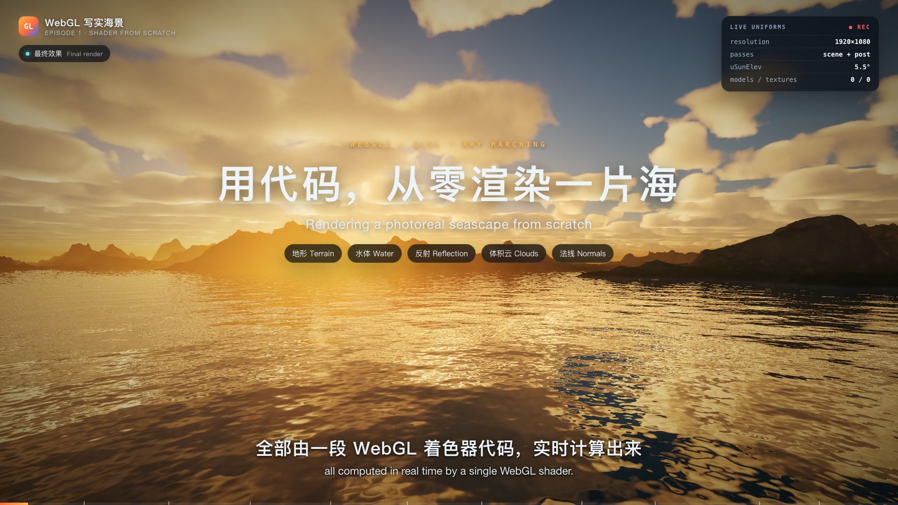

# SEA-004 · 按材质和距离分配水墨留白
案例：[ webgl-seascape-video ](../cases/webgl-seascape-video.md) · 机制证据：`source_only`

效果图用于理解来源作品，不自动验证本卡中的每个机制。

## 设计动作

用几何语义约束滤镜；单仓案例候选，非跨项目效果定律。

## 实现与参数

纸色(.93,.90,.83)+4%噪声；far=exp(−depth*.00055)；陆地按luma和wash分墨，海面仅.10稀疏横纹；边缘偏移.004并噪声断笔，太阳(.78,.16,.10)。

## 审美细节

山实水虚远淡天轻由material ID决定；不是全屏灰度。

## 适用条件

- 有线性深度/ID
- 独立章节允许插画风

## 相邻方案与区别

油画分支是4×49采样最小方差，水墨是语义留白，不是同一效果换色。

## 失败模式

- ID占alpha不能和透明度混用
- 屏幕纸纹可能滑动感
- 反序smoothstep需正序重写

## Movie 裁决

- **verdict**：reference
- **reason**：水墨过场参考，先验证山水留白。

## Frontend 裁决

- **verdict**：defer
- **reason**：主界面不默认上全屏滤镜。

## 最小对照

对照关闭ID遮罩；墨团若吞没山体轮廓或海面留白失败则拒绝。

## 源码证据

- [Repos/webgl-seascape-video/gl/post.js:69–80](https://github.com/holooooo/webgl-seascape-video/blob/915cb7c9a318e03bd2228bc232494b496ff2316c/gl/post.js#L69-L80)：深度+法线边缘
- [Repos/webgl-seascape-video/gl/post.js:103–125](https://github.com/holooooo/webgl-seascape-video/blob/915cb7c9a318e03bd2228bc232494b496ff2316c/gl/post.js#L103-L125)：山水云独立墨量、远淡、朱砂日

## 项目效果图

实际查看：低太阳金色海面、远山暗轮廓和层叠云，海面反光有多尺度细纹；叠加第一期教学标题和LIVE UNIFORMS面板。

来源：[原作者/出处](https://webgl-seascape.pages.dev/cover1.jpg) · author_og_effect_cover。作者部署首页明确og:image=cover1.jpg；是第一期海景效果封面，画面内“全部实时计算”等文字是作者声明，不是本轮运行验证。

## 归纳与练习

[CINE-02](../lenses/CINE-02.md)

保留独立案例。
