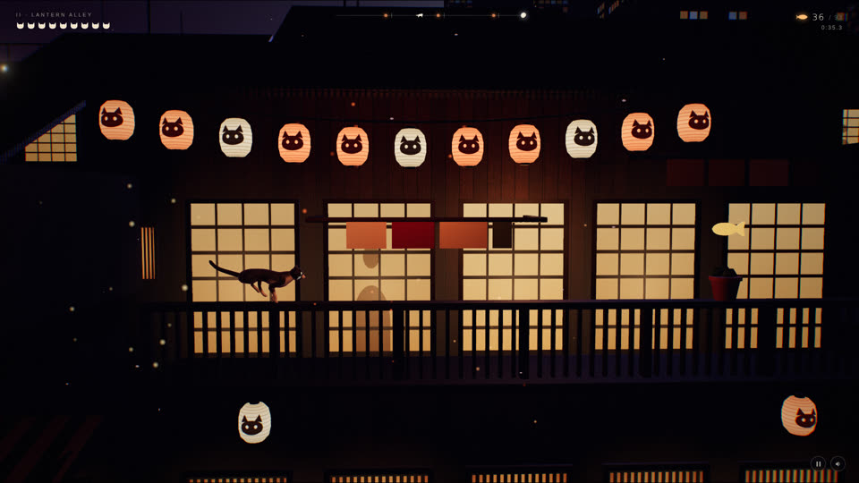

# SHOW-002 · 让颜色纹理与凹凸纹理共享结构边界
案例：[ awesome-opus5.5-frontend-showcases ](../cases/awesome-opus5.5-frontend-showcases.md) · 机制证据：`source_only`

效果图用于理解来源作品，不自动验证本卡中的每个机制。

## 设计动作

颜色的接缝与光照起伏对齐，避免图案看似砖墙、侧光却像塑料。源码注释指出硬阶会在掠射月光下变1px线；尚未复现。

## 实现与参数

paint(size,fn)→map(SRGB)+bump(No sRGB)；brick 512²，bw51.2/bh16/mortar2.2；stone bevel=(edge−1)/5后smoothstep。

## 审美细节

颜色的接缝与光照起伏对齐，避免图案看似砖墙、侧光却像塑料。源码注释指出硬阶会在掠射月光下变1px线；尚未复现。

## 适用条件

- 几何尺度与纹理重复尺度一致
- bump保留线性色彩空间

## 相邻方案与区别

相对只贴albedo，多了同源表面法线线索；真实几何倒角对极近景更可信。

## 失败模式

- 高频接缝远景闪烁
- 每个面随意UV缩放导致砖尺寸不一致

## Movie 裁决

- **verdict**：prototype
- **reason**：用于墙面或石材近景可明确检验掠射光响应。

## Frontend 裁决

- **verdict**：adapt
- **reason**：需要一致UV密度，不能无区别替换所有材质。

## 最小对照

固定低角度光比较只色图/同源bump/平滑bump；若缝线仍闪或产生假阴影，降低频率。

## 源码证据

- [Repos/awesome-opus5.5-frontend-showcases/repro/catwalk/js/textures.js:65–114](https://github.com/OpenVGLab/awesome-opus5.5-frontend-showcases/blob/cac43b250f07b7b86f4709c61effc84269f46494/repro/catwalk/js/textures.js#L65-L114)：paint一次像素回调同时写色图与线性bump；brick共享砖缝及边缘
- [Repos/awesome-opus5.5-frontend-showcases/repro/catwalk/js/textures.js:183–197](https://github.com/OpenVGLab/awesome-opus5.5-frontend-showcases/blob/cac43b250f07b7b86f4709c61effc84269f46494/repro/catwalk/js/textures.js#L183-L197)：stone以平滑倒角替代缝边高度硬阶

## 项目效果图

已查看的来源静帧；不证明当前版本运行。

来源：[原作者/出处](https://github.com/OpenVGLab/awesome-opus5.5-frontend-showcases/blob/cac43b250f07b7b86f4709c61effc84269f46494/repro/_covers/catwalk.jpg) · historical_still_viewed。历史封面，不能证明当前运行/运动/交互

## 归纳与练习

暂未归入新增专业视角；保留原机制边界。

[MP-05](../patterns/MP-05.md)
