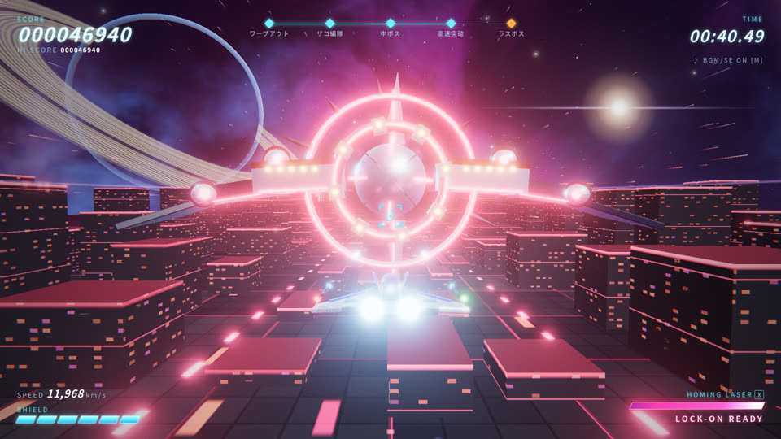

# SHOW-007 · 让环境色板随事件阶段变换并保留角色分工
案例：[ awesome-opus5.5-frontend-showcases ](../cases/awesome-opus5.5-frontend-showcases.md) · 机制证据：`source_only`

效果图用于理解来源作品，不自动验证本卡中的每个机制。

## 设计动作

色彩可以说明事件推进；各用途槽保持含义，避免阶段切换把地面与可操作对象混为一种颜色。这里只核对预设及目标字段，未审完整插值调用。

## 实现与参数

PALETTES按用途分槽；boss edge=[2.2,.15,.35]而victory=[1.8,1.2,.4]；Environment保留pal与palTarget。

## 审美细节

色彩可以说明事件推进；各用途槽保持含义，避免阶段切换把地面与可操作对象混为一种颜色。这里只核对预设及目标字段，未审完整插值调用。

## 适用条件

- 颜色不是唯一状态提示
- 事件不覆盖系统昼夜身份

## 相邻方案与区别

相对全屏滤镜，更能保留路径/窗口/雾各自层次。

## 失败模式

- 频繁换色造成认知负担
- 大面积紫背景违背项目禁区

## Movie 裁决

- **verdict**：adapt
- **reason**：可用于短片章节而非每镜头任意变色。

## Frontend 裁决

- **verdict**：reference
- **reason**：现项目昼夜跟系统时间，不能加访客昼夜按钮。

## 最小对照

灰度与正常色比较两阶段，若状态只能靠颜色猜或入口失去对比，判失败。

## 源码证据

- [Repos/awesome-opus5.5-frontend-showcases/repro/warp-shooter/src/env.js:222–249](https://github.com/OpenVGLab/awesome-opus5.5-frontend-showcases/blob/cac43b250f07b7b86f4709c61effc84269f46494/repro/warp-shooter/src/env.js#L222-L249)：warp/zako/mid/boost/boss/victory色板均含seam/light/lane/fog/winA/winB/edge/streak，初始化warp

## 项目效果图

已查看的来源静帧；不证明当前版本运行。

来源：[原作者/出处](https://github.com/OpenVGLab/awesome-opus5.5-frontend-showcases/blob/cac43b250f07b7b86f4709c61effc84269f46494/repro/_covers/warp-shooter.jpg) · historical_still_viewed。历史封面，不能证明当前运行/运动/交互

## 归纳与练习

暂未归入新增专业视角；保留原机制边界。

[MP-01](../patterns/MP-01.md)
