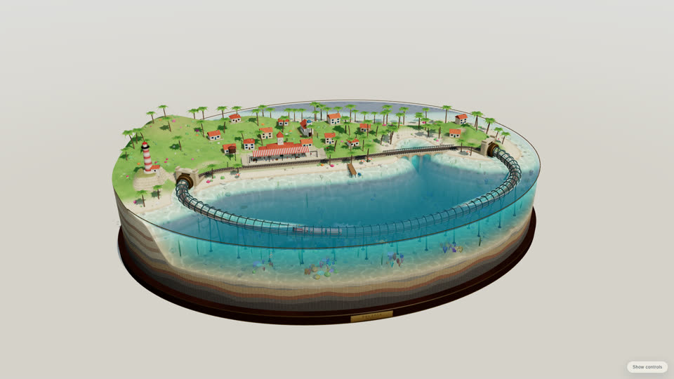

# SHOW-008 · 由一个夜间权重协调天空、灯具、水色和曝光
案例：[ awesome-opus5.5-frontend-showcases ](../cases/awesome-opus5.5-frontend-showcases.md) · 机制证据：`source_only`

效果图用于理解来源作品，不自动验证本卡中的每个机制。

## 设计动作

夜色成立依赖多个通道共变，而不只是把环境光调暗；源码具体保证广播路径，历史封面只显示白天。

## 实现与参数

set快照当前值→update dt/2.2→apply更新sun/hemi/sky/exposure/water→NIGHT_HOOKS；day曝光1、night1.28，夜天空#050b1d。

## 审美细节

夜色成立依赖多个通道共变，而不只是把环境光调暗；源码具体保证广播路径，历史封面只显示白天。

## 适用条件

- 不新增手动昼夜入口
- 颜色线性插值与数值插值区分

## 相邻方案与区别

相对两套硬切variant，连续状态适合过渡；现有day/night资产仍可保留。

## 失败模式

- 只改天空不改窗光导致脱节
- 夜曝光提高后暗部仍可能被bake重复压暗

## Movie 裁决

- **verdict**：prototype
- **reason**：固定同镜头跨昼夜可直接比较协调性。

## Frontend 裁决

- **verdict**：adapt
- **reason**：系统时间输入而非复制demo按钮。

## 最小对照

同机位日/夜并插值中点，观察窗灯、天空、水色、曝光是否同向；任何通道提前跳变即失败。

## 源码证据

- [Repos/awesome-opus5.5-frontend-showcases/repro/pelagia/index.html:1331–1447](https://github.com/OpenVGLab/awesome-opus5.5-frontend-showcases/blob/cac43b250f07b7b86f4709c61effc84269f46494/repro/pelagia/index.html#L1331-L1447)：ENV三预设，2.2秒smoothstep插值，NIGHT_HOOKS广播夜间度，点灯9/7/8×night

## 项目效果图

已查看的来源静帧；不证明当前版本运行。

来源：[原作者/出处](https://github.com/OpenVGLab/awesome-opus5.5-frontend-showcases/blob/cac43b250f07b7b86f4709c61effc84269f46494/repro/_covers/pelagia.jpg) · historical_still_viewed。历史封面，不能证明当前运行/运动/交互

## 归纳与练习

暂未归入新增专业视角；保留原机制边界。

[MP-01](../patterns/MP-01.md)
