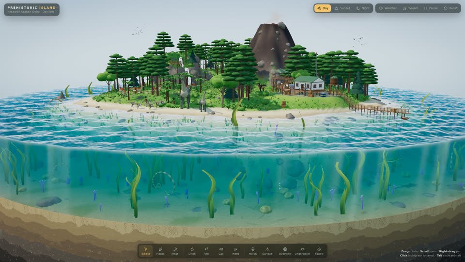

# SHOW-010 · 把雨量同时映射到粗糙度与漫反射
案例：[ awesome-opus5.5-frontend-showcases ](../cases/awesome-opus5.5-frontend-showcases.md) · 机制证据：`source_only`

效果图用于理解来源作品，不自动验证本卡中的每个机制。

## 设计动作

湿面让高光变集中且底色略暗，形成同时看得见的雨后变化。封面是晴天，未观察湿态效果。

## 实现与参数

patchMaterial→roughnessmap_fragment；wetK=uWet×smoothstep(-.2,.8,heightAboveSea)×isInsideWaterR；roughness mix(old,old×.38,wetK)。

## 审美细节

湿面让高光变集中且底色略暗，形成同时看得见的雨后变化。封面是晴天，未观察湿态效果。

## 适用条件

- 只对真正暴露表面启用
- 环境反射存在

## 相邻方案与区别

相对整地面替换镜面，连续控制原材质并保留差异。

## 失败模式

- 源码圆形范围是岛屿假设，不能迁到整个室内
- 遮雨区域缺失
- 太低roughness像塑料

## Movie 裁决

- **verdict**：prototype
- **reason**：雨夜街面固定镜头先试。

## Frontend 裁决

- **verdict**：adapt
- **reason**：需屋檐遮雨mask、可走地面层与bake持久化。

## 最小对照

同曝光拍无雨/雨后，关闭雨粒子仍应看出湿度；墙内/棚下也变湿即失败。

## 源码证据

- [Repos/awesome-opus5.5-frontend-showcases/repro/prehistoric-island/index.html:423–431](https://github.com/OpenVGLab/awesome-opus5.5-frontend-showcases/blob/cac43b250f07b7b86f4709c61effc84269f46494/repro/prehistoric-island/index.html#L423-L431)：patchMaterial注入共享uWet并区分材质缓存key
- [Repos/awesome-opus5.5-frontend-showcases/repro/prehistoric-island/index.html:481–495](https://github.com/OpenVGLab/awesome-opus5.5-frontend-showcases/blob/cac43b250f07b7b86f4709c61effc84269f46494/repro/prehistoric-island/index.html#L481-L495)：世界坐标湿面遮罩；粗糙度乘.38，颜色最多压暗22%

## 项目效果图

已查看的来源静帧；不证明当前版本运行。

来源：[原作者/出处](https://github.com/OpenVGLab/awesome-opus5.5-frontend-showcases/blob/cac43b250f07b7b86f4709c61effc84269f46494/repro/_covers/prehistoric-island.jpg) · historical_still_viewed。历史封面，不能证明当前运行/运动/交互

## 归纳与练习

暂未归入新增专业视角；保留原机制边界。

[MP-06](../patterns/MP-06.md)
