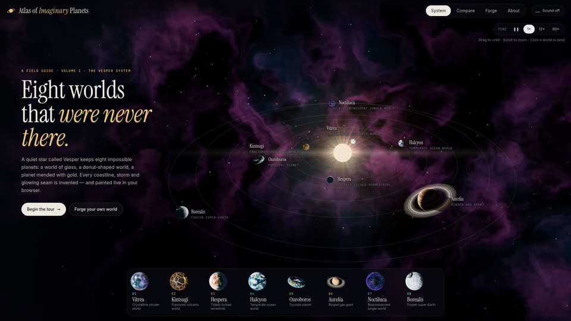

# SHOW-012 · 让对象强调色贯穿模型档案、标签与导航
案例：[ awesome-opus5.5-frontend-showcases ](../cases/awesome-opus5.5-frontend-showcases.md) · 机制证据：`source_only`

效果图用于理解来源作品，不自动验证本卡中的每个机制。

## 设计动作

对象在三维、目录、详情间保留身份；历史封面可见底部对象缩略图与对应标签，但小字可读性有限。

## 实现与参数

PLANETS.def.accent→--c卡片/标签；setAccent→--accent；对象还有独立colA..E与atmosphere，强调色不是所有表面统一染色。

## 审美细节

对象在三维、目录、详情间保留身份；历史封面可见底部对象缩略图与对应标签，但小字可读性有限。

## 适用条件

- 文字和轮廓也表达身份
- UI颜色不改变场景物理照明

## 相邻方案与区别

相对整页随机换主题，身份色保持跨视图对应；不会解决内容结构本身。

## 失败模式

- 多对象同时高饱和抢焦
- 源码紫色星云不能直接套用项目
- 底部密集标签在小屏拥挤

## Movie 裁决

- **verdict**：reference
- **reason**：用于片头标识或章节字幕而非场景全局染色。

## Frontend 裁决

- **verdict**：prototype
- **reason**：手机各内容入口可共享身份色和缩略图。

## 最小对照

同对象从列表→详情→返回，关闭颜色后仍靠名/图辨认；用户误认对象或焦点丢失即失败。

## 源码证据

- [Repos/awesome-opus5.5-frontend-showcases/repro/imaginary-planets/js/data.js:9–45](https://github.com/OpenVGLab/awesome-opus5.5-frontend-showcases/blob/cac43b250f07b7b86f4709c61effc84269f46494/repro/imaginary-planets/js/data.js#L9-L45)：Vitrea accent #8fe3ff、Kintsugi #f4b94a与各自表面/气层参数分离
- [Repos/awesome-opus5.5-frontend-showcases/repro/imaginary-planets/js/ui.js:7–9](https://github.com/OpenVGLab/awesome-opus5.5-frontend-showcases/blob/cac43b250f07b7b86f4709c61effc84269f46494/repro/imaginary-planets/js/ui.js#L7-L9)：setAccent统一CSS变量
- [Repos/awesome-opus5.5-frontend-showcases/repro/imaginary-planets/js/ui.js:36–82](https://github.com/OpenVGLab/awesome-opus5.5-frontend-showcases/blob/cac43b250f07b7b86f4709c61effc84269f46494/repro/imaginary-planets/js/ui.js#L36-L82)：dock/labels取def.accent；dock hover和focus绑定同一处理

## 项目效果图

已查看的来源静帧；不证明当前版本运行。

来源：[原作者/出处](https://github.com/OpenVGLab/awesome-opus5.5-frontend-showcases/blob/cac43b250f07b7b86f4709c61effc84269f46494/repro/_covers/imaginary-planets.jpg) · historical_still_viewed。历史封面，不能证明当前运行/运动/交互

## 归纳与练习

暂未归入新增专业视角；保留原机制边界。

保留独立案例。
