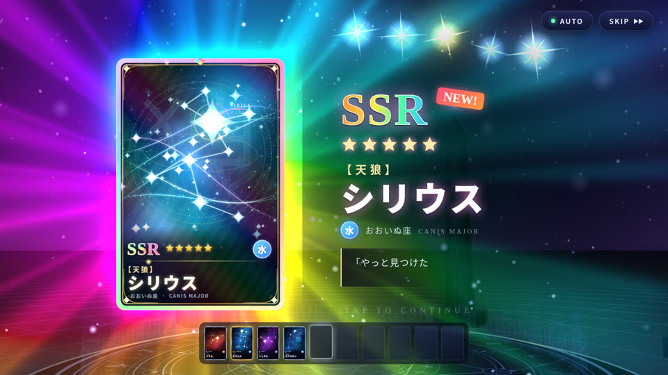

# SHOW-013 · 把结果提交与揭示动画拆开，使跳过保持结果一致
案例：[ awesome-opus5.5-frontend-showcases ](../cases/awesome-opus5.5-frontend-showcases.md) · 机制证据：`source_only`

效果图用于理解来源作品，不自动验证本卡中的每个机制。

## 设计动作

演出可以丰富，状态结果不可由动画完成与否决定。封面只证明有Skip按钮，不证明竞态正确。这里只借揭示机制，不建议引入抽卡经济。

## 实现与参数

startPull先生成results→phase=seq→race(runSequence,skipP)→finishSequence(results)；等待点击每.05s检查，auto delay=.8/1.4/2.6。

## 审美细节

演出可以丰富，状态结果不可由动画完成与否决定。封面只证明有Skip按钮，不证明竞态正确。这里只借揭示机制，不建议引入抽卡经济。

## 适用条件

- skip幂等
- 异步音画资源有清理
- 结果不因重播重复授予

## 相邻方案与区别

相对延时结束才发放结果，跳过不会吞奖励；不同于取消业务操作。

## 失败模式

- flush后残留tween写入结果页
- 连续点击重复触发
- 在网络未完成前伪造结果

## Movie 裁决

- **verdict**：adapt
- **reason**：电影可用于章节跳过，但需保证时间线和字幕收束。

## Frontend 裁决

- **verdict**：prototype
- **reason**：碎片/物件发现动画可用，阅读内容仍可直达。

## 最小对照

在charge/climax/reveal每阶段双击Skip，检查结果仅提交一次、音效停止、可返回；有残留或丢结果即失败。

## 源码证据

- [Repos/awesome-opus5.5-frontend-showcases/repro/gacha-reveal/js/main.js:109–142](https://github.com/OpenVGLab/awesome-opus5.5-frontend-showcases/blob/cac43b250f07b7b86f4709c61effc84269f46494/repro/gacha-reveal/js/main.js#L109-L142)：step检查session.skipped；doSkip触发onSkip并flush时钟
- [Repos/awesome-opus5.5-frontend-showcases/repro/gacha-reveal/js/main.js:148–187](https://github.com/OpenVGLab/awesome-opus5.5-frontend-showcases/blob/cac43b250f07b7b86f4709c61effc84269f46494/repro/gacha-reveal/js/main.js#L148-L187)：先roll确定结果，再Promise.race动画/skip，统一finishSequence

## 项目效果图

已查看的来源静帧；不证明当前版本运行。

来源：[原作者/出处](https://github.com/OpenVGLab/awesome-opus5.5-frontend-showcases/blob/cac43b250f07b7b86f4709c61effc84269f46494/repro/_covers/gacha-reveal.jpg) · historical_still_viewed。历史封面，不能证明当前运行/运动/交互

## 归纳与练习

[IF-06](../lenses/IF-06.md)

[MP-16](../patterns/MP-16.md)
