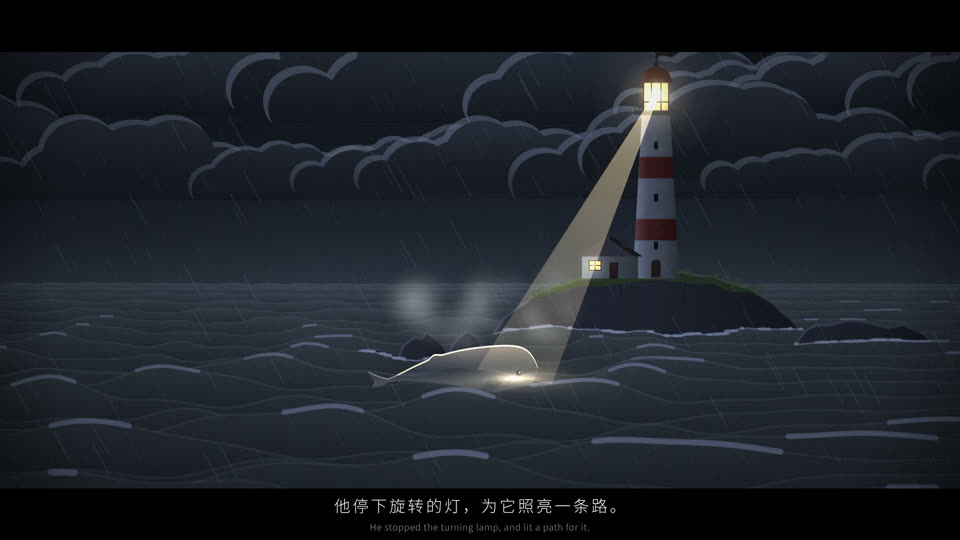

# SHOW-014 · 让天气预设同时控制景色、反光和叙事动作
案例：[ awesome-opus5.5-frontend-showcases ](../cases/awesome-opus5.5-frontend-showcases.md) · 机制证据：`source_only`

效果图用于理解来源作品，不自动验证本卡中的每个机制。

## 设计动作

天气承担情绪与叙事节拍，亮灯应在海面留下响应；封面可见灯塔光束照向海中鲸与附近亮斑。

## 实现与参数

LOOK.storm的wind/rain/deck=1，seaNear#04070b；lights(L)从月/日/灯强度生成反光；BOLTS在26.3/29.6/36/45/52.5秒触发。

## 审美细节

天气承担情绪与叙事节拍，亮灯应在海面留下响应；封面可见灯塔光束照向海中鲸与附近亮斑。

## 适用条件

- 时序明确
- 各绘制层共享时钟

## 相邻方案与区别

相对独立随机雨/雷，各通道围绕同一事件可读。

## 失败模式

- 只复制漂亮天空而反光不变
- 连续闪电抢夺字幕注意
- 全局天气强行覆盖用户系统昼夜

## Movie 裁决

- **verdict**：prototype
- **reason**：适合片段从宁静到风暴再释放的结构。

## Frontend 裁决

- **verdict**：reference
- **reason**：交互场景不应强迫150秒固定片段。

## 最小对照

在一次闪电的前/峰/后取帧，检查天空、海面、主体与字幕一致；只天空闪或字幕消失则失败。

## 源码证据

- [Repos/awesome-opus5.5-frontend-showcases/repro/xhs-free-short/js/film.js:12–82](https://github.com/OpenVGLab/awesome-opus5.5-frontend-showcases/blob/cac43b250f07b7b86f4709c61effc84269f46494/repro/xhs-free-short/js/film.js#L12-L82)：LOOK定义night/storm/dawn/day/dusk/winter/fog/glow的天空/海/环境/雾/灯/天气
- [Repos/awesome-opus5.5-frontend-showcases/repro/xhs-free-short/js/film.js:113–138](https://github.com/OpenVGLab/awesome-opus5.5-frontend-showcases/blob/cac43b250f07b7b86f4709c61effc84269f46494/repro/xhs-free-short/js/film.js#L113-L138)：太阳月亮灯束以同一L生成反光；闪电有具体时间表

## 项目效果图

已查看的来源静帧；不证明当前版本运行。

来源：[原作者/出处](https://github.com/OpenVGLab/awesome-opus5.5-frontend-showcases/blob/cac43b250f07b7b86f4709c61effc84269f46494/repro/_covers/xhs-free-short.jpg) · historical_still_viewed。历史封面，不能证明当前运行/运动/交互

## 归纳与练习

暂未归入新增专业视角；保留原机制边界。

[MP-06](../patterns/MP-06.md) / [MP-19](../patterns/MP-19.md)
