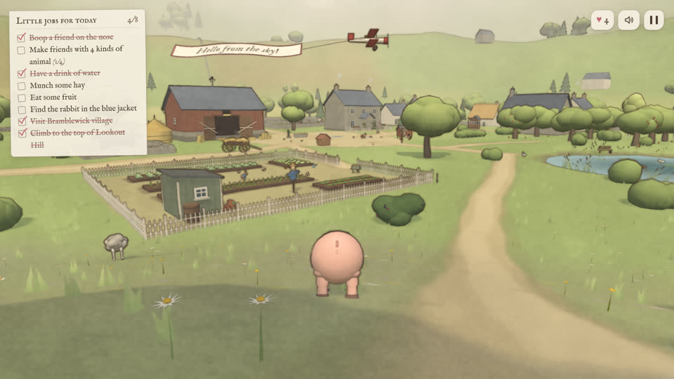

# SHOW-017 · 把纸纹与轮廓从颜色和深度中分别提取
案例：[ awesome-opus5.5-frontend-showcases ](../cases/awesome-opus5.5-frontend-showcases.md) · 机制证据：`source_only`

效果图用于理解来源作品，不自动验证本卡中的每个机制。

## 设计动作

纸张风格来自色块、断墨与纸纹各自可控；封面可见低饱和暖纸底、软色块与细轮廓。

## 实现与参数

makePaperTexture→P.b/a产生3.8px wobble，ink仅.35×；8邻域exp(-dot(d,d)×70)保边；远处22..140米减墨，暗部向纸色提升。

## 审美细节

纸张风格来自色块、断墨与纸纹各自可控；封面可见低饱和暖纸底、软色块与细轮廓。

## 适用条件

- 整张画面接受插画语言
- UI应在后期之后绘制

## 相邻方案与区别

相对全屏纸贴图，更有对象边界逻辑；与写实电影渲染不兼容。

## 失败模式

- 套到赛博朋克主场景会洗掉霓虹和锐利结构
- 深度边缘在透明材质处失效

## Movie 裁决

- **verdict**：reference
- **reason**：适合回忆或插画插段。

## Frontend 裁决

- **verdict**：defer
- **reason**：当前Places游戏赛博朋克主线不适合全面水彩化。

## 最小对照

若试作只对回忆片段A/B，检查字幕与焦点；主线霓虹辨识降低就停止。

## 源码证据

- [Repos/awesome-opus5.5-frontend-showcases/repro/farm-animals/js/post.js:4–42](https://github.com/OpenVGLab/awesome-opus5.5-frontend-showcases/blob/cac43b250f07b7b86f4709c61effc84269f46494/repro/farm-animals/js/post.js#L4-L42)：512RGBA程序纸纹分别存细粒、斑块、xy形变噪声
- [Repos/awesome-opus5.5-frontend-showcases/repro/farm-animals/js/post.js:79–130](https://github.com/OpenVGLab/awesome-opus5.5-frontend-showcases/blob/cac43b250f07b7b86f4709c61effc84269f46494/repro/farm-animals/js/post.js#L79-L130)：颜色8邻域保边平滑，1/z拉普拉斯轮廓，墨线和色块使用不同抖动

## 项目效果图

已查看的来源静帧；不证明当前版本运行。

来源：[原作者/出处](https://github.com/OpenVGLab/awesome-opus5.5-frontend-showcases/blob/cac43b250f07b7b86f4709c61effc84269f46494/repro/_covers/farm-animals.jpg) · historical_still_viewed。历史封面，不能证明当前运行/运动/交互

## 归纳与练习

暂未归入新增专业视角；保留原机制边界。

保留独立案例。
