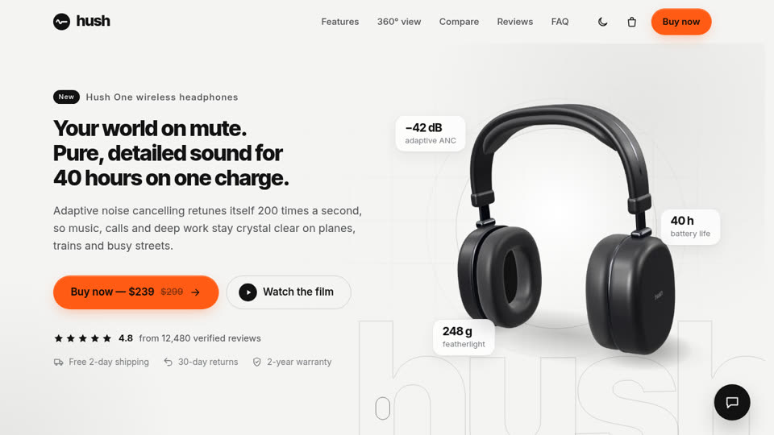

# SHOW-019 · 从操作位置展开主题变化以解释因果
案例：[ awesome-opus5.5-frontend-showcases ](../cases/awesome-opus5.5-frontend-showcases.md) · 机制证据：`source_only`

效果图用于理解来源作品，不自动验证本卡中的每个机制。

## 设计动作

变化从点击位置发出，用户能把操作和结果对应起来；未运行验证转场。

## 实现与参数

toggleTheme(origin)→算button中心(x,y)与最远角半径→startViewTransition(applyTheme)→clipPath圆扩张，650ms cubic-bezier(.2,.7,.2,1)。

## 审美细节

变化从点击位置发出，用户能把操作和结果对应起来；未运行验证转场。

## 适用条件

- 有真实用户主题操作
- 动画不阻断输入

## 相邻方案与区别

相对随机全屏fade，更解释操作来源，但无必要不加动画。

## 失败模式

- 项目全站昼夜是系统时间，不能因此增加昼夜按钮
- 整屏转场遮盖阅读

## Movie 裁决

- **verdict**：defer
- **reason**：电影镜头无需模拟按钮触发的主题切换。

## Frontend 裁决

- **verdict**：reference
- **reason**：只适用手机内部主题或局部界面状态。

## 最小对照

减动/无ViewTransition/快速连点三种情况，最终主题和aria必须一致；错态即失败。

## 源码证据

- [Repos/awesome-opus5.5-frontend-showcases/repro/product-landing/js/main.js:24–56](https://github.com/OpenVGLab/awesome-opus5.5-frontend-showcases/blob/cac43b250f07b7b86f4709c61effc84269f46494/repro/product-landing/js/main.js#L24-L56)：theme改属性/aria/meta并emit；ViewTransition圆心来自按钮，半径覆盖屏幕，650ms；不支持或减动时直接切

## 项目效果图

已查看的来源静帧；不证明当前版本运行。

来源：[原作者/出处](https://github.com/OpenVGLab/awesome-opus5.5-frontend-showcases/blob/cac43b250f07b7b86f4709c61effc84269f46494/repro/_covers/product-landing.jpg) · historical_still_viewed。历史封面，不能证明当前运行/运动/交互

## 归纳与练习

暂未归入新增专业视角；保留原机制边界。

保留独立案例。
