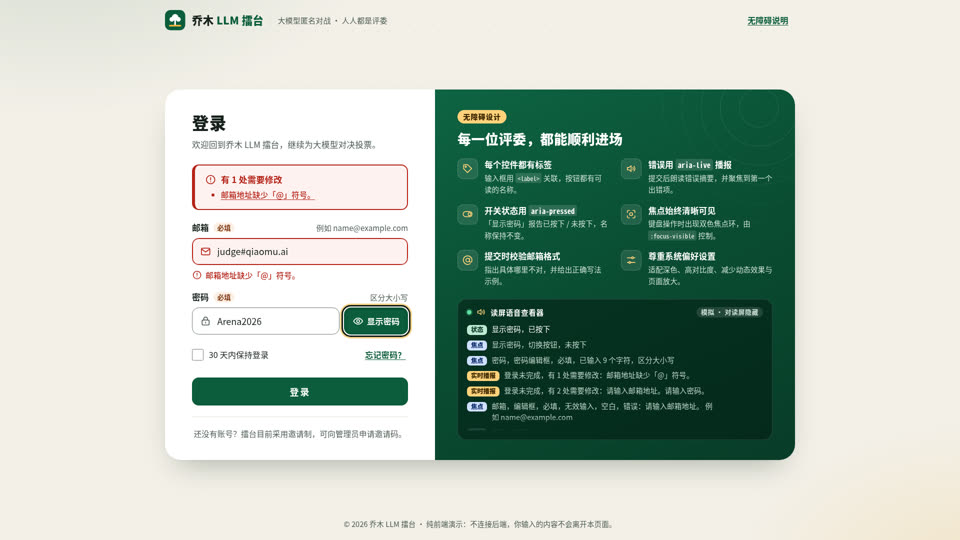

# SHOW-020 · 把错误提示做成可定位、可修复且不反复打断的状态
案例：[ awesome-opus5.5-frontend-showcases ](../cases/awesome-opus5.5-frontend-showcases.md) · 机制证据：`source_only`

效果图用于理解来源作品，不自动验证本卡中的每个机制。

## 设计动作

设计深度不只有装饰：错误边框、字段文本、摘要和焦点共同告诉用户下一步。封面实际展示了缺@错误和高亮字段，但不是屏幕阅读器实测。

## 实现与参数

setFieldError→renderSummary→firstInvalid.focus+announce；input修正静默syncField；startLogin设置busy且1.3s模拟成功。

## 审美细节

设计深度不只有装饰：错误边框、字段文本、摘要和焦点共同告诉用户下一步。封面实际展示了缺@错误和高亮字段，但不是屏幕阅读器实测。

## 适用条件

- 服务端错误也能映射字段
- 状态更新不重置输入

## 相邻方案与区别

相对toast一闪而过，保留上下文并支持定位。

## 失败模式

- 复制演示登录会产生伪认证
- 每个键都播报打断输入
- 仅红色不足以辨错

## Movie 裁决

- **verdict**：defer
- **reason**：不属于电影化场景打磨。

## Frontend 裁决

- **verdict**：prototype
- **reason**：手机表单/设置/消息发送失败可复用状态逻辑。

## 最小对照

键盘提交两个错误→修正一个→再提交；摘要数量、焦点、aria同步，输入保留，任何重复播报或丢输入失败。

## 源码证据

- [Repos/awesome-opus5.5-frontend-showcases/repro/a11y-login/index.html:1104–1172](https://github.com/OpenVGLab/awesome-opus5.5-frontend-showcases/blob/cac43b250f07b7b86f4709c61effc84269f46494/repro/a11y-login/index.html#L1104-L1172)：字段错误/aria-invalid/摘要互链；更正后静默更新
- [Repos/awesome-opus5.5-frontend-showcases/repro/a11y-login/index.html:1213–1260](https://github.com/OpenVGLab/awesome-opus5.5-frontend-showcases/blob/cac43b250f07b7b86f4709c61effc84269f46494/repro/a11y-login/index.html#L1213-L1260)：提交聚焦第一错误并播报；loading和成功焦点状态，登录只是1300ms模拟

## 项目效果图

已查看的来源静帧；不证明当前版本运行。

来源：[原作者/出处](https://github.com/OpenVGLab/awesome-opus5.5-frontend-showcases/blob/cac43b250f07b7b86f4709c61effc84269f46494/repro/_covers/a11y-login.jpg) · historical_still_viewed。历史封面，不能证明当前运行/运动/交互

## 归纳与练习

暂未归入新增专业视角；保留原机制边界。

[MP-15](../patterns/MP-15.md)
