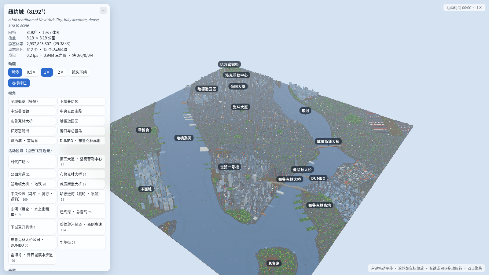

# SHOW-023 · 降细节时优先保留能识别地标的薄结构
案例：[ awesome-opus5.5-frontend-showcases ](../cases/awesome-opus5.5-frontend-showcases.md) · 机制证据：`source_only`

效果图用于理解来源作品，不自动验证本卡中的每个机制。

## 设计动作

远景中细塔尖和桥缆虽占少量体素，却比大块墙更决定轮廓身份；已看城市总览静帧，不能证明每个LOD保真。

## 实现与参数

material FLAGS→PRI(K=3,P=2,I=0)→downsample per meter；spire/cable不按多数投票消失。

## 审美细节

远景中细塔尖和桥缆虽占少量体素，却比大块墙更决定轮廓身份；已看城市总览静帧，不能证明每个LOD保真。

## 适用条件

- 对象确有关键薄件
- 不同LOD必须共享坐标与色板

## 相邻方案与区别

相对纯面数/体素多数简化，保形重点更接近视觉识别需求。

## 失败模式

- 所有细节都标keep会失去简化意义
- 1米体素近景粗糙
- 不适合直接迁入Atlas当前资产

## Movie 裁决

- **verdict**：adapt
- **reason**：远景巨构与桥梁可检查标志轮廓是否保留。

## Frontend 裁决

- **verdict**：reference
- **reason**：性能优化后置，先作为模型验收原则。

## 最小对照

同相机连续拉远比较薄结构是否突然消失；地标识别丢失或天际线跳变即失败。

## 源码证据

- [Repos/awesome-opus5.5-frontend-showcases/voxel/mega/nyc8192/src/lodcore.mjs:12–56](https://github.com/OpenVGLab/awesome-opus5.5-frontend-showcases/blob/cac43b250f07b7b86f4709c61effc84269f46494/voxel/mega/nyc8192/src/lodcore.mjs#L12-L56)：2×2列投票；3实心保留、2实心且priority>=2保留、1实心且priority3保留
- [Repos/awesome-opus5.5-frontend-showcases/voxel/mega/nyc8192/src/palette.mjs:29–47](https://github.com/OpenVGLab/awesome-opus5.5-frontend-showcases/blob/cac43b250f07b7b86f4709c61effc84269f46494/voxel/mega/nyc8192/src/palette.mjs#L29-L47)：玻璃/树叶为P，尖顶/缆索为K，语义优先级进入降采样
- [Repos/awesome-opus5.5-frontend-showcases/voxel/mega/nyc8192/README.md:74–82](https://github.com/OpenVGLab/awesome-opus5.5-frontend-showcases/blob/cac43b250f07b7b86f4709c61effc84269f46494/voxel/mega/nyc8192/README.md#L74-L82)：作者记录仅白天、近似AO、记忆地理及角色穿过问题，不是精确数字孪生

## 项目效果图

已查看的来源静帧；不证明当前版本运行。

来源：[原作者/出处](https://github.com/OpenVGLab/awesome-opus5.5-frontend-showcases/blob/cac43b250f07b7b86f4709c61effc84269f46494/voxel/mega/nyc8192/checks/static_overview.png) · historical_still_viewed。静帧观察；没有由此验证连续动画或性能。

## 归纳与练习

暂未归入新增专业视角；保留原机制边界。

[MP-22](../patterns/MP-22.md)
