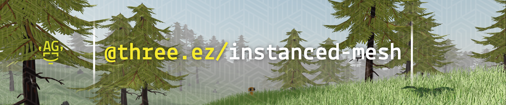

# SYS-006 · 让细节等级依据可见尺寸分配
案例：[ instanced-mesh ](../cases/instanced-mesh.md) · 机制证据：`source_only`

效果图用于理解来源作品，不自动验证本卡中的每个机制。

## 设计动作

源码支持distance或screen-size metric及shadow专用列表；这允许把近景轮廓放在优先位置，但不保证切换平滑。

## 实现与参数

getObjectLODIndex:distance用metricSquared或metric并减hysteresis比例；screen-size路径直接阈值比较；addShadowLOD单列castShadow对象。

## 审美细节

注意：本函数未基于上一等级保存真正双阈值状态，不能仅凭参数名宣称消除闪烁。

## 适用条件

- 每级保留主体轮廓
- 镜头FOV与尺度可核对

## 相邻方案与区别

与meshoptimizer生成低模不同，此处只负责选哪一级；选级不改善低模质量。

## 失败模式

- 距离阈值附近来回跳
- 阴影形状和主体不一致
- 无状态hysteresis被误当平滑过渡

## Movie 裁决

- **verdict**：defer
- **reason**：固定镜头可预选细节无需动态跳变

## Frontend 裁决

- **verdict**：defer
- **reason**：性能优化后置，先复用现有LOD

## 最小对照

慢速往返阈值并移动光源，检查轮廓、投影跳变；只统计三角数不能通过。

## 源码证据

- [Repos/instanced-mesh/src/core/feature/LOD.ts:141–161](https://github.com/agargaro/instanced-mesh/blob/56786de4651bf5d45d218d720bb09e95d765db93/src/core/feature/LOD.ts#L141-L161)：距离与屏幕尺寸的实际选择逻辑
- [Repos/instanced-mesh/src/core/feature/LOD.ts:204–218](https://github.com/agargaro/instanced-mesh/blob/56786de4651bf5d45d218d720bb09e95d765db93/src/core/feature/LOD.ts#L204-L218)：阴影LOD列表独立

## 项目效果图

作者横幅中可见层叠针叶林、草和远雾，叠有包名品牌。采用其可见场景作为展示，品牌文字不是机制证据。

来源：[原作者/出处](https://github.com/agargaro/instanced-mesh/blob/56786de4651b/public/banner.png) · author_showcase_banner。品牌覆盖较多，仅保留作者场景预览；不证明百万实例数量、裁剪、LOD或性能。

## 归纳与练习

暂未归入新增专业视角；保留原机制边界。

[MP-22](../patterns/MP-22.md)
