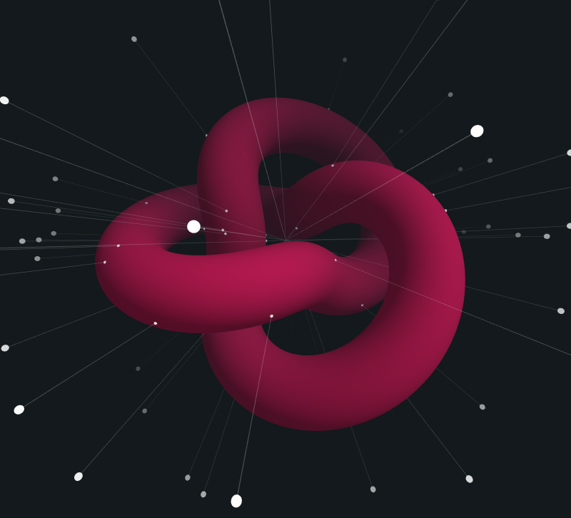

# SYS-009 · 让观众靠近细节时仍保有实体边界
案例：[ three-mesh-bvh ](../cases/three-mesh-bvh.md) · 机制证据：`source_only`

效果图用于理解来源作品，不自动验证本卡中的每个机制。

## 设计动作

单纯视觉精细而可穿透会破坏空间可信度；源码可给接近桌边/栏杆时一致的边界反馈。

## 实现与参数

胶囊线段转换至collider局部空间→radius扩AABB→shapecast→closestPointToSegment→以radius-distance推离→返回world；例子epsilon=1e-5。

## 审美细节

保住接近栏杆、桌角的尺度感；雾、glow、反射卡不能误作实体。

## 适用条件

- 碰撞体和渲染体坐标一致
- 动态几何更新索引
- 明确noCollide对象

## 相邻方案与区别

不是完整物理引擎，也不保证整条路可达；与Recast路线验证互补。

## 失败模式

- glow卡造成空气墙
- 烘焙后碰撞仍用旧几何
- 高速步进越过薄面

## Movie 裁决

- **verdict**：reference
- **reason**：运镜可借碰撞查询，但不能把人物胶囊直接当相机视锥

## Frontend 裁决

- **verdict**：adapt
- **reason**：已集成，继续校准新增细节的实体分类

## 最小对照

贴墙转角、靠桌、跨门槛、穿过雾卡四种路线；出现空气墙或穿透即失败。

## 源码证据

- [Repos/three-mesh-bvh/example/characterMovement.js:351–411](https://github.com/gkjohnson/three-mesh-bvh/blob/1d7a4249d4ac6d6500fe16eda482a2b8cf7be521/example/characterMovement.js#L351-L411)：胶囊局部空间碰撞和推离链
- [Repos/three-mesh-bvh/src/core/MeshBVH.js:625–641](https://github.com/gkjohnson/three-mesh-bvh/blob/1d7a4249d4ac6d6500fe16eda482a2b8cf7be521/src/core/MeshBVH.js#L625-L641)：shapecast适配triangle回调

## 项目效果图

深灰底上的洋红纽结，白色细线从多个白点射向中心；属于几何查询示例的可见输出。

来源：本轮已观察的历史截图 · author_demo_screenshot。技术示例静帧，不是高质量场景美术或BVH加速性能证明；线段命中正确性未运行核验。

## 归纳与练习

暂未归入新增专业视角；保留原机制边界。

[MP-10](../patterns/MP-10.md)
