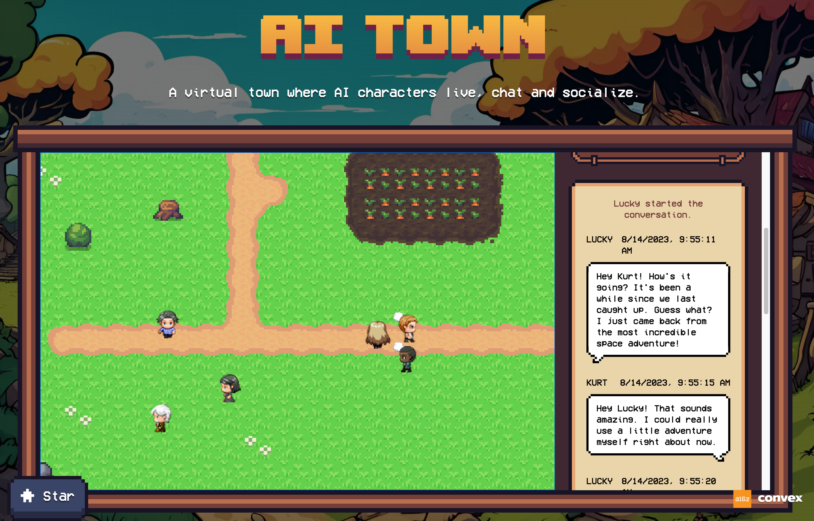

# SYS-011 · 用已发生的状态缓冲保持运动连续
案例：[ ai-town ](../cases/ai-town.md) · 机制证据：`source_only`

效果图用于理解来源作品，不自动验证本卡中的每个机制。

## 设计动作

HistoricalTimeManager只在已收到区间内选择时间，可减轻分批状态导致的瞬移；未实测流畅性。

## 实现与参数

缓冲<250ms rate=.8，>1250ms rate=1.2；最多落后1500ms，缺口跳到下个快照起点，超尾夹到末尾；Player用historicalLocation位置/方向。

## 审美细节

关注动作连续与转向不抽搐；此处会带延迟，不能用于直接操纵的游走相机。

## 适用条件

- 远端状态有时间戳
- 适用于非直接操纵对象

## 相邻方案与区别

区别于每帧lerp追最新值；有明确时间轴和buffer上限。

## 失败模式

- 时间倒退
- 慢缓冲让提示与画面错位
- 将1.5s延迟用于玩家输入

## Movie 裁决

- **verdict**：reference
- **reason**：适合回放，不必为预录镜头引入网络状态

## Frontend 裁决

- **verdict**：defer
- **reason**：本站主要本地游走，无需新增远端群体同步

## 最小对照

离线喂入突发/缺口快照，检查位置连续与停尾行为；输入响应不能被这一缓冲拖慢。

## 源码证据

- [Repos/ai-town/src/hooks/useHistoricalTime.ts:59–122](https://github.com/a16z-infra/ai-town/blob/8e05997f2409275669c8344b84a51692e83f3f33/src/hooks/useHistoricalTime.ts#L59-L122)：历史区间调速、缺口/尾端处理
- [Repos/ai-town/src/hooks/useHistoricalTime.ts:141–143](https://github.com/a16z-infra/ai-town/blob/8e05997f2409275669c8344b84a51692e83f3f33/src/hooks/useHistoricalTime.ts#L141-L143)：真实阈值250/1250/1500ms
- [Repos/ai-town/src/components/Player.tsx:38–44](https://github.com/a16z-infra/ai-town/blob/8e05997f2409275669c8344b84a51692e83f3f33/src/components/Player.tsx#L38-L44)：读取历史位置

## 项目效果图

左侧像素草地、交叉土路、菜地与多个人物，右侧羊皮纸色聊天栏显示Lucky/Kurt对话和时间戳。

来源：[原作者/出处](https://github.com/a16z-infra/ai-town/assets/3489963/a4c91f17-23ed-47ec-8c4e-9f9a8505057d) · author_demo_screenshot。README明确历史应用截图；含品牌页眉但主要区域是实际场景与聊天界面，不证明现有后端对话质量或实时运行。

## 归纳与练习

暂未归入新增专业视角；保留原机制边界。

保留独立案例。
