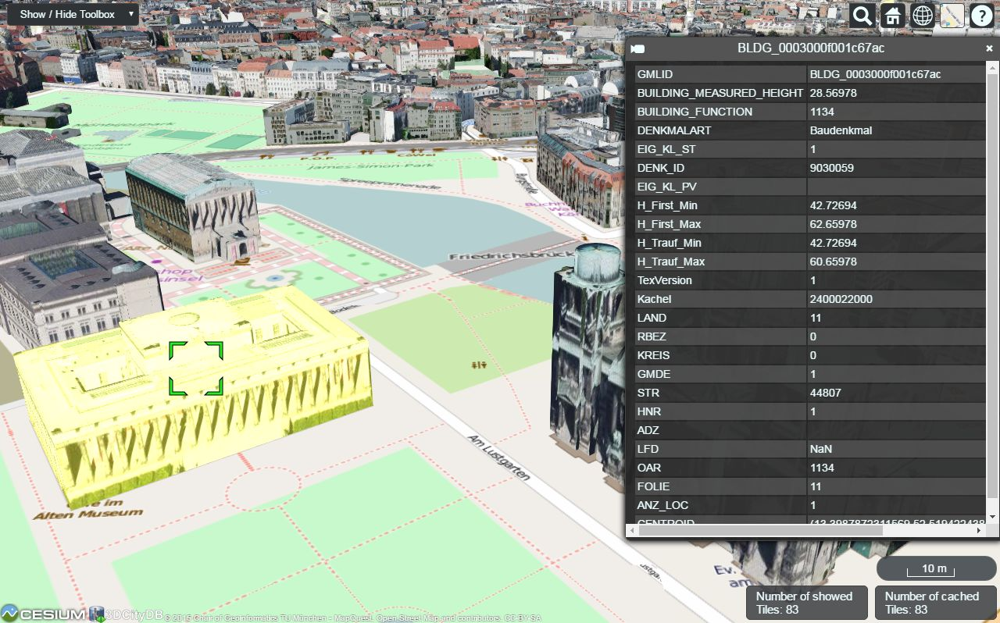
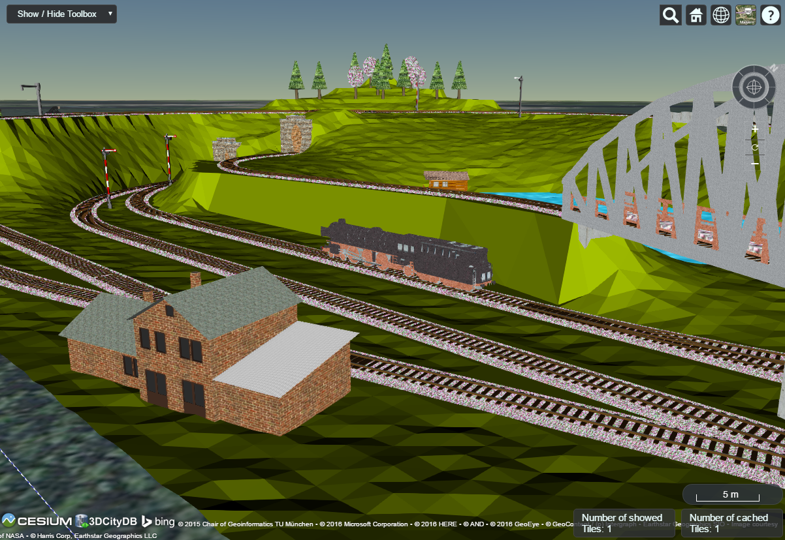

# 3dcitydb-web-map
主要为Cesium语义城市与工作区状态；不将GIS规模能力包装为3D美术打磨。

## 案例档案

[来源仓库](https://github.com/3dcitydb/3dcitydb-web-map)
分析版本：`2e779d9e8a5b2acdcb52ae405839950d4d778f51`

模型归属未独立认证。

## 初始源码审计边界

未审完整KML高亮worker、各种data source与实际城市瓦片；本轮不提出地图替换；未查看代表场景图。

以下保留初始源码审计的观察范围。后续新增静帧独立列于视觉材料，不追溯证明全部机制或运行状态。

## 机制与案例分析

### [SD-CI01 · 把镜头和场景配置打包成可重访的评审状态](../cards/SD-CI01.md)

多人比较画质需要同一视点与环境状态，分享场景状态比凭描述找镜头稳定。

本仓主要GIS数据/选择界面，无电影化调色或建模方法；只提炼可复访评审工具。

**Movie：reference** · 帮助锁定镜头验收，不直接提高画质。
**前端：adapt** · 小型QA视点链接有用，完整Cesium迁移无必要。

失败条件：- 原函数导出ion/Bing token不能照搬
- GIS经纬与本站局部米制坐标不通用
- 远端图层变化破坏可复现

## 项目效果与观察材料

实际查看：柏林贴图建筑与底图叠合，黄色高亮建筑、绿色选择框和右侧语义属性表同时出现。

来源：本轮已观察的历史截图 · author_repository_screenshot。README Demo 2历史截图，展示地理模型选择与语义数据；不是电影化建模质量样片。

实际查看：铁路、车站小屋、桥梁、隧道和植被落在三角地形上，带Cesium控件与比例尺。

来源：本轮已观察的历史截图 · author_repository_screenshot。README Demo 1的LoD3组合场景历史截图；不证明当前远端数据仍可访问。

## 复用边界

- **status**：observed
- **evidence**：LICENSE Apache2.0；源头数据集/地图服务权利另计
- **reuse**：conditional

图片及第三方素材的权利单独保留；源代码许可证不自动授权媒体。
