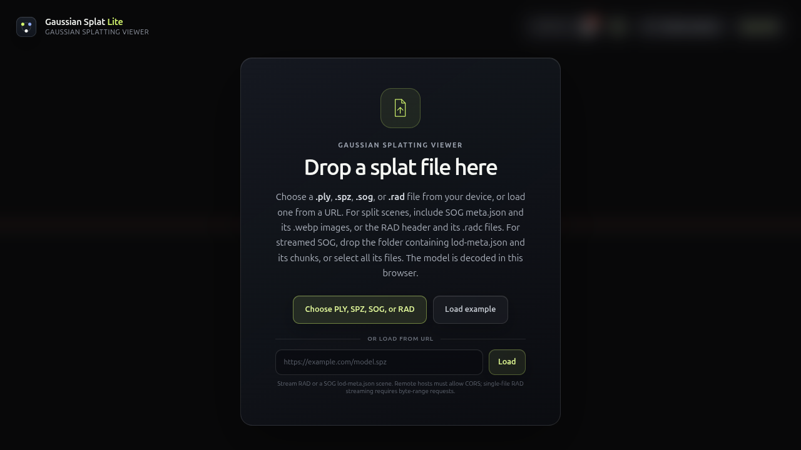

# Gaussian-Splat-Lite
三维采集资产的显示/编辑/流送管线，非自动建模方法。支持WebGPU及classic WebGL2但本地要求three>=.186；不适合本站直接整体升级。

## 案例档案

[来源仓库](https://github.com/WilliamLiu-1997/Gaussian-Splat-Lite)
分析版本：`581864925d74ca8d19dc04e362350a0c8726f32b`

模型归属未独立认证。

## 初始源码审计边界

未运行/未看模型；未深读WASM解码、SDF编辑、完整stream scheduler；无法从支持深度推断现有bake/collision兼容。

以下保留初始源码审计的观察范围。后续新增静帧独立列于视觉材料，不追溯证明全部机制或运行状态。

## 机制与案例分析

### [REN-021 · 让扫描背景与显式几何共享遮挡顺序](../cards/REN-021.md)

扫描背景若没有遮挡会像壁纸；能共享深度仍不代表可行走碰撞或可重照明。

扫描背景若没有遮挡会像壁纸；能共享深度仍不代表可行走碰撞或可重照明。

**Movie：reference** · 固定相机素材可试离线合成
**前端：defer** · 非当前Places建模路线；无合适资产不接

失败条件：- 透明边缘出现颗粒深度
- 扫描自带光照与昼夜不一致
- bake GLB/walkmask无法直接处理splat

### [REN-022 · 在细节替换期间保留前后表示的对应关系](../cards/REN-022.md)

避免镜头推进时细节突然爆出；集合身份保持比整屏交叉淡化更精确。

避免镜头推进时细节突然爆出；集合身份保持比整屏交叉淡化更精确。

**Movie：reference** · 慢推镜头避免细节跳变
**前端：reference** · 未来远景LOD系统参考，Atlas后置

失败条件：- 新旧重复显示造成增亮
- 快速往返LOD形成反复淡入
- await firstRenderable之前不更新导致等待不结束

### [REN-023 · 运动时保持响应，停下后替换为稳定细节](../cards/REN-023.md)

快速转动可接受噪声但停留后应恢复清晰；适用前端观察阶段，而导出应固定高质量。

快速转动可接受噪声但停留后应恢复清晰；适用前端观察阶段，而导出应固定高质量。

**Movie：defer** · 成片不应保留动态噪声策略
**前端：reference** · 未来扫描查看器可借状态机

失败条件：- 停住仍闪烁
- 细线在随机覆盖下消失
- 运动检测抖动反复切换

## 项目效果与观察材料

深色上传面板按格式、示例和URL分配入口；黄绿色只强调主要选择。

来源：本轮已观察的历史截图 · historical_ui_still。历史上传入口截图，不包含实际Gaussian场景，不证明排序或OIT效果。

## 复用边界

- **status**：observed
- **evidence**：LICENSE Apache2.0；NOTICE标记SparkJS/SuperSplat/ruzstd来源，发布须一并保留所需notice；采集资产另查。
- **reuse**：conditional

图片及第三方素材的权利单独保留；源代码许可证不自动授权媒体。
