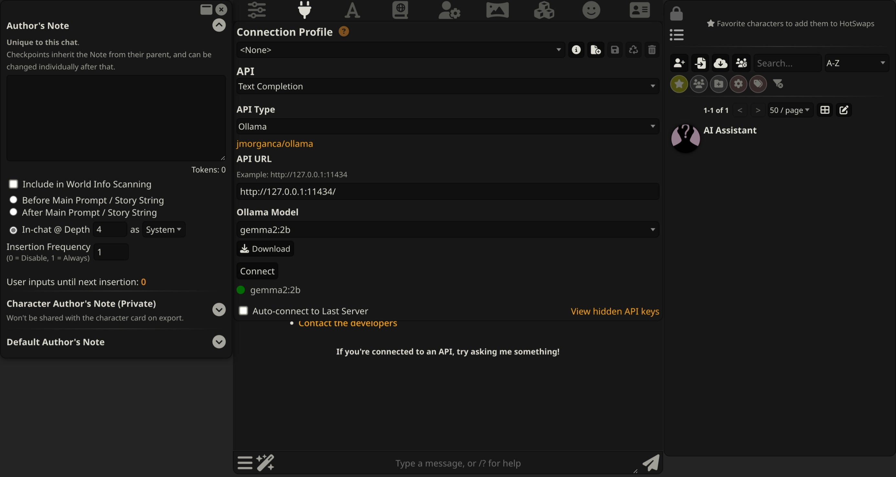
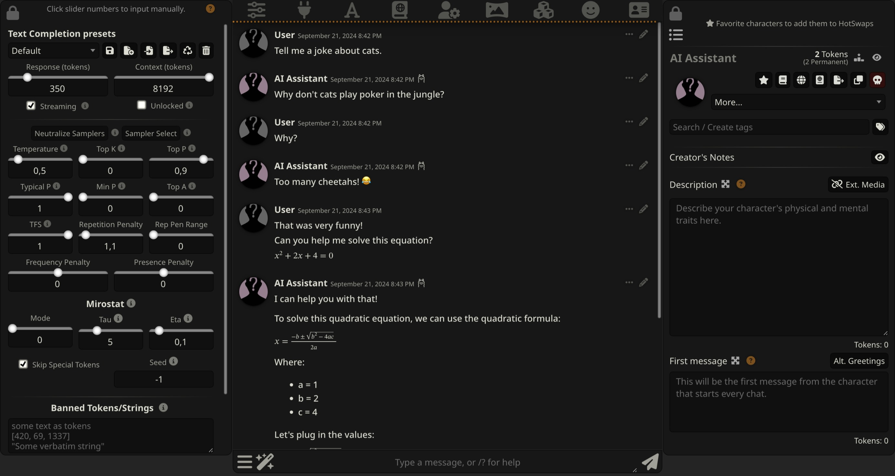

# SillyTavern
2D视觉小说机制有直接参考价值：换图占位、同情绪姿态变体、发言者层级。AGPL许可不等同可直接vendor。

## 案例档案

[来源仓库](https://github.com/SillyTavern/SillyTavern)
分析版本：`06bde939fb1e9c4c8d8641d810f0a916b5bce127`

模型归属未独立认证。

## 初始源码审计边界

只读expressions扩展实现及CSS；未读LLM分类、全部主题、角色资产或运行UI。

以下保留初始源码审计的观察范围。后续新增静帧独立列于视觉材料，不追溯证明全部机制或运行状态。

## 机制与案例分析

### [CN-009 · 换表情时锁定立绘占位再交叉呈现](../cards/CN-009.md)

换表情时锁定立绘占位再交叉呈现。这是由该仓实现提炼的候选操作，跨项目效果待验证。

保持人物脚线和容器尺寸，减少不同姿态资源切换时UI重排；源码没有证明图像已经decode完成。

**Movie：adapt** · 2D分镜可借占位与过渡机制，明确pose anchor
**前端：adapt** · 符合hIE屏幕空间立绘策略

失败条件：- 原实现不等待decode可能闪白
- 动画中来的新状态可能丢失，需latest-wins队列

### [CN-010 · 在同一情绪内选变体并明确缺图降级](../cards/CN-010.md)

在同一情绪内选变体并明确缺图降级。这是由该仓实现提炼的候选操作，跨项目效果待验证。

同情绪可有不同姿态，但影片复现需要固定选择而非每次随机。

**Movie：adapt** · 固定seed或明确override才可用于镜头
**前端：reference** · 变体丰富度有价值但非本轮必做

失败条件：- 随机破坏连贯手势或物件状态
- 没有fallback时人物消失

### [CN-011 · 用最近发言者决定遮挡层而保留减弱动态选项](../cards/CN-011.md)

用最近发言者决定遮挡层而保留减弱动态选项。这是由该仓实现提炼的候选操作，跨项目效果待验证。

多人视觉小说强调谁在说话；hIE默认单人居中不能因此改成常驻群像。

**Movie：reference** · 群像分镜可手动构图更可控
**前端：defer** · 当前单人hIE优先，多人功能后置

失败条件：- 按宽度分重叠可能遮住关键脸部
- 频繁换发言者引发来回滑动

## 项目效果与观察材料

官方文档截图中左侧Author Note、中间API连接设置、右侧角色管理并列；深灰底与少量琥珀提示保持多面板分区。

来源：[原作者/出处](https://docs.sillytavern.app/static/screenshot1.jpg) · author_historical_screenshot。已实际查看作者历史图；仅支持画面布局、配色和可见状态，不证明当前HEAD、动态行为或运行质量。

官方文档截图将参数滑杆、聊天正文、角色描述并列；中央对话含数学排版，底部输入条保持固定。

来源：[原作者/出处](https://docs.sillytavern.app/static/screenshot2.jpg) · author_historical_screenshot。已实际查看作者历史图；仅支持画面布局、配色和可见状态，不证明当前HEAD、动态行为或运行质量。

## 复用边界

- **status**：observed
- **evidence**：LICENSE与README: AGPL-3.0
- **reuse**：idea_only

图片及第三方素材的权利单独保留；源代码许可证不自动授权媒体。
