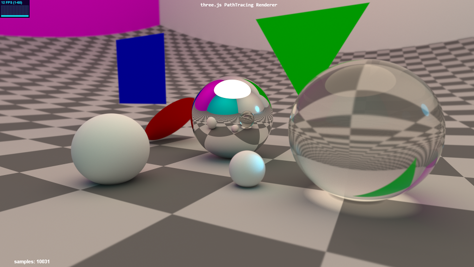

# THREE.js-PathTracing-Renderer
WebGL2上的自定义解析几何/路径追踪示例集；实读粗糙度样条与波浪高度，不把README移动端实时宣称当本机验证。

## 案例档案

[来源仓库](https://github.com/erichlof/THREE.js-PathTracing-Renderer)
分析版本：`f8ded116a3c674db552d4481e59c61d28cf81833`

模型归属未独立认证。

## 初始源码审计边界

未逐个读数十demo/BVH/CSG/天空；未跑WebGL性能；材质函数后段未穷尽。

以下保留初始源码审计的观察范围。后续新增静帧独立列于视觉材料，不追溯证明全部机制或运行状态。

## 机制与案例分析

### [REN-007 · 以同灯同形粗糙度阶梯校准材质身份](../cards/REN-007.md)

光斑宽度与反射轮廓能够区分塑料、金属、湿石，避免只换albedo。

光斑宽度与反射轮廓能够区分塑料、金属、湿石，避免只换albedo。

**Movie：adapt** · 用于特写道具的材质lookdev
**前端：prototype** · 可在当前lab搭小材质校准场，输出参数后回场景

失败条件：- 路径追踪参数直接照抄到PBR可能不等价
- 球体校准不能替代实际倒角/UV/使用痕迹

### [REN-008 · 叠加不同方向波段避免水面机械同步](../cards/REN-008.md)

方向与频率解耦产生不完全重复的波峰，水色vec3(.6,1,1)是源码设定，不是项目推荐值。

方向与频率解耦产生不完全重复的波峰，水色vec3(.6,1,1)是源码设定，不是项目推荐值。

**Movie：reference** · 可用于窗外海面层次设计
**前端：adapt** · 仅迁移波形构造到现有水面材质

失败条件：- 20单位波幅用于小水池会失真
- 仅改法线而不改几何时近景轮廓不跟随
- 时间跨帧采样会重置/拖影

## 项目效果与观察材料

棋盘地面上的漫反射、镜面与透明球，后方红绿蓝几何体；透明球中可见扭曲棋盘和投影。

来源：本轮已观察的历史截图 · author_demo_screenshot。README明确称2015年的旧渲染样例，仅作历史渲染效果；不能绑定当前材质实现或复用图中FPS为现性能。

## 复用边界

- **status**：observed
- **evidence**：LICENSE:1-10 CC0 1.0 Universal；第三方模型/图片仍逐项核对。
- **reuse**：conditional

图片及第三方素材的权利单独保留；源代码许可证不自动授权媒体。
