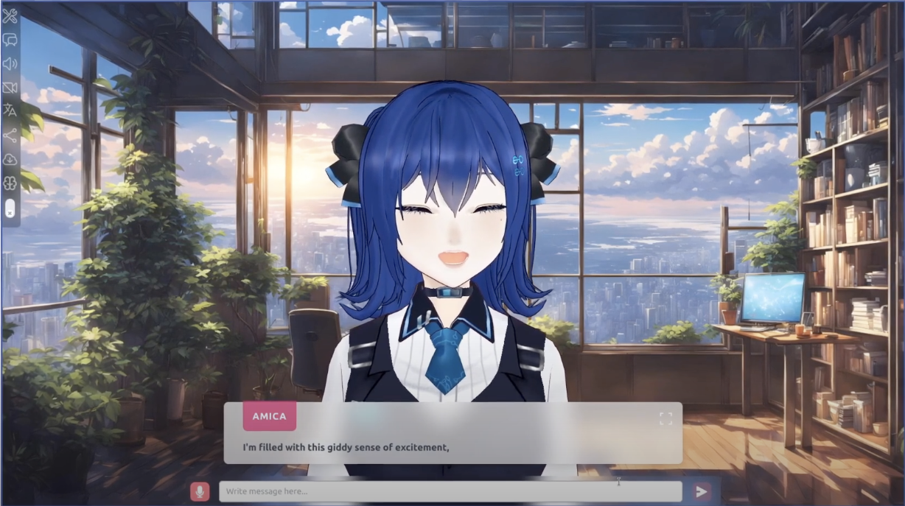

# amica
核心价值是多表情通道仲裁和注视坐标系。均来自VRM实现，当前hIE仅2D，因此裁决以reference/defer为主。

## 案例档案

[来源仓库](https://github.com/semperai/amica)
分析版本：`ca2415c77d20ec41dd4fcf917dbb0e97961ddf08`

模型归属未独立认证。

## 初始源码审计边界

未读proceduralAnimation、XR、LLM与语音provider；未使用.env文件；未运行3D角色。

以下保留初始源码审计的观察范围。后续新增静帧独立列于视觉材料，不追溯证明全部机制或运行状态。

## 机制与案例分析

### [CN-014 · 让情绪、眨眼和口型让出同一张脸的控制权](../cards/CN-014.md)

让情绪、眨眼和口型让出同一张脸的控制权。这是由该仓实现提炼的候选操作，跨项目效果待验证。

各通道不要直接相加把脸揉坏；2D整张图情绪切换不能直接套VRM权重，只能借优先级。

**Movie：reference** · 可指导2D分镜眨眼时机，当前不引VRM
**前端：reference** · 为将来有限2D分层表情提供规则

失败条件：- setTimeout未取消可能让旧情绪晚到覆盖新情绪
- 固定权重未必适合其他模型

### [CN-015 · 把注视目标挂在观察者坐标系而非世界固定点](../cards/CN-015.md)

把注视目标挂在观察者坐标系而非世界固定点。这是由该仓实现提炼的候选操作，跨项目效果待验证。

源仓3D角色会保持面向摄像机注视；迁移到2D只能在已绘制视线姿态中选择，不表示能让图片眼球真实追踪。

**Movie：reference** · 分镜视线关系可借，技术本身非本轮目标
**前端：defer** · 当前hIE仅2D，不增加3D目光引擎

失败条件：- 追随鼠标过度会显得躁动
- 未经授权的2D形变破坏画风

## 项目效果与观察材料

蓝发角色覆盖在暖色窗景房间中；底部浅色半透明对白与输入条，左侧窄工具栏。

来源：本轮已观察的历史截图 · author_historical_screenshot。已实际查看作者历史图；仅支持画面布局、配色和可见状态，不证明当前HEAD、动态行为或运行质量。

## 复用边界

- **status**：observed
- **evidence**：LICENSE: MIT (Semper AI,pixiv)；模型资产另查
- **reuse**：direct_with_notice

图片及第三方素材的权利单独保留；源代码许可证不自动授权媒体。
