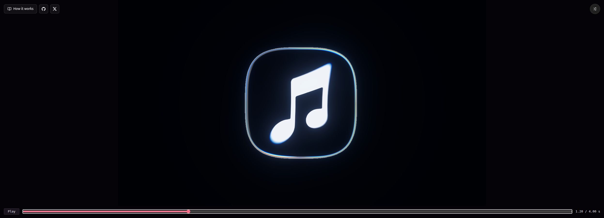
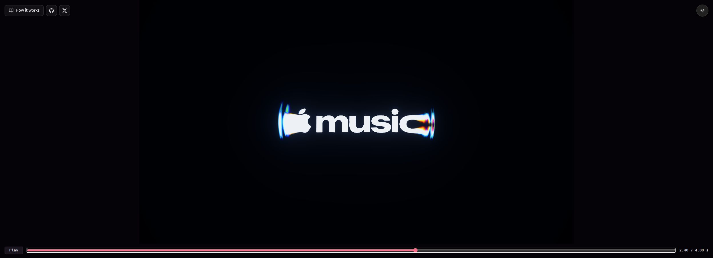

# apple-music-effect
闭式油透镜高度场、光谱折射与确定性子帧累积；不是流体模拟。README没有明确模型署名，AI来源标签未由源码确认。已查看preview与scorecard历史静帧。

## 案例档案

[来源仓库](https://github.com/transitive-bullshit/apple-music-effect)
分析版本：`e31a67602ea03659d60de5290f85b657d11ab27d`

模型归属未独立认证。

## 初始源码审计边界

未运行/导出/重现拟合；analysis/capture.py与scorecard.py未深读，报告指标仅作者陈述；未核全资产权利。

以下保留初始源码审计的观察范围。后续新增静帧独立列于视觉材料，不追溯证明全部机制或运行状态。

## 机制与案例分析

### [NWR-001 · 用少数连续形变曲线导演液态表面](../cards/NWR-001.md)

把铺展、隆起、圆到方、收敛分开导演；静帧见清洁黑底和薄亮边。dome.ts头部旧公式不能取代shader真实实现。

把铺展、隆起、圆到方、收敛分开导演；静帧见清洁黑底和薄亮边。dome.ts头部旧公式不能取代shader真实实现。 根代理在Chrome线上播放器Seek到1.2秒，本子代理实际查看保存截图：圆角音符边缘为薄透明轮廓与轻虹彩，中央白色音符保持清楚。 线上指定帧观察，不证明本地HEAD一致、连续流畅性或性能。

**Movie：prototype** · 适合单物件液态镜头
**前端：adapt** · 仅局部视觉容器，避免扭曲正文

失败条件：- 无法再现大幅非对称流体破裂
- 几何参数只按画面拟合，不能称物理实测

### [NWR-002 · 把光谱色散集中在陡峭边缘](../cards/NWR-002.md)

中央白色字形保持清洁，边缘形成青蓝/紫光谱；不是给整个画面加RGB分离。作者已承认暖红不足。

中央白色字形保持清洁，边缘形成青蓝/紫光谱；不是给整个画面加RGB分离。作者已承认暖红不足。 根代理在Chrome线上播放器Seek到2.4秒，本子代理实际查看保存截图：字标两端拉伸并有明显彩散，中央music仍可辨识。 线上指定帧观察，不证明本地HEAD一致、连续流畅性或性能。

**Movie：prototype** · 可作为玻璃/能量薄膜局部材质
**前端：adapt** · 适合封面图形，正文区不适合

失败条件：- 高坡度饱和彩边吞没细节
- 波长数量配置越过64会破坏采样覆盖
- 这种折射不是黑洞广义相对论透镜

### [NWR-003 · 用时间子帧重算形体再累积运动模糊](../cards/NWR-003.md)

模糊来自曝光时段的实际形态，而非把单帧轮廓整体抹软；可重复帧利于A/B调色。

模糊来自曝光时段的实际形态，而非把单帧轮廓整体抹软；可重复帧利于A/B调色。

**Movie：prototype** · 适用于可离线采样的运动镜头
**前端：defer** · 交互性能本轮后置，不能直接把离线样本量搬进页面

失败条件：- 切镜边界只在起点clamp，须检查尾端跨镜行为
- 增加子帧不自动解决错误光学模型

### [NWR-004 · 用整段视觉统计约束调色而保留人工裁决](../cards/NWR-004.md)

已查看scorecard静图：单指标改善不代表暖冷、色量、运动都吻合；应把图和帧同时审阅。

已查看scorecard静图：单指标改善不代表暖冷、色量、运动都吻合；应把图和帧同时审阅。

**Movie：prototype** · 直接服务镜头打磨验收
**前端：adapt** · 可用于转场片段，不能替代可用性测试

失败条件：- 优化RMS得到更暗更软错误画面
- 时间平滑掩盖瞬时闪烁
- 复制对比片/音效/商标受到单独权利约束

## 项目效果与观察材料

本轮view_image实际看过的仓内历史静图，未验证运行或运动

来源：[原作者/出处](https://github.com/transitive-bullshit/apple-music-effect/blob/e31a67602ea03659d60de5290f85b657d11ab27d/docs/preview.webp) · observed_still。静帧观察；没有由此验证连续动画或性能。

本轮view_image实际看过的仓内历史静图，未验证运行或运动

来源：[原作者/出处](https://github.com/transitive-bullshit/apple-music-effect/blob/e31a67602ea03659d60de5290f85b657d11ab27d/docs/scorecard.webp) · observed_still。静帧观察；没有由此验证连续动画或性能。

2026-10-25根代理Chrome线上Seek指定帧，本子代理view_image复核；非本地HEAD运行/连续运动/性能验证

来源：[原作者/出处](https://apple-music-effect.transitivebullsh.it/) · live_site_still。静帧观察；没有由此验证连续动画或性能。

2026-10-25根代理Chrome线上Seek指定帧，本子代理view_image复核；非本地HEAD运行/连续运动/性能验证

来源：[原作者/出处](https://apple-music-effect.transitivebullsh.it/) · live_site_still。静帧观察；没有由此验证连续动画或性能。

## 复用边界

- **status**：observed
- **evidence**：license MIT；readme.md:35明确Apple/X商标及sting、描摹logo、对比图等例外
- **reuse**：conditional

图片及第三方素材的权利单独保留；源代码许可证不自动授权媒体。
