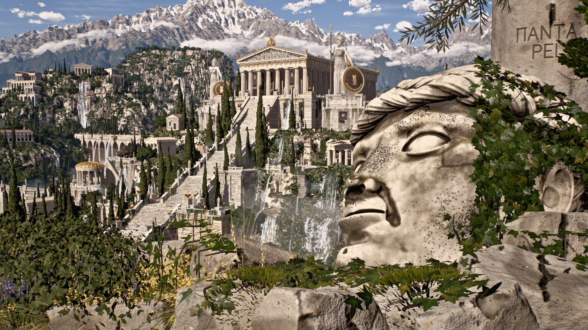
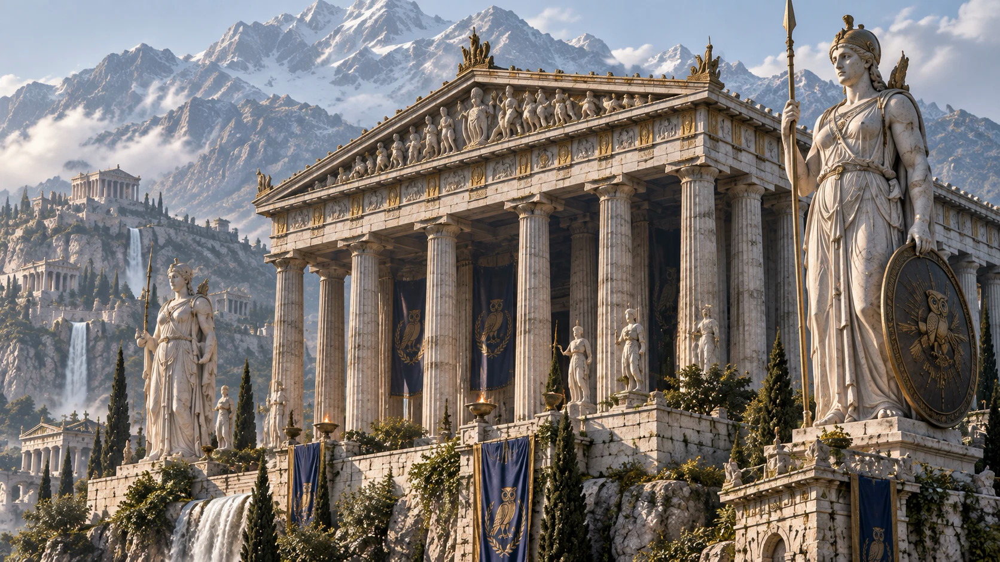

# athenaion
以程序化建筑、SDF雕塑、地形支撑接口和按参考构图编排的电影场景。9个参考相机，实际视频序列8段54.3秒；作者性能/模型/零外部资产宣称未独立认证。

## 案例档案

[来源仓库](https://github.com/Leonxlnx/athenaion)
分析版本：`9b8bd23b39c458a50fb1201037360047781c45b5`

docs/PROMPT.md:3/README为作者自述Claude Code Opus5.5 xhigh；不认证模型身份、生成过程、55 agent、147agent-hours等宣传数字。

## 初始源码审计边界

阅读提示词、构图文档和所列核心源码片段；未穷尽全部地形/水/植被/材质模块；未运行、构建、bake、看视频或测FPS。实际查看4张历史静图（包含一张参考图）；不能证明所有视点/模型质量，不能证明Zero external assets整仓声明。

以下保留初始源码审计的观察范围。后续新增静帧独立列于视觉材料，不追溯证明全部机制或运行状态。

## 机制与案例分析

### [ATH-001 · 先用明暗构件节律建立远景可读性，再追加雕花](../cards/ATH-001.md)

历史shot5可见暖石立柱与深色内殿交替，黑洞般的柱间隙比细雕花更能建立层次；这是图像观察与代码支持的设计推论，不是通用美术规律。

历史shot5可见暖石立柱与深色内殿交替，黑洞般的柱间隙比细雕花更能建立层次；这是图像观察与代码支持的设计推论，不是通用美术规律。

**Movie：prototype** · 适合对一座主建筑锁镜头做体块先行A/B。
**前端：adapt** · 自由视点需真实洞深与侧面，不能只做正面黑片。

失败条件：- 全局AO或阴影过黑会把内部压成无细节黑块
- 照搬希腊柱式不能解决赛博场景自身造型

### [ATH-002 · 以地形分位数和发布的支撑高度约束建筑接地](../cards/ATH-002.md)

建筑落地不是把中心点吸附地面。覆盖足迹的基础遮住高低差；大型雕像读实际承台高度。历史全景仅支持接地外观，未检查全部脚底。

建筑落地不是把中心点吸附地面。覆盖足迹的基础遮住高低差；大型雕像读实际承台高度。历史全景仅支持接地外观，未检查全部脚底。

**Movie：prototype** · 能直接减少大全景悬空和基座接缝。
**前端：adapt** · 自由视角要检查所有边缘与可走碰撞，单镜头掩盖不够。

失败条件：- p90仍可能穿过最高10%地形
- 无基座时取min会埋入而非保证贴地
- 统计阈值是该世界米制尺度，不能通用照搬

### [ATH-003 · 按身份识别部位分配雕塑几何精度](../cards/ATH-003.md)

shot5中头像、头盔和盾牌是身份锚点；与refs/ref5比较，实际渲染的衣褶和表情仍更规整，不能继承提示词99.9%匹配承诺。可选眼孔关闭机制说明细节过多也会误读。

shot5中头像、头盔和盾牌是身份锚点；与refs/ref5比较，实际渲染的衣褶和表情仍更规整，不能继承提示词99.9%匹配承诺。可选眼孔关闭机制说明细节过多也会误读。

**Movie：adapt** · 优先现有资产局部修整，必要时才借分区生成。
**前端：reference** · 不引入重型实时SDF生成；展示时用已烘焙模型。

失败条件：- 近景仍可能暴露SDF有机形体不足
- 生成缓存版本不更新可能继续读取旧形体
- 不适用于要求hIE迁回3D，当前hIE保留2D

### [ATH-004 · 把镜头专用布景显式限定在其适用镜头](../cards/ATH-004.md)

大全景需要雕像轮廓与建筑间留空；源码以镜头可见性解决构图冲突。这是电影布景技巧，不是世界本体一致性证据。

大全景需要雕像轮廓与建筑间留空；源码以镜头可见性解决构图冲突。这是电影布景技巧，不是世界本体一致性证据。

**Movie：adapt** · 可用于特定电影镜头，但必须登记为镜头布景并检查转场。
**前端：reject** · 当前按镜头ID隐藏巨物不适合连续可探索前端。

失败条件：- 自由浏览中物体消失会破坏空间记忆
- 隐藏模型也改变投影；跨fade可能不连续
- 占地登记与visible不同步，需审计碰撞代理

### [ATH-005 · 围绕已审核构图限制相机运动幅度，并独立验证采样路径](../cards/ATH-005.md)

小幅运动延续已验收构图，不自动保证所有中间帧。长焦压缩和宽镜头展示属于不同镜头职责。只看过静帧，未确认运动流畅与GPU表现。

小幅运动延续已验收构图，不自动保证所有中间帧。长焦压缩和宽镜头展示属于不同镜头职责。只看过静帧，未确认运动流畅与GPU表现。

**Movie：prototype** · 适合电影按镜头收敛；需补路径接地与子帧目检。
**前端：adapt** · 适合点击地标后的短预览，恢复自由视角须保留用户状态。

失败条件：- 相机路径没有避障，楼梯跟随需另做
- easeout使注释中点假设失效
- 5像素非黑检查不等于画面质量验收
- 9个参考相机不能写成9段成片

## 项目效果与观察材料

已查看的来源静帧；不证明当前版本运行。

来源：[原作者/出处](https://github.com/Leonxlnx/athenaion/blob/9b8bd23b39c458a50fb1201037360047781c45b5/media/overview.jpg) · historical_still_viewed。静帧观察；没有由此验证连续动画或性能。

已查看的来源静帧；不证明当前版本运行。

来源：[原作者/出处](https://github.com/Leonxlnx/athenaion/blob/9b8bd23b39c458a50fb1201037360047781c45b5/media/shot5.jpg) · historical_still_viewed。静帧观察；没有由此验证连续动画或性能。

已查看的来源静帧；不证明当前版本运行。

来源：[原作者/出处](https://github.com/Leonxlnx/athenaion/blob/9b8bd23b39c458a50fb1201037360047781c45b5/media/shot8.jpg) · historical_still_viewed。静帧观察；没有由此验证连续动画或性能。

已查看的来源静帧；不证明当前版本运行。

来源：[原作者/出处](https://github.com/Leonxlnx/athenaion/blob/9b8bd23b39c458a50fb1201037360047781c45b5/refs/ref5.png) · historical_still_viewed。静帧观察；没有由此验证连续动画或性能。

## 复用边界

- **status**：observed
- **evidence**：LICENSE:1-21 MIT, Copyright 2026 Leon Lin；可复用代码需保留许可。参考图的生成来源仅作者自述，未独立核验其权利链。
- **reuse**：direct_with_notice

图片及第三方素材的权利单独保留；源代码许可证不自动授权媒体。
