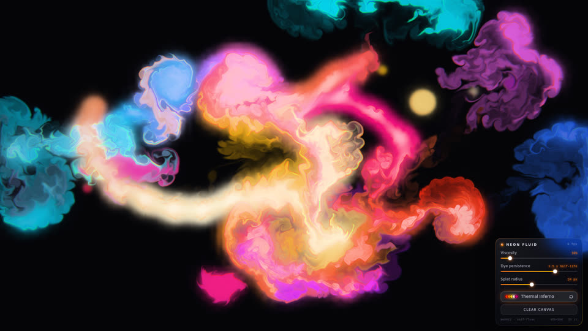

# awesome-opus5.5-frontend-showcases
23张源码支持的案例/机制候选，13个不同子作品核心切片阅读，13张历史静帧实看。逐项记录本地作品与README外链；未运行，不把模型归属作者自述当认证。

## 案例档案

[来源仓库](https://github.com/OpenVGLab/awesome-opus5.5-frontend-showcases)
分析版本：`cac43b250f07b7b86f4709c61effc84269f46494`

- **status**：author_claim_only
- **evidence**：README.md:5
- **claim**：作者称收集Claude Opus 5.5作品并给发布日期；本轮未认证模型、版本或生成全过程。

## 初始源码审计边界

只深入列出的13个子作品选定机制，未穷尽34个repro及其他作品；其余每项明确inventory_only；README外链只是发现线索，不是已读作品。所有动画/键盘/性能均未运行验证。未在这些实读切片中取得黑洞机制证据，不强造黑洞卡。

以下保留初始源码审计的观察范围。后续新增静帧独立列于视觉材料，不追溯证明全部机制或运行状态。

## 机制与案例分析

### [SHOW-001 · 按可见贡献分配灯位，保持实体光源与局部受光对应](../cards/SHOW-001.md)

设计推论：把有限动态光预算放在当前画面真正读到的灯笼、招牌与行动附近；封面可见暖窗和灯笼，不能由静帧证实切灯无跳变。

设计推论：把有限动态光预算放在当前画面真正读到的灯笼、招牌与行动附近；封面可见暖窗和灯笼，不能由静帧证实切灯无跳变。

**Movie：adapt** · 电影路径已知可事先固定英雄灯，避免依赖运行时抢灯。
**前端：adapt** · 自由走动适合按贡献选光，但须改为三维距离与遮挡感知。

失败条件：- 源码只按x距离，直接搬入自由3D走动会错选
- 槽位换灯仍可能跳变
- r170阴影属性需核对

### [SHOW-002 · 让颜色纹理与凹凸纹理共享结构边界](../cards/SHOW-002.md)

颜色的接缝与光照起伏对齐，避免图案看似砖墙、侧光却像塑料。源码注释指出硬阶会在掠射月光下变1px线；尚未复现。

颜色的接缝与光照起伏对齐，避免图案看似砖墙、侧光却像塑料。源码注释指出硬阶会在掠射月光下变1px线；尚未复现。

**Movie：prototype** · 用于墙面或石材近景可明确检验掠射光响应。
**前端：adapt** · 需要一致UV密度，不能无区别替换所有材质。

失败条件：- 高频接缝远景闪烁
- 每个面随意UV缩放导致砖尺寸不一致

### [SHOW-003 · 以窗内生活剪影区分建筑占用状态](../cards/SHOW-003.md)

不同窗口不是随机明暗矩形，而是用窗帘、植物、人物等内部遮挡暗示活动；静帧中的纸窗人物剪影与暖光可见。

不同窗口不是随机明暗矩形，而是用窗帘、植物、人物等内部遮挡暗示活动；静帧中的纸窗人物剪影与暖光可见。

**Movie：prototype** · 固定中景窗可用剪影形成次叙事。
**前端：adapt** · 远近分层，近窗必要时增加室内几何。

失败条件：- 透明贴片近看无视差
- 所有窗同样亮使楼层身份丢失
- 图集边界渗色

### [SHOW-004 · 以分层雾化轮廓补足窗外城市纵深](../cards/SHOW-004.md)

远层更受雾染，近层更深；少量亮窗跨层保留城市生活感。源封面视野主要为近景，远层效果未单独观察。

远层更受雾染，近层更深；少量亮窗跨层保留城市生活感。源封面视野主要为近景，远层效果未单独观察。

**Movie：prototype** · 适合室内向窗外的限定电影机位。
**前端：adapt** · 自由移动需要360度围合或限制可见角度。

失败条件：- 自由绕行会看见纸片
- 透明排序和窗框遮挡冲突
- 层间移动视差不符合真实尺度

### [SHOW-005 · 用楼层节律与稀疏亮窗给简单楼体可读尺度](../cards/SHOW-005.md)

建筑轮廓可简单，楼层/窗口节律提供尺度参照；历史封面可见条带和稀疏窗。

建筑轮廓可简单，楼层/窗口节律提供尺度参照；历史封面可见条带和稀疏窗。

**Movie：adapt** · 背景移动镜头有效，主楼仍需轮廓独特。
**前端：adapt** · 只用于不可抵达背景楼。

失败条件：- 近看表面无深度
- 重复统一盒体会像阵列
- 频繁呼吸亮度削弱真实城市感

### [SHOW-006 · 限制Bloom输入峰值以保留爆发的局部性](../cards/SHOW-006.md)

爆炸和发光核心允许很亮，送入模糊的能量被限制，减少全屏白雾；封面中心依然强烈过曝，不能声称问题已彻底解决。

爆炸和发光核心允许很亮，送入模糊的能量被限制，减少全屏白雾；封面中心依然强烈过曝，不能声称问题已彻底解决。

**Movie：prototype** · 高亮高潮与镜头逆光可做单独A/B。
**前端：adapt** · 交互物轮廓与文字必须在爆发时可读。

失败条件：- 字符串替换随Three版本失效
- 硬上限可能压平英雄光晕
- 封面仍有大面积中心炫光

### [SHOW-007 · 让环境色板随事件阶段变换并保留角色分工](../cards/SHOW-007.md)

色彩可以说明事件推进；各用途槽保持含义，避免阶段切换把地面与可操作对象混为一种颜色。这里只核对预设及目标字段，未审完整插值调用。

色彩可以说明事件推进；各用途槽保持含义，避免阶段切换把地面与可操作对象混为一种颜色。这里只核对预设及目标字段，未审完整插值调用。

**Movie：adapt** · 可用于短片章节而非每镜头任意变色。
**前端：reference** · 现项目昼夜跟系统时间，不能加访客昼夜按钮。

失败条件：- 频繁换色造成认知负担
- 大面积紫背景违背项目禁区

### [SHOW-008 · 由一个夜间权重协调天空、灯具、水色和曝光](../cards/SHOW-008.md)

夜色成立依赖多个通道共变，而不只是把环境光调暗；源码具体保证广播路径，历史封面只显示白天。

夜色成立依赖多个通道共变，而不只是把环境光调暗；源码具体保证广播路径，历史封面只显示白天。

**Movie：prototype** · 固定同镜头跨昼夜可直接比较协调性。
**前端：adapt** · 系统时间输入而非复制demo按钮。

失败条件：- 只改天空不改窗光导致脱节
- 夜曝光提高后暗部仍可能被bake重复压暗

### [SHOW-009 · 以支撑脚点采样把构筑物真正接到地面](../cards/SHOW-009.md)

连接关系比堆材质更决定模型可信度。须区别：最低点下沉适合石/植被，不能保证桌椅全脚不穿地；代码注释写3.6但循环为4.8。

连接关系比堆材质更决定模型可信度。须区别：最低点下沉适合石/植被，不能保证桌椅全脚不穿地；代码注释写3.6但循环为4.8。

**Movie：prototype** · 桥柱/码头特写容易暴露悬空，优先补。
**前端：adapt** · 接地后仍需walkmask和碰撞同步。

失败条件：- 最低点策略让高侧埋入
- 不同的碰撞/渲染坐标造成假接地

### [SHOW-010 · 把雨量同时映射到粗糙度与漫反射](../cards/SHOW-010.md)

湿面让高光变集中且底色略暗，形成同时看得见的雨后变化。封面是晴天，未观察湿态效果。

湿面让高光变集中且底色略暗，形成同时看得见的雨后变化。封面是晴天，未观察湿态效果。

**Movie：prototype** · 雨夜街面固定镜头先试。
**前端：adapt** · 需屋檐遮雨mask、可走地面层与bake持久化。

失败条件：- 源码圆形范围是岛屿假设，不能迁到整个室内
- 遮雨区域缺失
- 太低roughness像塑料

### [SHOW-011 · 把柔性权重与空间相位结合成有根的风动](../cards/SHOW-011.md)

同风场但不同空间相位让植被形成连贯阵风，根部不整体漂移。静帧只能观察树形，不能验证风动。

同风场但不同空间相位让植被形成连贯阵风，根部不整体漂移。静帧只能观察树形，不能验证风动。

**Movie：adapt** · 远近树丛可给静止机位持续微动。
**前端：adapt** · 适用于植物/布条，不应用到hIE立绘。

失败条件：- 全顶点相同权重导致根浮起
- shadow material未同步顶点动画会出现影子脱节

### [SHOW-012 · 让对象强调色贯穿模型档案、标签与导航](../cards/SHOW-012.md)

对象在三维、目录、详情间保留身份；历史封面可见底部对象缩略图与对应标签，但小字可读性有限。

对象在三维、目录、详情间保留身份；历史封面可见底部对象缩略图与对应标签，但小字可读性有限。

**Movie：reference** · 用于片头标识或章节字幕而非场景全局染色。
**前端：prototype** · 手机各内容入口可共享身份色和缩略图。

失败条件：- 多对象同时高饱和抢焦
- 源码紫色星云不能直接套用项目
- 底部密集标签在小屏拥挤

### [SHOW-013 · 把结果提交与揭示动画拆开，使跳过保持结果一致](../cards/SHOW-013.md)

演出可以丰富，状态结果不可由动画完成与否决定。封面只证明有Skip按钮，不证明竞态正确。这里只借揭示机制，不建议引入抽卡经济。

演出可以丰富，状态结果不可由动画完成与否决定。封面只证明有Skip按钮，不证明竞态正确。这里只借揭示机制，不建议引入抽卡经济。

**Movie：adapt** · 电影可用于章节跳过，但需保证时间线和字幕收束。
**前端：prototype** · 碎片/物件发现动画可用，阅读内容仍可直达。

失败条件：- flush后残留tween写入结果页
- 连续点击重复触发
- 在网络未完成前伪造结果

### [SHOW-014 · 让天气预设同时控制景色、反光和叙事动作](../cards/SHOW-014.md)

天气承担情绪与叙事节拍，亮灯应在海面留下响应；封面可见灯塔光束照向海中鲸与附近亮斑。

天气承担情绪与叙事节拍，亮灯应在海面留下响应；封面可见灯塔光束照向海中鲸与附近亮斑。

**Movie：prototype** · 适合片段从宁静到风暴再释放的结构。
**前端：reference** · 交互场景不应强迫150秒固定片段。

失败条件：- 只复制漂亮天空而反光不变
- 连续闪电抢夺字幕注意
- 全局天气强行覆盖用户系统昼夜

### [SHOW-015 · 按深度插入雾幕与前景物，控制二维海景遮挡](../cards/SHOW-015.md)

二维也可通过一致遮挡序建立纵深，雾不应作为最后一层均匀白色蒙版。封面可见远云、岛、海面、前景波纹的层次。

二维也可通过一致遮挡序建立纵深，雾不应作为最后一层均匀白色蒙版。封面可见远云、岛、海面、前景波纹的层次。

**Movie：prototype** · 适用于2D序章/海报动图。
**前端：reference** · 仅用于手机内展示或背景视频，不能替代3D Places雾。

失败条件：- 自由3D移动会失去正确交叉
- 全屏近雾影响前景UI

### [SHOW-016 · 让场景摆放、路径和活动区引用同一份米制布局](../cards/SHOW-016.md)

几何、脚下路径与交互区一致是空间设计本体。当前只读声明，未逐个跟踪所有消费者，不能声称所有碰撞都正确。

几何、脚下路径与交互区一致是空间设计本体。当前只读声明，未逐个跟踪所有消费者，不能声称所有碰撞都正确。

**Movie：adapt** · 分镜取景亦应引用布局中的地标。
**前端：prototype** · 与当前逐场景layout SOP一致，优先核验执行情况。

失败条件：- 另一文件硬编码重复坐标
- 视觉门口有路但碰撞封住

### [SHOW-017 · 把纸纹与轮廓从颜色和深度中分别提取](../cards/SHOW-017.md)

纸张风格来自色块、断墨与纸纹各自可控；封面可见低饱和暖纸底、软色块与细轮廓。

纸张风格来自色块、断墨与纸纹各自可控；封面可见低饱和暖纸底、软色块与细轮廓。

**Movie：reference** · 适合回忆或插画插段。
**前端：defer** · 当前Places游戏赛博朋克主线不适合全面水彩化。

失败条件：- 套到赛博朋克主场景会洗掉霓虹和锐利结构
- 深度边缘在透明材质处失效

### [SHOW-018 · 只显示朝向观众的物件热点并同步键盘可达性](../cards/SHOW-018.md)

提示文字跟随实物而不是遮挡在背面；源码只是朝向近似，并非深度遮挡检测。封面是hero页，未观察360热点。

提示文字跟随实物而不是遮挡在背面；源码只是朝向近似，并非深度遮挡检测。封面是hero页，未观察360热点。

**Movie：reference** · 镜头字幕定位可借用，但不需交互热点。
**前端：adapt** · 适合独立物件inspect页，不能套到固定观赏视角。

失败条件：- 凹形物件正面仍被别物遮挡
- 旧焦点可能留在被隐藏按钮
- 当前固定视角只观看不能擅加标记

### [SHOW-019 · 从操作位置展开主题变化以解释因果](../cards/SHOW-019.md)

变化从点击位置发出，用户能把操作和结果对应起来；未运行验证转场。

变化从点击位置发出，用户能把操作和结果对应起来；未运行验证转场。

**Movie：defer** · 电影镜头无需模拟按钮触发的主题切换。
**前端：reference** · 只适用手机内部主题或局部界面状态。

失败条件：- 项目全站昼夜是系统时间，不能因此增加昼夜按钮
- 整屏转场遮盖阅读

### [SHOW-020 · 把错误提示做成可定位、可修复且不反复打断的状态](../cards/SHOW-020.md)

设计深度不只有装饰：错误边框、字段文本、摘要和焦点共同告诉用户下一步。封面实际展示了缺@错误和高亮字段，但不是屏幕阅读器实测。

设计深度不只有装饰：错误边框、字段文本、摘要和焦点共同告诉用户下一步。封面实际展示了缺@错误和高亮字段，但不是屏幕阅读器实测。

**Movie：defer** · 不属于电影化场景打磨。
**前端：prototype** · 手机表单/设置/消息发送失败可复用状态逻辑。

失败条件：- 复制演示登录会产生伪认证
- 每个键都播报打断输入
- 仅红色不足以辨错

### [SHOW-021 · 让切换面板保留共同高度，降低阅读位置跳动](../cards/SHOW-021.md)

页面切换时FAQ不被不同内容长度来回推移；封面可见代码/预览并排与FAQ。高度稳定不是始终最佳：手机长内容会留巨大空白。

页面切换时FAQ不被不同内容长度来回推移；封面可见代码/预览并排与FAQ。高度稳定不是始终最佳：手机长内容会留巨大空白。

**Movie：defer** · 没有movie用途。
**前端：adapt** · 适合手机短设置/项目小面板，需响应式与键盘测试。

失败条件：- 最高面板过长造成空白
- radio交互不等于完整ARIA tab模式
- 源码紫色强调不直接套项目

### [SHOW-022 · 让指针痕迹具有可持续的流动记忆](../cards/SHOW-022.md)

一次划动继续卷曲、扩散并消退，产生可追踪因果；历史封面可见复杂卷曲色带，未验证动态稳定性。

一次划动继续卷曲、扩散并消退，产生可追踪因果；历史封面可见复杂卷曲色带，未验证动态稳定性。

**Movie：reference** · 可离线录制为短片能量纹理，需控制构图。
**前端：defer** · 当前阅读主线不应被全屏流体干扰。

失败条件：- 全屏艳色遮挡内容
- 固定步长假设导致帧率相关
- 模拟昂贵且缺乏语义价值

### [SHOW-023 · 降细节时优先保留能识别地标的薄结构](../cards/SHOW-023.md)

远景中细塔尖和桥缆虽占少量体素，却比大块墙更决定轮廓身份；已看城市总览静帧，不能证明每个LOD保真。

远景中细塔尖和桥缆虽占少量体素，却比大块墙更决定轮廓身份；已看城市总览静帧，不能证明每个LOD保真。

**Movie：adapt** · 远景巨构与桥梁可检查标志轮廓是否保留。
**前端：reference** · 性能优化后置，先作为模型验收原则。

失败条件：- 所有细节都标keep会失去简化意义
- 1米体素近景粗糙
- 不适合直接迁入Atlas当前资产

## 项目效果与观察材料

已查看的来源静帧；不证明当前版本运行。

来源：[原作者/出处](https://github.com/OpenVGLab/awesome-opus5.5-frontend-showcases/blob/cac43b250f07b7b86f4709c61effc84269f46494/repro/_covers/catwalk.jpg) · historical_still_viewed。历史封面，不能证明当前运行/运动/交互

已查看的来源静帧；不证明当前版本运行。

来源：[原作者/出处](https://github.com/OpenVGLab/awesome-opus5.5-frontend-showcases/blob/cac43b250f07b7b86f4709c61effc84269f46494/repro/_covers/warp-shooter.jpg) · historical_still_viewed。历史封面，不能证明当前运行/运动/交互

已查看的来源静帧；不证明当前版本运行。

来源：[原作者/出处](https://github.com/OpenVGLab/awesome-opus5.5-frontend-showcases/blob/cac43b250f07b7b86f4709c61effc84269f46494/repro/_covers/pelagia.jpg) · historical_still_viewed。历史封面，不能证明当前运行/运动/交互

已查看的来源静帧；不证明当前版本运行。

来源：[原作者/出处](https://github.com/OpenVGLab/awesome-opus5.5-frontend-showcases/blob/cac43b250f07b7b86f4709c61effc84269f46494/repro/_covers/prehistoric-island.jpg) · historical_still_viewed。历史封面，不能证明当前运行/运动/交互

已查看的来源静帧；不证明当前版本运行。

来源：[原作者/出处](https://github.com/OpenVGLab/awesome-opus5.5-frontend-showcases/blob/cac43b250f07b7b86f4709c61effc84269f46494/repro/_covers/imaginary-planets.jpg) · historical_still_viewed。历史封面，不能证明当前运行/运动/交互

已查看的来源静帧；不证明当前版本运行。

来源：[原作者/出处](https://github.com/OpenVGLab/awesome-opus5.5-frontend-showcases/blob/cac43b250f07b7b86f4709c61effc84269f46494/repro/_covers/gacha-reveal.jpg) · historical_still_viewed。历史封面，不能证明当前运行/运动/交互

已查看的来源静帧；不证明当前版本运行。

来源：[原作者/出处](https://github.com/OpenVGLab/awesome-opus5.5-frontend-showcases/blob/cac43b250f07b7b86f4709c61effc84269f46494/repro/_covers/xhs-free-short.jpg) · historical_still_viewed。历史封面，不能证明当前运行/运动/交互

已查看的来源静帧；不证明当前版本运行。

来源：[原作者/出处](https://github.com/OpenVGLab/awesome-opus5.5-frontend-showcases/blob/cac43b250f07b7b86f4709c61effc84269f46494/repro/_covers/farm-animals.jpg) · historical_still_viewed。历史封面，不能证明当前运行/运动/交互

已查看的来源静帧；不证明当前版本运行。

来源：[原作者/出处](https://github.com/OpenVGLab/awesome-opus5.5-frontend-showcases/blob/cac43b250f07b7b86f4709c61effc84269f46494/repro/_covers/product-landing.jpg) · historical_still_viewed。历史封面，不能证明当前运行/运动/交互

已查看的来源静帧；不证明当前版本运行。

来源：[原作者/出处](https://github.com/OpenVGLab/awesome-opus5.5-frontend-showcases/blob/cac43b250f07b7b86f4709c61effc84269f46494/repro/_covers/a11y-login.jpg) · historical_still_viewed。历史封面，不能证明当前运行/运动/交互

已查看的来源静帧；不证明当前版本运行。

来源：[原作者/出处](https://github.com/OpenVGLab/awesome-opus5.5-frontend-showcases/blob/cac43b250f07b7b86f4709c61effc84269f46494/repro/_covers/tabs-accordion.jpg) · historical_still_viewed。历史封面，不能证明当前运行/运动/交互

已查看的来源静帧；不证明当前版本运行。

来源：[原作者/出处](https://github.com/OpenVGLab/awesome-opus5.5-frontend-showcases/blob/cac43b250f07b7b86f4709c61effc84269f46494/repro/_covers/neon-fluid.jpg) · historical_still_viewed。历史封面，不能证明当前运行/运动/交互

已查看的来源静帧；不证明当前版本运行。

来源：[原作者/出处](https://github.com/OpenVGLab/awesome-opus5.5-frontend-showcases/blob/cac43b250f07b7b86f4709c61effc84269f46494/voxel/mega/nyc8192/checks/static_overview.png) · historical_still_viewed。静帧观察；没有由此验证连续动画或性能。

## 复用边界

- **status**：observed
- **evidence**：LICENSE:1-21，MIT，Copyright 2026 Yiying Yang；vendor、字体及引用算法需保留各自许可，不把合集MIT当所有外链作品授权。
- **reuse**：direct_with_notice

图片及第三方素材的权利单独保留；源代码许可证不自动授权媒体。
