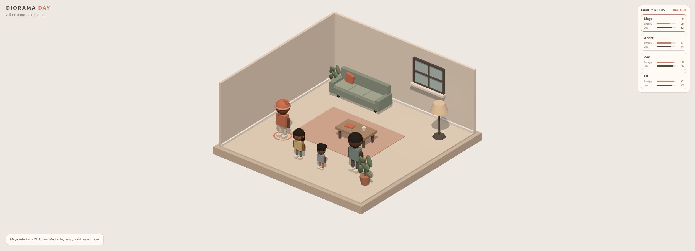

# csc35-diorama-day
单HTML房间样机；读过房壳/家具/程序角色、选择-移动-到达链、needs状态、昼夜光照和响应式镜头。角色只是几何骨架摆动，源代码不包含完整寻路或坐下接触。

## 案例档案

[来源仓库](https://github.com/agent-marsha/csc35-diorama-day)
分析版本：`aa88c6276e2d57f16e855245780bb83bea662721`

模型归属未独立认证。

## 初始源码审计边界

未运行、无本地截图；CSS只检查配色/小屏布局和可交互入口，没有逐条视觉验收。未验证键盘等价操作；核心移动明显是直线，没有碰撞/避障。作者模型归因仅作来源备注。

以下保留初始源码审计的观察范围。后续新增静帧独立列于视觉材料，不追溯证明全部机制或运行状态。

## 机制与案例分析

### [SD-DD01 · 用开口房壳与正交构图保持室内小物件可读](../cards/SD-DD01.md)

低复杂度房间靠清晰的层次、尺度和留空形成可读场景，正交投影减少近远大小变化，但必须主动处理墙遮挡。

背景#eee8e1、地板#eadfd3、墙#f2e9e1/#eee1d8、沙发#91a497、accent#d8755d贯穿抱枕/书/UI；植物深浅绿提供小范围对比。未找到本地截图，不把配色数值当实际画面验收。

**Movie：reference** · 适合单室微缩展示，透视叙事镜头不一定适用。
**前端：adapt** · 作为一个小型互动房间的构图草案，不替代当前写实Place。

失败条件：- 源码未限制azimuth，绕到后墙仍会遮挡
- 无自动bounds fit，15.2是本场景常数
- 所有roughness .9不能支撑写实材质差异
- 正交能缩小距离感也会削弱电影推镜深度

### [SD-DD02 · 把选中、走向、到达和物件响应连成可读动作链](../cards/SD-DD02.md)

点击物件后的反馈要有阶段：对象被选中、意图已接受、移动进行、到达后才执行；不让视觉动作和业务状态各说各话。

可借的是可读的操作状态与目标点；沙发“relax”仍是站在沙发前的小幅姿态，没有完整坐下接触。四个程序人物的发型/服色区别只是案例，不建议本站hIE改3D。

**Movie：reference** · 状态链可帮助组织可理解的短镜头，动作本身未观察。
**前端：adapt** · 可把同样逻辑用于2D hIE与现有物件交互，保留本站walkmask。

失败条件：- 原直线运动穿越家具，不能直接迁移
- index横向偏移不保证多人避碰
- 动作姿势长期停留，未定义完成/退出事件
- 6px阈值不完整处理多指/取消指针

### [SD-DD03 · 让窗色、环境光和局部灯共享昼夜状态而保留开关权](../cards/SD-DD03.md)

昼夜过渡需要可见的参照物一起变化，同时保持用户关灯具有持续效力；否则环境变化和交互状态互相覆盖。

冷蓝窗与背景退入夜色、暖#ffd9ac点光相对增强。太阳位置和颜色不随daylight移动，窗口roughness1是实色面，所以不能称天文太阳或真实窗外景观。

**Movie：adapt** · 可作为材质/光强统一状态原型，录制时直接锁daylight。
**前端：adapt** · 适合已有昼夜系统中明确用户开关与环境状态的组合。

失败条件：- 太阳方向不变，只是风格化状态混合
- 低帧率dt截断会使周期落后真实时间
- 没有reduce-motion/用户暂停时间入口
- 灯罩改色不是emissive，暗处可能与亮灯不一致

## 项目效果与观察材料

奶油色正交房间，低饱和绿沙发和陶土色地毯划分活动区；四个人物占据前部，需求面板留在右侧。

来源：[原作者/出处](https://github.com/agent-marsha/csc35-diorama-day) · local_head_still。本轮本地HEAD页面打开并开始后截图；未验证家具动作、寻路、持续状态与性能。

## 复用边界

- **status**：unknown
- **evidence**：仓内仅index.html，未找到README/LICENSE或许可证声明；Three经CDN用0.160.0，其MIT不自动授权该HTML作品
- **reuse**：idea_only

图片及第三方素材的权利单独保留；源代码许可证不自动授权媒体。
