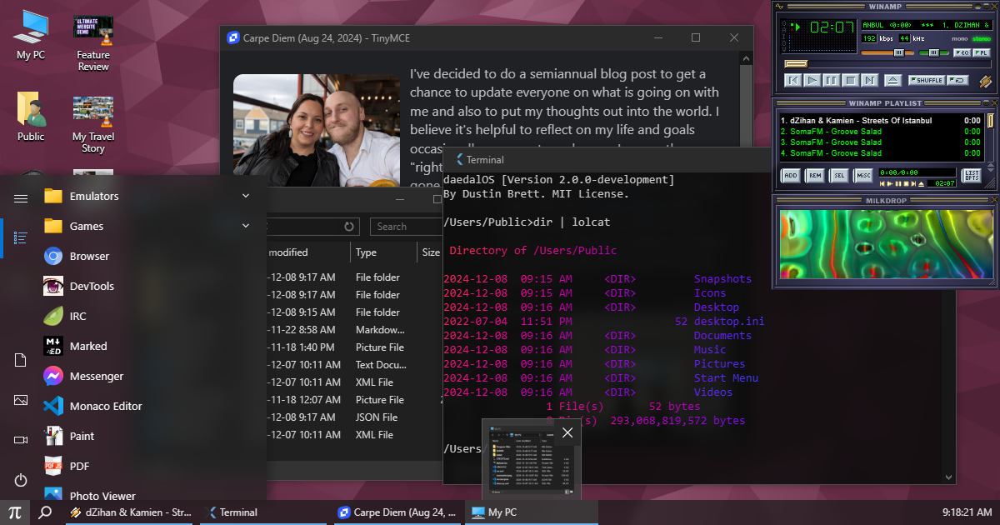

# daedalOS
实读窗口动画与焦点堆叠，历史截图显示多窗口/任务栏/播放器，不能证明本地当前交互。

## 案例档案

[来源仓库](https://github.com/DustinBrett/daedalOS)
分析版本：`f017b393d4175eb396a741a7562299423843f1b1`

模型归属未独立认证。

## 初始源码审计边界

未审虚拟文件系统或各应用；不移植整个桌面。

以下保留初始源码审计的观察范围。后续新增静帧独立列于视觉材料，不追溯证明全部机制或运行状态。

## 机制与案例分析

### [FM-017 · 让收起动画落在可恢复入口上](../cards/FM-017.md)

消失方向解释内容去了哪里，恢复时有清楚来源。历史静帧仅确认任务栏与窗口同时存在。

消失方向解释内容去了哪里，恢复时有清楚来源。历史静帧仅确认任务栏与窗口同时存在。

**Movie：reference** · 可用于片内UI状态示意
**前端：adapt** · 可用于手机收起/应用返回

失败条件：- 缩放后取错getBoundingClientRect导致二次位移
- 移动入口后隐藏窗口仍朝旧位置

### [FM-018 · 让视觉堆叠顺序跟随真实输入焦点](../cards/FM-018.md)

看起来在前面的窗口也应收到键盘输入，避免眼睛和操作对象分离。

看起来在前面的窗口也应收到键盘输入，避免眼睛和操作对象分离。

**Movie：defer** · 无互动成片不需此机制
**前端：adapt** · 手机+Galgame对话叠层有直接意义

失败条件：- 只改z-index不转focus
- 浮层预览抢走输入

## 项目效果与观察材料

view_image executed 2026-10-25; repository historical still only; not current runtime or motion evidence

来源：[原作者/出处](https://github.com/DustinBrett/daedalOS/blob/f017b393d4175eb396a741a7562299423843f1b1/public/screenshot.png) · observed_still。静帧观察；没有由此验证连续动画或性能。

## 复用边界

- **status**：observed
- **evidence**：LICENSE MIT；捆绑第三方应用/图标/皮肤须独立检查
- **reuse**：conditional

图片及第三方素材的权利单独保留；源代码许可证不自动授权媒体。
