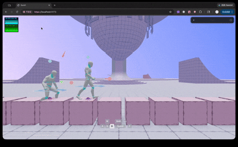

# ecctrl
当前仓已是 R3F9/Three r184+ 的模块化物理控制器；实读地面 ShapeCast、弹簧阻尼、动态 up 相机与动画状态解析。只提取接触反馈思路，不迁移整包或3D hIE。

## 案例档案

[来源仓库](https://github.com/pmndrs/ecctrl)
分析版本：`e2cab804f9f15661a642e76f52d09f0b2db63f35`

模型归属未独立认证。

## 初始源码审计边界

未读车辆/无人机/触屏编辑器、未跑动作或检查 montage。

以下保留初始源码审计的观察范围。后续新增静帧独立列于视觉材料，不追溯证明全部机制或运行状态。

## 机制与案例分析

### [SYS-002 · 以接触面而非单点决定踏步和落地反馈](../cards/SYS-002.md)

宽支撑探测能表达平台边缘和斜坡接触；是否改善 Citadel 的楼梯体验需要样机。

重点是经过台阶时镜头与接触的一致性，非人物外观；hIE继续2D。

**Movie：reference** · 只作为人物/视点接触演出的状态参考
**前端：reference** · 当前第一人称walk与floorY已有实现，先诊断台阶问题

失败条件：- 窄台阶被大半径探测架空
- 弹簧过硬造成镜头震动
- 着地状态抖动反复触发反馈

## 项目效果与观察材料

小型浏览器录屏静帧：两个浅色角色位于粉紫积木平台，背景有坡道和大球，保留调试面板与控件。

来源：本轮已观察的历史截图 · author_gif_extracted_still。仓内ShapeCast character GIF约1秒帧；只见角色/碰撞测试舞台，不能证明连续跨坎、弹簧稳定性或接触精度。

## 复用边界

- **status**：observed
- **evidence**：LICENSE:1-21 MIT；示例资产权利另查。
- **reuse**：direct_with_notice

图片及第三方素材的权利单独保留；源代码许可证不自动授权媒体。
