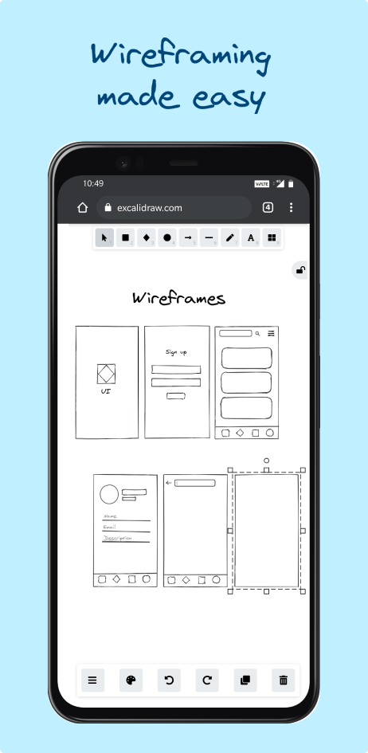

# excalidraw
实读rough形状选项、缓存和主题；查看wireframe历史静帧确认手绘边界与清晰结构，不把整站手绘作为建议。

## 案例档案

[来源仓库](https://github.com/excalidraw/excalidraw)
分析版本：`bee01e3a12812c930109aa91242658709480bbf3`

模型归属未独立认证。

## 初始源码审计边界

未读协作、编辑App或导出全流程；只提取局部风格机制。

以下保留初始源码审计的观察范围。后续新增静帧独立列于视觉材料，不追溯证明全部机制或运行状态。

## 领域分析

可用的手绘风格由“稳定的不规则内容”与“精确的操作框架”共同成立；不是让整站都看起来歪斜。

### 画面与证据

已看public/screenshots/wireframe.png历史静帧：内容边界有手绘感，但结构与工具区仍清楚。原图只能支持静态层级，不能证明协作、触控或缩放性能。

### 因果链

- 【源码】packages/element/src/shape.ts:170–227由元素seed稳定生成粗糙边界，小尺寸通过adjustRoughness减弱扰动，描边和填充纹理分别控制。
- 【源码】packages/excalidraw/css/theme.scss:24–50给工具浮岛独立底色与接触/近/远阴影，而非把工具绘进内容笔触。
- 【推论】稳定seed使一个对象在重绘前后仍是同一个对象；尺寸自适应避免小箭头变噪点。
- 【推论】工具浮岛的边界比画布内容更规整，建立“可操作工具”和“被操作内容”的不同权威层。

### 审美决策

- 随机性必须有身份；同一元素重绘不应换一组歪曲线。
- 精细工具和内容可以有不同材质语汇，但共享基本对齐与可辨轮廓。
- 手绘强度要按最终显示尺寸裁决，不用大图里好看的粗糙度覆盖小图标。

### 相邻方案

与每帧随机抖动相比，固定seed表达笔触而非生命动画；与全站手写字体/手绘按钮相比，它把风格主要留给内容，让工具维持操作精度。与玻璃浮层相比，工具分层靠实体底色和有限阴影完成。

### 迁移顺序

- 选一个需要草图语义的内容区，保持导航、表单和状态文字原有排版。
- 给对象生成稳定seed，再按最小展示尺寸降低粗糙度；独立裁决轮廓、填充和文字。
- 用同一对象两次渲染的像素或参数对照确认身份稳定，并在实际缩略尺寸看方向识别。
- 用窄屏、深浅内容背景检查工具浮岛不遮挡任务对象；不直接搬品牌紫色。

### 局限

原卡只覆盖形状与主题局部，未审全部App、协作和导出。历史图不是当前运行结果；稳定参数也不等于跨浏览器像素必然一致。

## 机制与案例分析

### [FM-021 · 让手绘扰动保持身份并按小尺寸减弱](../cards/FM-021.md)

手绘不是每帧乱抖；线条不完美但身份稳定，小图形降低扰动保证识别。

手绘不是每帧乱抖；线条不完美但身份稳定，小图形降低扰动保证识别。

**Movie：adapt** · 适合场景内纸条/白板叙事
**前端：reference** · 主手机导航不需手绘化

失败条件：- 随机seed每帧变化造成闪烁
- 小icon粗糙度过高变成污点

### [FM-022 · 给工作内容与工具浮岛保留不同的视觉层](../cards/FM-022.md)

历史图中工具条集中在边缘，中央画布保留工作对象；柔和层级不需大块玻璃。

历史图中工具条集中在边缘，中央画布保留工作对象；柔和层级不需大块玻璃。

**Movie：reference** · 适合制作工具而非剧情镜头
**前端：adapt** · 可改进照片模式工具栏

失败条件：- 阴影在暗底不可见
- 照搬紫色brand与项目不符

## 项目效果与观察材料

view_image executed 2026-10-25; repository historical still only; not current runtime or motion evidence

来源：[原作者/出处](https://github.com/excalidraw/excalidraw/blob/bee01e3a12812c930109aa91242658709480bbf3/public/screenshots/wireframe.png) · observed_still。静帧观察；没有由此验证连续动画或性能。

## 复用边界

- **status**：observed
- **evidence**：LICENSE MIT，字体单独许可须保留
- **reuse**：conditional

图片及第三方素材的权利单独保留；源代码许可证不自动授权媒体。
