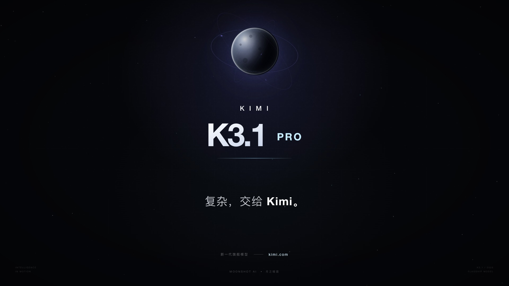

# kimi-k31pro-opus55-benchmark-showcase
双模型目录归档，14个作品入口、10个任务产物目录；7张海滩机制卡和3张电影/交互卡。作者归因为Kimi K3.1 Pro / Claude Opus 5.5，同题但未证明同预算，不做模型排名。

## 案例档案

[来源仓库](https://github.com/Zp-Peter/kimi-k31pro-opus55-benchmark-showcase)
分析版本：`65e82c53b63f2fdd918617269c057d8e53af2c6f`

模型归属未独立认证。

## 初始源码审计边界

已列全部14入口；两海滩核心深读，其他按台账抽样。未运行demo/电影，未测试交互、性能、构建和跨浏览器。未穷尽游戏world/AI/碰撞、所有电影shot、vendor与dist。主agent补充3张在线现场截图已实际复看；证据只达still_observed，不能据此证明时序衰减、AO成因或当前HEAD对应在线部署。

以下保留初始源码审计的观察范围。后续新增静帧独立列于视觉材料，不追溯证明全部机制或运行状态。

## 领域分析

两份黑沙滩提供互补解法：形体层级建立地貌，退水后的材质时间差建立近景。

### 画面与证据

已查看在线截图kimi-beach-live/columns-live及opus-beach-overcast/golden-live：Kimi全景有左侧大衬线标题、右侧深黑崖与灰雾白浪带；近景柱高错落，但崖体仍有块状感、暗部细节被压住。Opus默认画面中S形湿沙带通向远礁；切黄金时刻后天空转暖，太阳沿礁边出现，水与湿沙反光呼应。这是特定在线帧和操作结果，未关联到本地HEAD。

### 因果链

- 源码事实：Kimi的42块大石含8固定锚点，1550小石分布中1100在近区，另有5个远海蚀柱；不同尺度服务不同距离，而不是均匀随机填满（KIM-007）。
- 源码事实：Opus玄武柱依邻高设置层段和裂隙；间隙.022–.042、倒角.045–.115及深度AO产生面与缝的区别（KIM-003）。推论：近景可增加柱体识别，但过暗AO会反而抹掉体积。
- 源码事实：退水后薄膜exp(-since/4.5)与湿暗exp(-since/30)分别变化；水/湿沙共享半分辨率平面反射，湿沙再用roughness与边缘衰减筛选（KIM-002/006）。

### 审美决策

- 黑色材料仍需要能分辨的转折；黑不能成为缺失造型的掩护。
- 固定远景锚点，给近景接触与材料留下空间；网页文字与电影画面分别裁决。
- 退水后先失去镜面、再慢慢变干，比单一湿mask更能说明时间。

### 相邻方案

电影优先做一个退潮近景接远礁的镜头；前端优先迁双时钟湿材质和稳定地标层级。共享平面反射仅适合近似共面的水/湿岸；多层水体或大坡面应另选局部反射方案。

### 迁移顺序

- 先保留原场景与岸线，标出英雄海蚀柱、巨石与近石三层；不要先加小石总数。
- 在同一块沙上实现4.5/30秒两通道，锁曝光观察退水四时刻，数值再按本场景节奏调整。
- 把水和湿沙反射对齐后检查断缝、屏幕边缘和剔除层；在阴天/黄金时刻复测，避免用整体增亮掩盖黑柱造型。

### 局限

无LICENSE，只借思路并重写。模型名为作者归因；同题不等于同预算，不能据此排名。已有14个子作品入口台账，本文重点仅两海滩；KIM-001泡沫带与Citadel已有机制重叠，不列首要新增。

## 机制与案例分析

### [KIM-001 · 让泡沫带沿共享岸线分批推进](../cards/KIM-001.md)

把边界现象绑定到同一空间函数。本卡是单仓候选，效果判断仍需样机。

灰青泡沫(.46,.53,.54)混至偏暖白(.9,.93,.89)，远处150–340淡出，避免宽白胶带。

**Movie：reference** · 仅作更简单远岸实现对照，先保留已有Beach效果
**前端：reference** · Beach已有同类共享岸线和错相泡沫，六条独立带不是明确升级

失败条件：- 泡沫未与水波真实相位耦合
- 每16单位周期重置仍可能跳接
- 浅滩坡度变化时平面带浮空

### [KIM-002 · 用退潮时刻分别衰减湿暗和薄膜高光](../cards/KIM-002.md)

给同一事件的不同材质反应设置不同恢复时钟。本卡是单仓候选，效果判断仍需样机。

沙粒底色约(.05,.051,.055)，浸湿暗化但镜面薄膜更快消失；避免整片沙滩永远塑料亮。

**Movie：prototype** · 潮退近景可明确读出时间层次
**前端：adapt** · 交互海岸局部启用

失败条件：- 仅保留4波并非任意长历史
- 反序GLSL smoothstep需改写为1−smoothstep正序
- 大量重叠波max会形成不连续

### [KIM-003 · 按邻柱高度雕出玄武岩裂隙与台阶](../cards/KIM-003.md)

用相邻几何关系生成接触深度。本卡是单仓候选，效果判断仍需样机。

宏观阶梯、五至七边形柱簇、窄裂缝和小倒角分工；顶端高光与侧缝暗部建立尺度。

**Movie：prototype** · 横移近景可看缝隙和倒角
**前端：adapt** · 固化几何后可用

失败条件：- AO不是物理遮蔽
- 邻柱world ground高度不同需复核相对高度
- 规则格或均匀seed会露重复

### [KIM-004 · 让碎石脚印共同写入一张沙地接触图](../cards/KIM-004.md)

把静态接触证据写回承载面。本卡是单仓候选，效果判断仍需样机。

石头不靠独立黑圆片悬浮贴图，接触暗部由底面采样统一处理。

**Movie：adapt** · 静物和远中景岸滩
**前端：prototype** · 可先在一小块沙地验证

失败条件：- 移动石块会留下旧影
- 直接漫反射也被压暗，可能过度遮光
- 0.25m图对微小石粒不足

### [KIM-005 · 先看得见再增加沙粒闪烁和风纹](../cards/KIM-005.md)

让微细纹理随投影尺度退出。本卡是单仓候选，效果判断仍需样机。

黑沙细节靠局部矿粒亮点，而非整体金属化；远景退回稳定色块。

**Movie：adapt** · 近景慢推需要时域检查
**前端：reference** · 仅近摄可见时值得实现

失败条件：- 源码闪点主要距离门控，未直接覆盖每粒pixel footprint
- 反序smoothstep(.32,.08,...)需正序改写
- pow700仍可能alias

### [KIM-006 · 让海水与湿沙共享同一份被筛选的平面反射](../cards/KIM-006.md)

把相邻表面的反射来源保持一致。本卡是单仓候选，效果判断仍需样机。

反射对象一致可以让水岸边界读起来连续；在线阴天截图可见湿沙与海水均有地标反射，但共享RT因果仍来自源码。

**Movie：adapt** · 同平面水岸一镜内有价值
**前端：defer** · 先确认现有反射足够且多表面成本确实存在

失败条件：- 非平面海滩会投影错位
- 递归反射和状态恢复需防护
- 源码部分edge smoothstep反序

### [KIM-007 · 用确定性大中小形体约束散布层级](../cards/KIM-007.md)

先固定叙事地标再随机补细节。本卡是单仓候选，效果判断仍需样机。

宏观剪影负责构图，中景巨石形成视觉路径，微石粒提供尺度；随机只填充设计留下的空间。

**Movie：adapt** · 固定镜头尤其容易验证层级
**前端：adapt** · 多视角需额外碰撞/轮廓检查

失败条件：- 散布未做完整碰撞检测
- 近景多面体轮廓过硬
- 海蚀柱固定重叠只适合预设视角

### [KIM-008 · 把镜头局部时间与快门采样分开](../cards/KIM-008.md)

以可寻址时间驱动电影状态。本卡是单仓候选，效果判断仍需样机。

已看keyframes.jpg：蓝黑底冷白标题、能力图形、短段洋红强度表；接触表仅证明静帧构图，不证明运镜顺滑或片中参数宣传真实。

**Movie：prototype** · 导出电影的可复现剪辑与真实子帧模糊
**前端：defer** · 实时交互用1sample，不复制8–12倍成本

失败条件：- 若update累加状态，倒放/重复采样不确定
- 一个时刻>2活动entry被忽略
- 输出高帧成本不宜实时照搬

### [KIM-009 · 让昼夜切换同时改文案、环境光和装饰角色](../cards/KIM-009.md)

让交互状态在信息和场景中同义表达。本卡是单仓候选，效果判断仍需样机。

日间#f7f0e3/#23302a/#2f6b4f，夜间#0f1630/#f3ecdf，露营火光由背景变主角。

**Movie：reference** · 可以作为章节昼夜过渡
**前端：prototype** · 商品/场景信息卡适用；需中断恢复和减少动态

失败条件：- 快速连点会叠加GSAP rotation和文案回调
- CSS reduced-motion没有自动停JS tween
- 未运行，未验证对比度

### [KIM-010 · 用速度和动作状态控制追随距离而非固定震屏](../cards/KIM-010.md)

把运动反馈拆成视距、前瞻和微震。本卡是单仓候选，效果判断仍需样机。

速度主要通过前瞻/距离/FOV表达，震动只在boost或越界时短暂参与。

**Movie：reference** · 用于可控追逐段
**前端：adapt** · 适合竞速/移动载具，不适合读卡时相机

失败条件：- reduceMotion仍未关闭动态FOV
- 高速拐角前瞻可能越墙
- 固定参数按本场景尺寸，不直接复制到步行场景

## 项目效果与观察材料

已查看的来源静帧；不证明当前版本运行。

来源：[原作者/出处](https://github.com/Zp-Peter/kimi-k31pro-opus55-benchmark-showcase/blob/65e82c53b63f2fdd918617269c057d8e53af2c6f/opus/kimi-k3.1-promo/out/keyframes.jpg) · historical_still_viewed。静帧观察；没有由此验证连续动画或性能。

已查看的来源静帧；不证明当前版本运行。

来源：[原作者/出处](https://github.com/Zp-Peter/kimi-k31pro-opus55-benchmark-showcase/blob/65e82c53b63f2fdd918617269c057d8e53af2c6f/kimi/kimi-k3.1-film/dist/Kimi-K3.1-Pro-Poster.jpg) · historical_still_viewed。静帧观察；没有由此验证连续动画或性能。

全景：大衬线文字、黑柱壁剪影、远礁、灰雾和白浪带

来源：[原作者/出处](https://zp-peter.github.io/kimi-k31pro-opus55-benchmark-showcase/kimi/iceland-black-sand/dist/index.html) · live_still_observed。主agent从已登录Chrome在线站点获取，本agent实际view_image复看；非本地HEAD运行、非运动/性能验收。

柱岩机位：高度错落、柱面暗缝；山体轮廓较块状

来源：[原作者/出处](https://zp-peter.github.io/kimi-k31pro-opus55-benchmark-showcase/kimi/iceland-black-sand/dist/index.html) · live_still_observed。主agent从已登录Chrome在线站点获取，本agent实际view_image复看；非本地HEAD运行、非运动/性能验收。

阴天：S形湿沙反射带、分层柱壁、细小HUD

来源：[原作者/出处](https://zp-peter.github.io/kimi-k31pro-opus55-benchmark-showcase/opus/reynisfjara/index.html) · live_still_observed。主agent从已登录Chrome在线站点获取，本agent实际view_image复看；非本地HEAD运行、非运动/性能验收。

黄金时刻现场截图：暖米色天空/雾、海蚀柱旁太阳与水/湿沙反光相呼应。

来源：[原作者/出处](https://zp-peter.github.io/kimi-k31pro-opus55-benchmark-showcase/opus/reynisfjara/index.html) · live_still_observed。主agent点击按钮后抓取，本agent复看；非本地HEAD或动态性能验收。

## 复用边界

- **status**：unknown
- **evidence**：全仓文件名扫描未发现LICENSE；README:41要求第三方依赖/素材沿原授权，Kimi官方视频仅引用。
- **reuse**：idea_only

图片及第三方素材的权利单独保留；源代码许可证不自动授权媒体。
