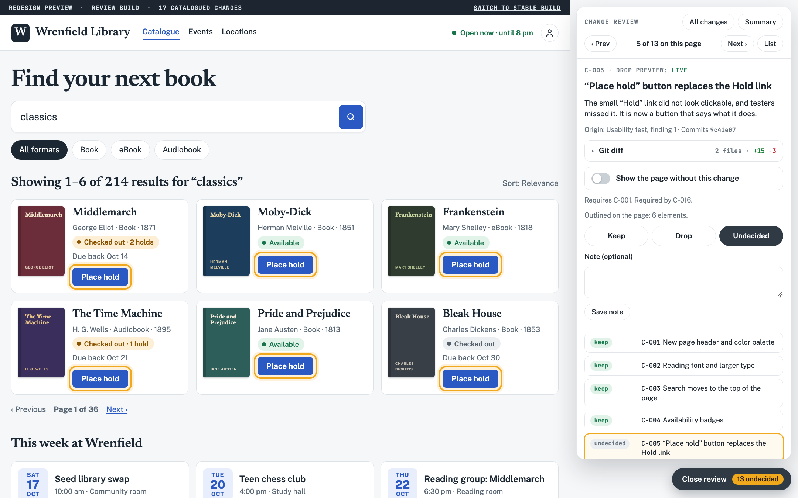

# line-item-review
Opus5.5归因为作者README声明。实读17项虚构变更的CSS class切换、评审tray与localStorage；实看review-tray与c006-without历史图。仓库是可工作的浏览器交互演示，mock git diff/虚构catalogue/服务器重建仍是说明，不是已实现集成系统；未发现LICENSE。

## 案例档案

[来源仓库](https://github.com/pshankinclarke/line-item-review)
分析版本：`c4e995a2e36033eb9f33a6a6b42636882b4aa819`

模型归属未独立认证。

## 初始源码审计边界

未运行或读完全部mock diff；不验证README外部两App的统计，不执行重建/提交/安装。

以下保留初始源码审计的观察范围。后续新增静帧独立列于视觉材料，不追溯证明全部机制或运行状态。

## 领域分析

设计评审界面的价值在于提供可定位、可逆的反事实比较，并把“试着拿掉”与“最终拒绝”保持为不同动作。

### 画面与证据

已看docs/shots/review-tray.png与c006-without.png历史静帧：变更列表与原画面并存，多处按钮可一起被框出；C006临时关闭后表格结构回来，而其他新版字体与按钮仍保留。这支持局部比较的读法，不证明服务端重建或Git裁决已经实现。

### 因果链

- 【源码】docs/demo/index.html:988–1005用变更ID匹配data-ch并描边，视口外对象滚入视野；getClientRects只证明有布局矩形，不能排除opacity:0或visibility:hidden。
- 【源码】897–908、1008–1013区分S.without临时预览与S.decisions最终选择，应用时两者都影响CSS，但数据来源不同。
- 【源码】758–777只在无URL decide参数且存储可用时持久化decisions/notes，临时预览不作为最终决定保存。
- 【源码】889–895、929–960检查依赖并产出计划；695–710、903–911为不能靠视觉判断的项说明其他验证。此处不执行Git或真实重建。
- 【推论】评审可以追问“这一项到底改善了什么”，而不是靠整个新版的总体好感投票。

### 审美决策

- 高亮框解释变化范围；裁决时必须能关掉框，避免覆盖层本身改变美感判断。
- 一张卡尽量对应一个可解释操作，但多对象的同一操作应一起标出，不能拆成虚假独立收益。
- 需要运行证据的改动保留文字验证入口；没有视觉变化不等于无价值。

### 相邻方案

与全页before/after相比，局部without更有利于定位机制，但共享灯光/版式的耦合可能使“单变量”不成立；与代码diff相比，先给出画面作用范围，但仍需回到实现与依赖。它是浏览器评审demo，不能包装为完整审核后端。

### 迁移顺序

- 先给每张设计卡附对象ID、视角与变化范围；前端用selector，3D用对象ID或mask。
- 分别实现临时预览、最终裁决和保存状态，文案明确它们的生效范围。
- 为键盘焦点、运动、碰撞、性能等非静态项指定独立证据要求。
- 检查依赖冲突和循环，再看保留组合的整体结果；产出计划不标记为已施工完成。

### 局限

没有LICENSE正文，当前idea_only。mock diff、虚构catalogue与服务器流程不得当真实集成证据；本轮未运行demo。planOrder未见明确循环诊断，迁移必须补验。

## 机制与案例分析

### [NF-005 · 让每项视觉变更在原画面中有可定位的边界](../cards/NF-005.md)

评审从抽象“更好看”落到画面中的一组对象；历史图同时框出六个被改按钮，说明变更可影响多个位置。

评审从抽象“更好看”落到画面中的一组对象；历史图同时框出六个被改按钮，说明变更可影响多个位置。

**Movie：prototype** · 可用于场景打磨评审工具，非成片效果
**前端：prototype** · 前端打磨审阅直接适配

失败条件：- 只框到DOM不含shader改变
- 高亮遮住细节改变判断
- getClientRects不能排除visibility:hidden或opacity:0；需另核真实可见性

### [NF-006 · 把临时去除效果与最终拒绝决定分开保存](../cards/NF-006.md)

先做单变量反事实比较，再决定是否保留；用户可以试关而不意外作出最终裁决。历史图C006切回表格，其他字体与按钮仍保持新版。

先做单变量反事实比较，再决定是否保留；用户可以试关而不意外作出最终裁决。历史图C006切回表格，其他字体与按钮仍保持新版。

**Movie：prototype** · 灯光/雾/材质开关可做镜头A/B
**前端：prototype** · 适合逐项UI设计裁决

失败条件：- 共享材质/灯光依赖导致不是单变量
- localStorage保存被误称服务端已同步

### [NF-007 · 对无法靠静帧裁决的变更明确写出替代验证](../cards/NF-007.md)

电影/前端卡需要各自证据层：静态美术、动画、交互和运行是不同裁决对象。

电影/前端卡需要各自证据层：静态美术、动画、交互和运行是不同裁决对象。

**Movie：adapt** · 运动连续性必须影片，静帧不足
**前端：prototype** · 前端状态和辅助功能必须动作验证

失败条件：- 把场景FPS/碰撞修改只用美图验收
- demo声称服务器项但本仓没有服务器实现

### [NF-008 · 在逐项保留决定之间显式检查依赖](../cards/NF-008.md)

多个好改动的组合可能不成立，灯光依赖材质、文字依赖版式，需要组合层复审；逐项多数票不是最终场景验收。

多个好改动的组合可能不成立，灯光依赖材质、文字依赖版式，需要组合层复审；逐项多数票不是最终场景验收。

**Movie：adapt** · 适用于场景施工包裁决
**前端：adapt** · 适用于手机布局/状态变更包

失败条件：- 源码planOrder没显式环诊断
- 把生成重建计划当已重建并通过

## 项目效果与观察材料

view_image executed 2026-10-25; repository historical still only; not current runtime or motion evidence

来源：[原作者/出处](https://github.com/pshankinclarke/line-item-review/blob/c4e995a2e36033eb9f33a6a6b42636882b4aa819/docs/shots/review-tray.png) · observed_still。静帧观察；没有由此验证连续动画或性能。

view_image executed 2026-10-25; repository historical still only; not current runtime or motion evidence

来源：[原作者/出处](https://github.com/pshankinclarke/line-item-review/blob/c4e995a2e36033eb9f33a6a6b42636882b4aa819/docs/shots/c006-without.png) · observed_still。静帧观察；没有由此验证连续动画或性能。

## 复用边界

- **status**：unknown
- **evidence**：顶层没有LICENSE，README未给明确授权；只借机制
- **reuse**：idea_only

图片及第三方素材的权利单独保留；源代码许可证不自动授权媒体。
