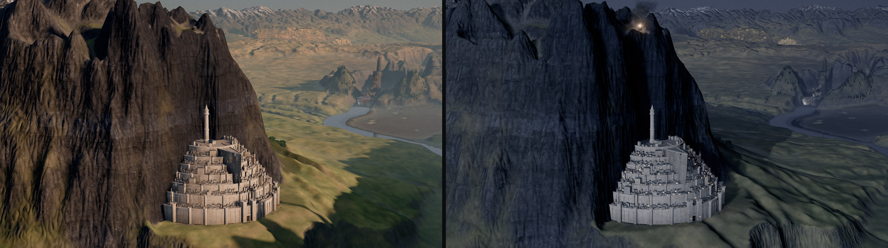

# map-of-middle-earth
共享世界状态、地标声明、无历史特效与电影轨道组成的WebGPU中土模型。提取5个机制分支；这是读源码与历史静图的迁移建议，不认证作者运行与画质宣称。

## 案例档案

[来源仓库](https://github.com/earthwalker17/map-of-middle-earth)
分析版本：`696e968e9d550327beda9e663ef5aec6961583c9`

已查README与PROJECT_STATE只见Claude Code工作流痕迹，未找到具体模型版本可核记录；归属unknown，不作为Opus5.5或K3.1性能案例。

## 初始源码审计边界

未运行、安装、bake、抓帧或看视频；GIS及baked世界不在仓内，当前克隆无法据此宣称可直接启动完整世界。24个地标仅lake-town核心布局/造型片段深读，其余登记目录并未逐地标逆向。未穷尽terrain材质、河流烘焙、乐谱和Argonath Blender生成链。未发现原始PROMPT文件；CLAUDE.md是项目约定，不等于完整原始提示词。

以下保留初始源码审计的观察范围。后续新增静帧独立列于视觉材料，不追溯证明全部机制或运行状态。

## 领域分析

聚落先有交通与结构，再有密度；城市镜头先保留整体可读性，再选择少量光学强调。

### 画面与证据

已实际查看docs/images/lake-town.jpg与pair-minas-tirith.jpg：湖镇屋顶聚集在薄甲板与桩上，前景水面亮、后山暗，部分建筑细节仍因背光难读；米那斯提力斯日夜对照中的层层白墙与塔依山展开，远处地形仍可辨。图像支持构图/轮廓阅读，不能证明轨道或昼夜切换运行正确。

### 因果链

- 源码事实：湖镇先生成连续边界，扣除水道，给街区±5–10度偏转并留市场；放建筑检查中心与四角，薄甲板/桩说明承托（layout.ts:49–149、index.ts:18–90、181–258）。
- 源码事实：灯体、表面spill、空气halo、水面glint共用事件状态；最多8个spill、preview4，缺少真实遮挡。因果统一有价值，但可穿墙的近似仍需修补。
- 源码事实：lens.ts默认f/22深焦，样本数至少8才启用镜头；CoC直径上限画高.003，焦平面通过视窗补偿维持位置（20–52、72–106）。这是优先保护地标层级的控制，而非越虚越电影。

### 审美决策

- 大密度建立在连续地块、通道与支撑上；水道与市场属于造型的一部分。
- 日夜都要能读出主地标，避免夜景只剩灯点或白墙全部过曝。
- 先让世界尺度成立，再局部用景深；保留大场景的深焦并不缺少电影感。

### 相邻方案

电影可先制作一个湖镇街区与两机位，而不是重建整张地图；前端可迁通道约束与共享灯事件。已有点光源能解释照明时，无需立即搬TSL spill或WebGPU管线。

### 迁移顺序

- 以现有资产重排一块街区，固定镜头比较散点布局与水道/广场优先布局。
- 选一个灯事件核查灯体、地面、空气和水同步，另用背墙专测漏光。
- 建立深焦基线，再试小CoC；轨道逐时刻检查遮挡与净空，不能只看起终帧。

### 局限

代码MIT，docs图片/影片/配乐及GIS资产不统一随代码授权。克隆缺少完整baked世界，本轮未运行；建筑有展示尺度夸张，五点足迹检查不是严格几何求交，轨道平滑不是完整碰撞保证。

## 机制与案例分析

### [MOME-001 · 用连续地块、交通留白和分区偏转组织聚落，避免散落玩具盒](../cards/MOME-001.md)

实际lake-town.jpg能看到薄甲板下桩、密集屋脊和成片城镇轮廓；大面积背光仍压暗细部，不能仅凭高密度称其已达电影品质。把主街/水道与广场作为负空间，随机性局限在街区内部。

实际lake-town.jpg能看到薄甲板下桩、密集屋脊和成片城镇轮廓；大面积背光仍压暗细部，不能仅凭高密度称其已达电影品质。把主街/水道与广场作为负空间，随机性局限在街区内部。

**Movie：prototype** · 一段街区即可测试轮廓与通道的可读性。
**前端：adapt** · 需补完整足迹/可走空间检查与多方向照明。

失败条件：- 五点足迹检测可能漏细窄通道或凹边交叉
- 以英雄机位分配灯窗会让背面显空
- 本仓建筑人为约9倍展示尺度，不能搬成真实城市尺寸

### [MOME-002 · 让同一发光事件同时改变灯体、受光面、空气和水面](../cards/MOME-002.md)

mount-doom历史图有暖岩浆与烟底红光、冷灰远山，灯体与环境颜色相互解释。代码把控制通道统一，减少只有发光贴片没有邻近受光的漂浮感；静图不能确认事件切换正确。

mount-doom历史图有暖岩浆与烟底红光、冷灰远山，灯体与环境颜色相互解释。代码把控制通道统一，减少只有发光贴片没有邻近受光的漂浮感；静图不能确认事件切换正确。

**Movie：prototype** · 在一处信号灯/火源检验环境反馈即可。
**前端：adapt** · 需保留自由走动时的遮挡与选光稳定性，不搬整套WebGPU渲染器。

失败条件：- 该spill没有真实遮挡阴影，会穿墙漏光
- 灯数筛选是近似，英雄光应单独核对
- CPU/GPU公式后续改动可能漂移

### [MOME-003 · 以粒子年龄闭式求值保留烟羽形态，同时支持任意帧重放](../cards/MOME-003.md)

mount-doom图显示暗烟柱、顶部大范围烟团和熔岩亮核。机制不是随机透明球堆：烟柱升高、扩散、顺风、顶棚合并各有阶段；重放能力由代码结构支持但本轮未验随机帧像素一致。

mount-doom图显示暗烟柱、顶部大范围烟团和熔岩亮核。机制不是随机透明球堆：烟柱升高、扩散、顺风、顶棚合并各有阶段；重放能力由代码结构支持但本轮未验随机帧像素一致。

**Movie：prototype** · 适合离线随机帧、补帧和快门采样，也便于A/B。
**前端：adapt** · 暂停恢复/拖时间可用；用户控制风时需过渡或重新定义局部时钟。

失败条件：- 循环年龄重置处淡出不足会跳变
- 实时骤变风向会整体瞬移，因为无历史惯性
- 不适合要求精确碰撞/流体守恒的物理烟

### [MOME-004 · 把地形跟随和净空约束做成平滑安全轨道，再叠加审美运镜](../cards/MOME-004.md)

与Athenaion的参考构图小幅平移相比，本仓明确把跨山/跨水高度当作轨道输入。它是宏观地形安全机制，不是几何全碰撞保证，连续帧仍需抽检。

与Athenaion的参考构图小幅平移相比，本仓明确把跨山/跨水高度当作轨道输入。它是宏观地形安全机制，不是几何全碰撞保证，连续帧仍需抽检。

**Movie：prototype** · 一段跨越地形的长镜头最适合验证，补足ATH-005的路径限制。
**前端：adapt** · 适用于预设旅游镜头；不能替代自由相机实时碰撞。

失败条件：- 只测地形水面，不自动避开高楼、桥底、树和巨像
- 5点空间/96Hz时间采样可能漏窄尖峰
- 高斯平滑不构成严格净空数学证明
- 抬升相机可能破坏已审核构图

### [MOME-005 · 把景深限制为画幅的小比例，保留微缩世界的结构尺度](../cards/MOME-005.md)

历史米那斯提力斯日夜对照保留了城墙层级、远山和河流，不靠大幅虚化制造微缩感。本实现孔径按取景距离缩放，是屏幕尺度一致的美术镜头形式；代码注释“physically exact”不能外推成固定真实相机标定。

历史米那斯提力斯日夜对照保留了城墙层级、远山和河流，不靠大幅虚化制造微缩感。本实现孔径按取景距离缩放，是屏幕尺度一致的美术镜头形式；代码注释“physically exact”不能外推成固定真实相机标定。

**Movie：adapt** · 适合少量英雄近景；先检查当前movie是否已有同等镜头功能。
**前端：defer** · 互动前端本轮以模型/材质优先，不引入多样本离线累积。

失败条件：- 过少采样产生斑点
- 画幅/焦距改变后同数值未必符合美术目标
- 直接搬实时积累会延迟交互反馈

## 项目效果与观察材料

已查看的来源静帧；不证明当前版本运行。

来源：[原作者/出处](https://github.com/earthwalker17/map-of-middle-earth/blob/696e968e9d550327beda9e663ef5aec6961583c9/docs/images/lake-town.jpg) · historical_still_viewed。静帧观察；没有由此验证连续动画或性能。

已查看的来源静帧；不证明当前版本运行。

来源：[原作者/出处](https://github.com/earthwalker17/map-of-middle-earth/blob/696e968e9d550327beda9e663ef5aec6961583c9/docs/images/mount-doom.jpg) · historical_still_viewed。静帧观察；没有由此验证连续动画或性能。

已查看的来源静帧；不证明当前版本运行。

来源：[原作者/出处](https://github.com/earthwalker17/map-of-middle-earth/blob/696e968e9d550327beda9e663ef5aec6961583c9/docs/images/pair-minas-tirith.jpg) · historical_still_viewed。静帧观察；没有由此验证连续动画或性能。

## 复用边界

- **status**：observed
- **evidence**：LICENSE:1-21代码MIT，CREDITS:48-58原始模型标MIT；字体OFL，外取PolyHaven纹理CC0；CREDITS:60-106明确GIS来源条款/DEM许可未明，docs/images与影片配乐没有复用许可。只迁移代码机制与重新创作，不把图/影片/GIS当MIT资产。
- **reuse**：conditional

图片及第三方素材的权利单独保留；源代码许可证不自动授权媒体。
