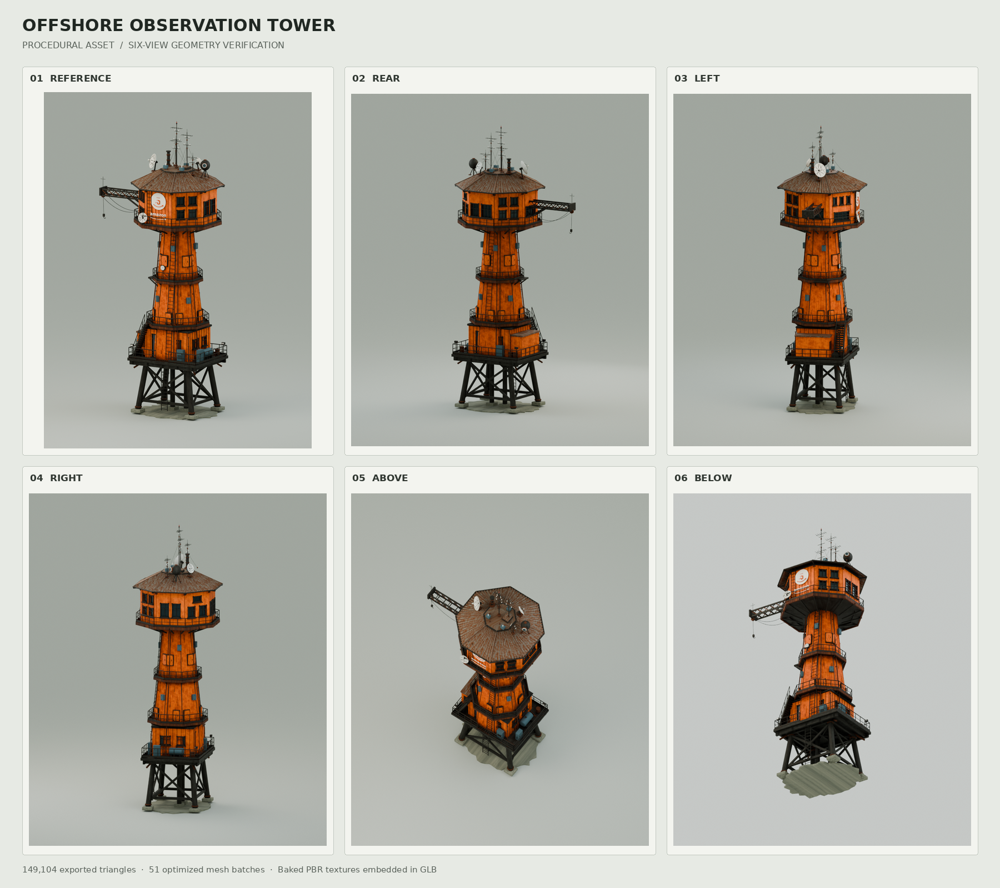

# offshore-tower
塔楼程序源、PBR烘焙、装配导出、网页查看四段已读；根生成器与app/tools副本hash相同，根GLB与app/public副本hash相同。只读解析GLB结构与manifest数量一致。

## 案例档案

[来源仓库](https://github.com/thebuggeddev/offshore-tower)
分析版本：`3a67f5ea7aec7955aaa7a576e8d772832add4afe`

模型归属未独立认证。

## 初始源码审计边界

未逐行审屋顶全部波纹、天线/碟形接收器/吊臂全套生成、utility屋内、字体来源；未运行生成器/网页/测试。作者浏览器测试声明未经本轮复现；模型/模型生成归因只按来源自述。

以下保留初始源码审计的观察范围。后续新增静帧独立列于视觉材料，不追溯证明全部机制或运行状态。

## 机制与案例分析

### [SD-OT01 · 让主轮廓同时约束外板、接缝、开口与附属结构](../cards/SD-OT01.md)

模型打磨首先使主次构件彼此对得上；以少量真实结构数据派生细节，比逐个摆装饰件更不容易悬空或错位。

玻璃相对center后退.035，外框前出.105，窗台再前出.035，形成厚度而非黑色贴方块。看过六视图拼图：橙色塔身收分、深色平台与架腿分层，背面亦有窗和设备，底视图可见斜撑。

**Movie：prototype** · 适合现有hero建筑从特写到远景的结构连续性打磨。
**前端：reference** · 方法可自写，源仓未找到许可，不能直接搬生成器/GLB。

失败条件：- 几何波纹远处可能产生闪烁
- boolean与solidify须在导出后检查
- 微细螺栓不该替代主轮廓质量
- 源模型含品牌标记，不能直接把标记带到本站

### [SD-OT02 · 把程序材质变成可携带的颜色、粗糙度和法线资产](../cards/SD-OT02.md)

程序节点在制作软件里成立还不够；把设计关系转成明确贴图通道，网页才能保留同一材质意图。

橙钢#48251A/#B54814/#EB6D1C/#F58C3B，roughness .5–.84/metal .28；深钢metal .78，锈接缝roughness .72–.96，基础盐蚀混凝土.84–.98。灰绿背景中橙塔成为焦点，深骨架保留层次。ORM名字不意味着烘过AO，此处O恒1。

**Movie：adapt** · 适合保证Blender素材向电影预览的材质可携带性。
**前端：adapt** · 提取通道约定与验证办法，不迁移r180 TSL管线。

失败条件：- np.roll只包裹法线差分，不证明底色/高度贴图天然无缝
- 贴图名ORM不能当AO存在证明
- 常数metal仍是艺术参数，不代表锈层物理混合
- TSL fromMaterial和本站r170不直接兼容

### [SD-OT03 · 保留编辑部件，只按装配与材质生成网页交付批次](../cards/SD-OT03.md)

美术源文件需要细部件可改，网页资产需要一致的落地几何；两种需求通过独立导出副本衔接。

批次保持基础/塔身/屋顶/通信/吊臂等装配可追踪；manifest的111080是导出modifier前基础网格数，不应拿它当最终渲染三角数。当前检查只确认资产结构，未执行Blender或渲染。

**Movie：adapt** · 多视角电影镜头可复用同一交付模型，源部件仍便于返工。
**前端：reference** · 当前性能后置；先保留交付一致性，再根据实际场景决定是否合批。

失败条件：- join后丢单螺栓/窗扇拾取粒度
- 当前脚本只取material_slots[0]，不能泛化到多材质对象
- 无动画导出不适用于活动门和角色
- mesh.data.validate不是视觉验收

### [SD-OT04 · 用正反俯仰和线框检验资产，并给渲染失败保留真实预览](../cards/SD-OT04.md)

单个漂亮正面不证明资产完整；查看入口应同时提供结构检查、相机复位和真实的载入失败状态。

六视图拼图已实际查看：背面窗组不同、上下平台、楼梯、吊臂与底部交叉撑均有几何；仍不能由小图确认每个窗口接缝。网页使用35°透视，离线为正交，因此两者并非像素等价验收。

**Movie：adapt** · 作为镜头覆盖和资产检查清单，先确定各角度都有足够设计。
**前端：adapt** · 采用有含义的静态fallback与独立线框/复位；不用本仓完整viewer替换本站。

失败条件：- README宣称浏览器测试通过属于作者报告，本轮未复现
- 离线与网页光照/投影不同不能逐像素比较
- 合批后线框很多不代表结构正确
- 源仓许可未知不能搬poster

## 项目效果与观察材料

已view_image Tower_Verification_Views.png六视图拼图：橙色收分塔、深骨架、多层维护平台、后侧窗组、底部交叉支撑、顶部天线与吊臂。历史离线渲染，不是当前网页截图或实时性能证据。

来源：[原作者/出处](https://github.com/thebuggeddev/offshore-tower/blob/3a67f5ea7aec7955aaa7a576e8d772832add4afe/Tower_Verification_Views.png) · observed_still。静帧观察；没有由此验证连续动画或性能。

## 复用边界

- **status**：unknown
- **evidence**：根目录及app未找到LICENSE，package未声明license；README“全程序生成、无外部素材”不是复用授权，模型含可见品牌标记
- **reuse**：idea_only

图片及第三方素材的权利单独保留；源代码许可证不自动授权媒体。
