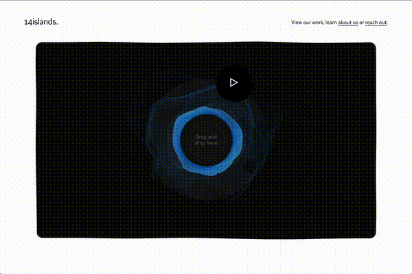

# r3f-scroll-rig
实读DOM跟踪、单场景裁剪、sticky三阶段与图像uniform，不把基础库本身称为美术升级。

## 案例档案

[来源仓库](https://github.com/14islands/r3f-scroll-rig)
分析版本：`123663599e4b31af56f1845a19132d17e6a9b81f`

模型归属未独立认证。

## 初始源码审计边界

未深读useTracker/GlobalRenderer算法，未验证现有依赖版本与浏览器；不整包迁移。

以下保留初始源码审计的观察范围。后续新增静帧独立列于视觉材料，不追溯证明全部机制或运行状态。

## 机制与案例分析

### [FM-009 · 让DOM布局成为WebGL装饰的唯一位置基准](../cards/FM-009.md)

HTML承担排版与入口，WebGL随内容移动；屏幕缩放后不再维护两套坐标。

HTML承担排版与入口，WebGL随内容移动；屏幕缩放后不再维护两套坐标。

**Movie：reference** · 对离线镜头没有直接价值
**前端：adapt** · 适合局部卡图特效

失败条件：- 异步字体/图片改变布局但跟踪未刷新
- margin不足切断位移效果

### [FM-010 · 把粘滞展示明确分成进入、停留、离开三段](../cards/FM-010.md)

粘滞对象只在所属内容范围内停留，离开时重新归入文档，避免全站悬浮干扰。

粘滞对象只在所属内容范围内停留，离开时重新归入文档，避免全站悬浮干扰。

**Movie：adapt** · 可作为章节展示调度思路
**前端：reference** · 当前自由探索不应用滚轮驱动相机

失败条件：- 父元素static导致边界错位
- 手机视口变更改变停留长度

## 项目效果与观察材料

作者GIF第1秒：白色页面中央黑色圆角媒体区包含蓝色环状物和播放入口；单帧不能证明DOM/WebGL对齐或滚动交接。

来源：[原作者/出处](https://www.dropbox.com/s/kqaweg996jtb2ho/14islands600_10fps_2.gif?dl=0&raw=1) · author_demo_frame。实际查看所采用的1秒抽帧；没有运行项目、没有连续播放或验证动态行为。

## 复用边界

- **status**：observed
- **evidence**：LICENSE MIT
- **reuse**：direct_with_notice

图片及第三方素材的权利单独保留；源代码许可证不自动授权媒体。
