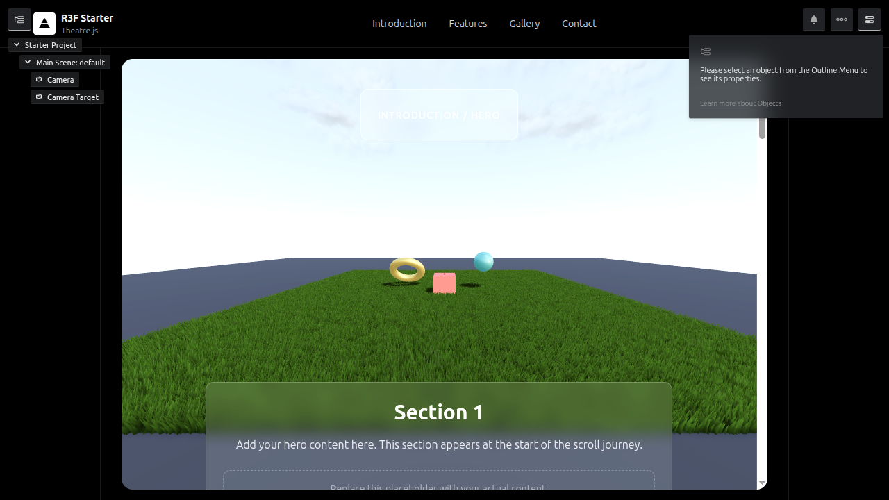

# r3f-theatrejs-starter
实读相机时间线绑定与云平面实现；名字InstancedClouds实际map独立mesh并clone材质，不是InstancedMesh。

## 案例档案

[来源仓库](https://github.com/gabrielagbese/r3f-theatrejs-starter)
分析版本：`77583f3e7c047ee36cf72e93d116b589cf92ae43`

模型归属未独立认证。

## 初始源码审计边界

未读grass长shader/state.json全部关键帧，未核截图与运行；不得复制40万草叶配置进入项目。

以下保留初始源码审计的观察范围。后续新增静帧独立列于视觉材料，不追溯证明全部机制或运行状态。

## 机制与案例分析

### [FM-011 · 把相机路径与播放控制分离](../cards/FM-011.md)

镜头可视化编辑与输入驱动分开，允许同一镜头由时间播放或用户控制。源E快捷键与Citadel疾跑冲突。

镜头可视化编辑与输入驱动分开，允许同一镜头由时间播放或用户控制。源E快捷键与Citadel疾跑冲突。

**Movie：prototype** · 适合场景展示短片
**前端：reference** · 自由走动只可临时接管并随时退出

失败条件：- 滚轮劫持破坏手机阅读
- 照搬E键与疾跑冲突

### [FM-012 · 用低透明多层广告牌云补远景空气](../cards/FM-012.md)

远景软层提供空气感，适合受限窗外视角；不是体积云，camera lookAt还须核父坐标。

远景软层提供空气感，适合受限窗外视角；不是体积云，camera lookAt还须核父坐标。

**Movie：adapt** · 固定镜头可成立
**前端：defer** · 自由视角与窗外系统需先核遮挡

失败条件：- 靠近或侧移暴露薄片
- 透明排序重叠污斑
- Math.random造成每次构图不同

## 项目效果与观察材料

编辑器侧栏与网页叙事共存；草地上的三种几何作为相机练习对象，卡片叠在下部。

来源：本轮已观察的历史截图 · historical_ui_still。历史本地示例截图，未验证当前构建或滚动轨迹。

## 复用边界

- **status**：unknown
- **evidence**：README有MIT徽章，顶层未见LICENSE正文
- **reuse**：idea_only

图片及第三方素材的权利单独保留；源代码许可证不自动授权媒体。
