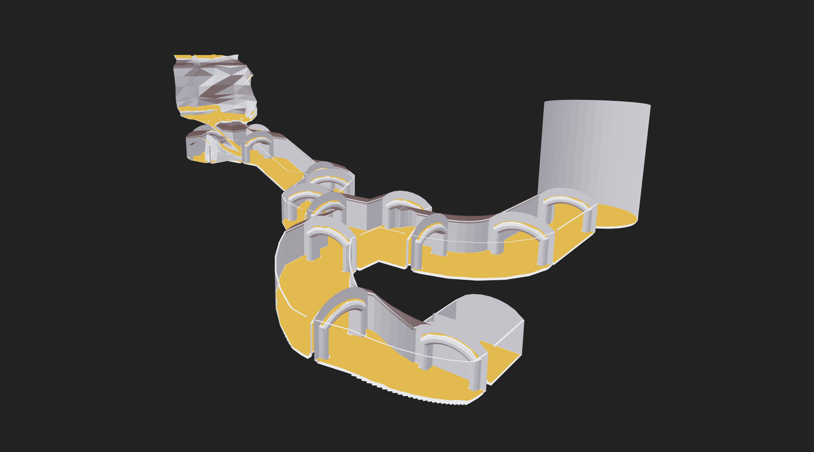

# recast-navigation-js
实读walkable过滤与路径末端钳制；可用于检查场景通路是否符合身体尺度，不能把路径success当确实到达目的地。

## 案例档案

[来源仓库](https://github.com/isaac-mason/recast-navigation-js)
分析版本：`8769e8b9995f127033af9f6e6eeac3fad7d66201`

模型归属未独立认证。

## 初始源码审计边界

未读crowd/tilecache/WASM全部底层；未生成导航网格。

以下保留初始源码审计的观察范围。后续新增静帧独立列于视觉材料，不追溯证明全部机制或运行状态。

## 机制与案例分析

### [SYS-008 · 用身体净空验证场景动线](../cards/SYS-008.md)

生成器先过滤低顶/落差，再以agent radius侵蚀；它把可通行要求落实为几何约束。

用于防止新桌椅、灯箱使漂亮场景无法探索；无配色/光照建议。

**Movie：reference** · 可做运镜路线的预检查，仍需镜头体积测试
**前端：reference** · 现有walkmask无需为此替换

失败条件：- 窄门在侵蚀后消失
- 上层平台被当同层连接
- partial path误报完成

## 项目效果与观察材料

深灰底的灰白拱廊/坡道模型，黄色区域连续覆盖部分地面，白线经过门廊与曲线路径。

来源：本轮已观察的历史截图 · author_demo_screenshot。实际导航调试场景封面；用于理解通行面与路径层级，不把黄色navmesh当场景最终美术或到达保证。

## 复用边界

- **status**：observed
- **evidence**：LICENSE:1-21 MIT，保留版权许可；示例资产单独核对。
- **reuse**：direct_with_notice

图片及第三方素材的权利单独保留；源代码许可证不自动授权媒体。
