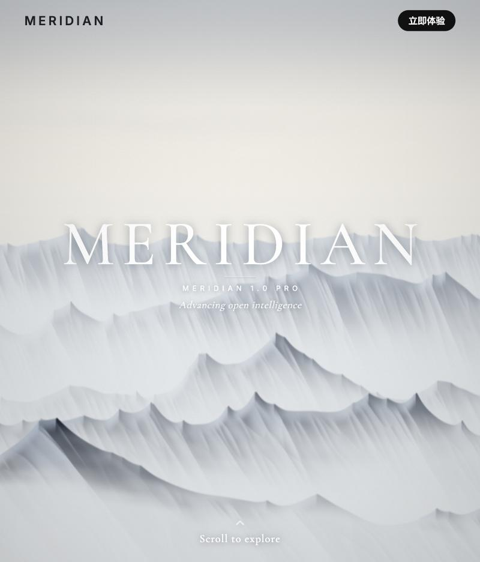
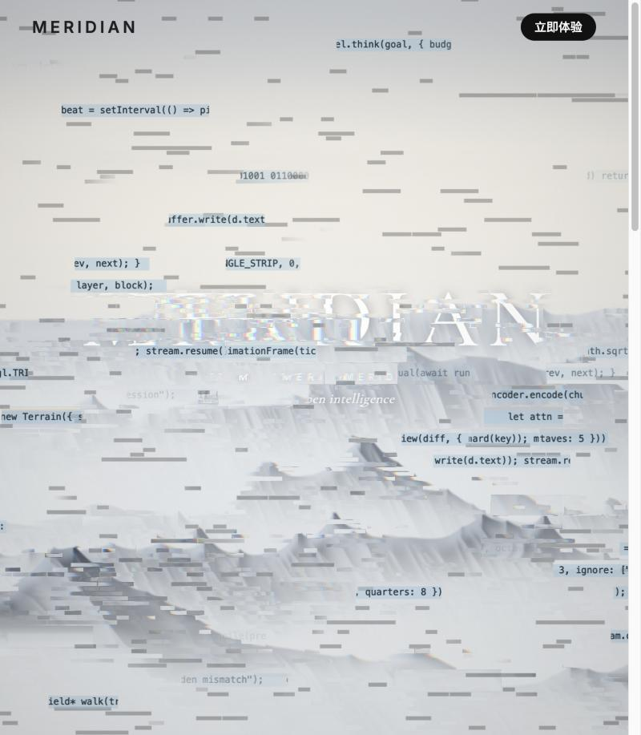
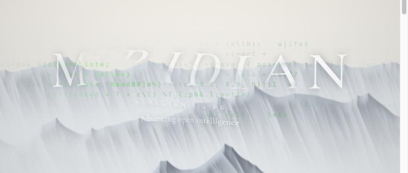

# scroll-glitch-hero
单HTML WebGL2两通道景片、相位触发转场、字符轨迹与粗格弹簧反馈；3张不同机制卡。README称灵感来自Kimi K3.1 Pro官网并声明独立重写，不提供生成模型归因；归因不是收录门槛。

## 案例档案

[来源仓库](https://github.com/CoderMaurice/scroll-glitch-hero)
分析版本：`6e0b8e6189dc4c40cd2b590174a3eb814e55c1b7`

- **status**：not_claimed
- **evidence**：README.md:18-19称受官网启发及独立重写，不代表Kimi生成或官方代码。

## 初始源码审计边界

实读主要交互/GLSL/状态机；未运行或做浏览器兼容验证；未深读字体纹理排版/完整文章及全部GL初始化异常路径。三图仅历史静帧，未证明运动与无障碍。

以下保留初始源码审计的观察范围。后续新增静帧独立列于视觉材料，不追溯证明全部机制或运行状态。

## 机制与案例分析

### [NG-001 · 把故障遮罩的消退与真实正文的接管同步](../cards/NG-001.md)

图形转场既改变画面也管理真实DOM的可读/可操作时间；固定时间线让一次触发形成完整段落，但全局滚动锁必须改造。

transition.jpg实际可见横向裂缝、局部代码板、字边彩色错位；不能证明播放节奏或键盘恢复。hero.jpg为银灰山雾、米白天空与细衬线白字，属平面shader景片，不是3D地形。

**Movie：adapt** · 可用作离线章节切换，需去掉输入锁和DOM依赖。
**前端：reference** · 借图层接管机制；现成全页滚动锁不直接植入phone。

失败条件：- 源码拦截wheel/touchmove/方向键，可能劫持阅读
- contextlost处理未明确清除main.inert，若转场中失败可能留下不可交互正文
- reduced只在加载时读取；hint点击start未显式guard static
- 全局scrollRestoration=manual并滚回0会损失页面恢复

### [NG-002 · 让指针痕迹继续生长并按底图亮度隐现](../cards/NG-002.md)

交互留下有限寿命的痕迹，指针停下后仍有少量自主变化；亮背景压低字符存在感，使痕迹像环境信息而非固定HUD。

pointer.png有稀薄绿色代码叠在灰山与白标题附近；静帧可确认色彩/位置关系，不能确认4秒淡出或静止生长。山亮部通过连续系数压淡，绝非硬剔除。

**Movie：reference** · 离线需固定seed与轨迹后才可重复比较。
**前端：adapt** · 可用于可选装饰窗；主要内容保持无轨迹也可读。

失败条件：- 亮背景仍留12%基值，不能声称绝对隐藏
- 随机run和乱码没有seed，不适合要求完全可复现的审片
- 频繁生成可能压过正文/指示器
- 每帧mouse .04插值不是按delta归一

### [NG-003 · 把可回弹位移与可恢复擦除分成独立字段](../cards/NG-003.md)

同一次手势产生两类时间行为：字形位移用弹簧回家，笔刷遮罩保持后逐渐恢复；二者不强绑同一个fade。

pointer.png白色字母被局部推偏和削弱，绿色痕迹穿过；不能由该图证明弹簧稳定、2.4秒恢复或触控行为。注释733-734仍称不到1秒干燥，与当前2.4秒配置不同，以代码为准。

**Movie：reference** · 可按预设笔刷路径做局部揭示，但先确保文字可辨。
**前端：defer** · 当前更适合低优先级装饰试验，不能先动Title。

失败条件：- 主标题短时消失会损伤识别，本项目Title禁止迁移
- 分辨率改变重建field会抹掉当前状态
- 擦除恢复取决于wet与fiber阈值，2.4秒是配置并非每像素精确恢复时刻
- 强度/阻尼修改需重验稳定性

## 项目效果与观察材料

实际查看：米灰天空与白色纵向褶皱山脊，中央衬线MERIDIAN标题，小字号副标题和右上黑按钮。

来源：本轮已观察的历史截图 · author_repository_screenshot。README Hero历史截图，展示首屏排版与景深层次；没有证明滚动动画。

实际查看：原山景/大标题被横向碎条、代码片段与轻微彩边打断，仍能辨认原构图。

来源：本轮已观察的历史截图 · author_repository_screenshot。README Transition历史截图，只确认转场的一个中间态；不能证明正反播放连续性。

实际查看：山脊和MERIDIAN字形附近出现局部弯曲、错位及浅绿色代码字，原构图仍在。

来源：本轮已观察的历史截图 · author_repository_screenshot。README Pointer interaction历史截图，仅一个指针反馈状态；并非本轮交互测试。

## 复用边界

- **status**：observed
- **evidence**：LICENSE:1-21 MIT Copyright2026 CoderMaurice；index.html:7-9远程Google Fonts，字体权利与部署另核；原站素材未使用为作者声明。
- **reuse**：conditional

图片及第三方素材的权利单独保留；源代码许可证不自动授权媒体。
