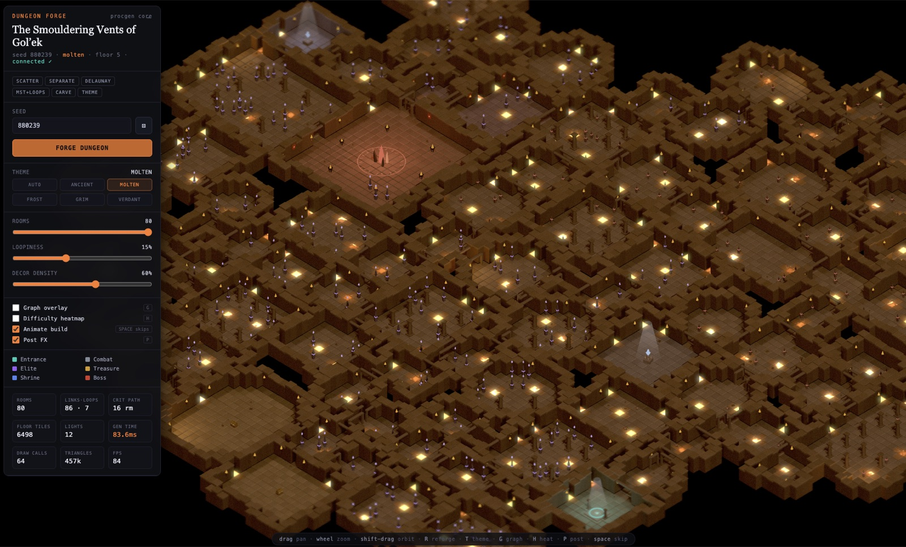

# threejs-procedural-dungeon
单文件大型生成器按布局/主题/栅格复核/装饰粒子与灯光四段深读。

## 案例档案

[来源仓库](https://github.com/majidmanzarpour/threejs-procedural-dungeon)
分析版本：`0a2aa0980028cbbc77af6642b4232b45713dc5de`

模型归属未独立认证。

## 初始源码审计边界

未全读液体shader、后期、所有道具几何、UI生成动画；BFS有效不等于walkmask验收。

以下保留初始源码审计的观察范围。后续新增静帧独立列于视觉材料，不追溯证明全部机制或运行状态。

## 机制与案例分析

### [SD-DU01 · 先给空间路径语义，再用栅格连通性复核几何落地](../cards/SD-DU01.md)

图连通不代表雕刻后的走廊可走；规划层与实际占用层需要分别验证。

历史俯视图有主厅、细廊和灯点层次；格网连通不代表带人物半径可通过，也没包含后加装饰阻挡。

**Movie：reference** · 可规划镜头的压缩→释放节奏。
**前端：adapt** · 适合场景layout审查，不要把现成Place改随机地牢。

失败条件：- 原BFS发生在装饰前
- 方格点连通不代表连续人物体积
- 主题类型不能生搬成博客战斗内容

### [SD-DU02 · 让粒子发射位置解释主题而不均匀撒满画面](../cards/SD-DU02.md)

主题差异应同时改变材质、光色、物理来源和密度。

ancient暖火#ffa640配冷环境#2e3a52；frost蓝冰/冷白；verdant青绿根和孢子。

**Movie：adapt** · 主题来源适合镜头可读性
**前端：prototype** · 先给单Place已有motes绑定真正光柱/通风口。

失败条件：- 无源时源码回退全floor随机点
- 12灯是本仓配置非本站性能结论
- 固定样本可能遗漏关键近景灯

## 项目效果与观察材料

已view_image docs/preview.jpg：暖色俯视地牢、点灯与主厅；截图HUD帧率不能视为当前实测。

来源：[原作者/出处](https://github.com/majidmanzarpour/threejs-procedural-dungeon/blob/0a2aa0980028cbbc77af6642b4232b45713dc5de/docs/preview.jpg) · observed_still。静帧观察；没有由此验证连续动画或性能。

## 复用边界

- **status**：observed
- **evidence**：LICENSE:1-21 为 MIT，保留版权与许可；本轮只对代码作此判读
- **reuse**：direct_with_notice

图片及第三方素材的权利单独保留；源代码许可证不自动授权媒体。
