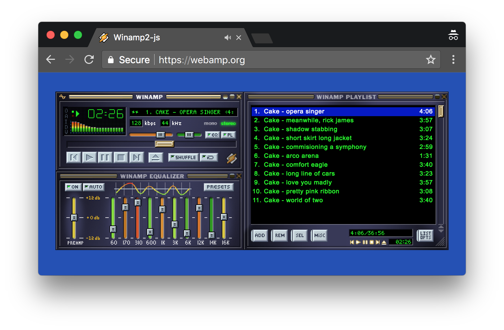

# webamp
实读吸附几何、Milkdrop播放门控与像素皮肤尺寸，历史图显示模块化硬件面板。

## 案例档案

[来源仓库](https://github.com/captbaritone/webamp)
分析版本：`f01369fc2d7aaa9366a3ba9ab0ad1db4b6417a40`

模型归属未独立认证。

## 初始源码审计边界

未读皮肤parser及音频引擎；旧截图不证明新版本像素一致。

以下保留初始源码审计的观察范围。后续新增静帧独立列于视觉材料，不追溯证明全部机制或运行状态。

## 机制与案例分析

### [FM-019 · 用吸附边界把自由面板组织成设备组](../cards/FM-019.md)

播放器、均衡器、列表可以独立布局又形成整齐设备堆栈；历史图有清楚的同宽模块。

播放器、均衡器、列表可以独立布局又形成整齐设备堆栈；历史图有清楚的同宽模块。

**Movie：adapt** · 可指导道具屏幕模块排布
**前端：reference** · 手机空间有限不宜加多窗口

失败条件：- 阈值在高DPI/缩放下手感变化
- 多候选竞争造成抖动；源码多处TODO提示边界待核

### [FM-020 · 让音乐视觉的生命状态与真实播放一致](../cards/FM-020.md)

屏幕动态表明设备正在工作；首次不要等长溶解，主动换风格可以较长融合。

屏幕动态表明设备正在工作；首次不要等长溶解，主动换风格可以较长融合。

**Movie：adapt** · 可用于酒吧/游戏房音响屏幕
**前端：adapt** · 适合可选音乐组件

失败条件：- 静音/暂停仍跳动传达错误状态
- 源码说明无法销毁重建visualizer，切analyser不生效

## 项目效果与观察材料

view_image executed 2026-10-25; repository historical still only; not current runtime or motion evidence

来源：[原作者/出处](https://github.com/captbaritone/webamp/blob/f01369fc2d7aaa9366a3ba9ab0ad1db4b6417a40/packages/webamp-demo/images/preview.png) · observed_still。静帧观察；没有由此验证连续动画或性能。

## 复用边界

- **status**：observed
- **evidence**：LICENSE.txt MIT；Winamp皮肤/商标/音乐另核
- **reuse**：conditional

图片及第三方素材的权利单独保留；源代码许可证不自动授权媒体。
