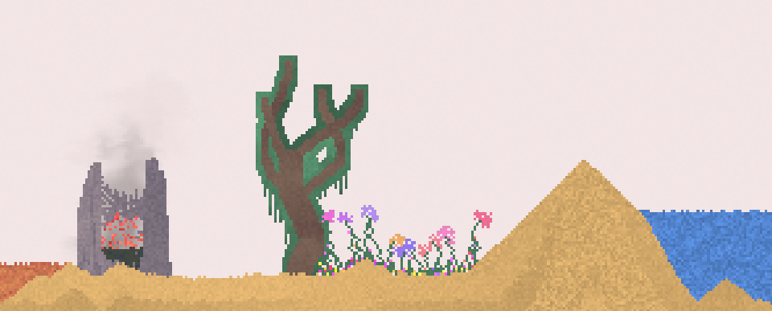
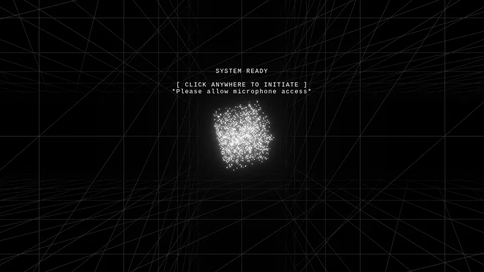

> 工程版历史资料：本文件保留重做视觉卡之前的盘点与分析，其“本轮”等表述指旧阶段。当前逐图裁决与筛选范围以 [public/sources.md](../public/sources.md) 为准。

# 全部案例效果与图文入口

此页保留所有来源；每张图的原出处与具体边界见完整案例和媒体台账。无独立画面的库/后端不伪装成作品效果。

## [ChatdollKit](../cases/ChatdollKit.md)

实读表情寿命、语音停顿与对话优先队列。可迁移的是2D表演调度，不是Unity/VRM角色体系。

3 张机制卡 · 机制级分析

Unity Game视图中粉发猫耳角色位于中央；下方半透明识别文字与音量条，右侧为Microphone Controller设置。编辑器截图，不是独立产品页面。

证据：author_historical_screenshot。已实际查看作者历史图；仅支持画面布局、配色和可见状态，不证明当前HEAD、动态行为或运行质量。

## [Open-LLM-VTuber](../cases/Open-LLM-VTuber.md)

实读有序TTS、组会话中断与Live2D情绪映射。前端目录可能来自子模块，未以Python后端证据宣称画面效果。

3 张机制卡 · 机制级分析

左侧历史与摄像头区域、右侧教室中的角色及字幕，底部有thinking-speaking状态、麦克风和打断按钮。

证据：author_historical_screenshot。已实际查看作者历史图；仅支持画面布局、配色和可见状态，不证明当前HEAD、动态行为或运行质量。

## [OpenRoom](../cases/OpenRoom.md)

参考仓README现已称VibeApps。源码SHA02468154与本地vendor记载一致；Action已存在，桌面window host没有直接采用。

2 张机制卡 · 机制级分析

太空背景、左侧应用图标、底栏和黄色聊天输入共同组成桌面壳。

证据：live_site_still。角色窗口持续Loading，已最小化以观察桌面；没有发送消息或验证角色行动回执。

## [SillyTavern](../cases/SillyTavern.md)

2D视觉小说机制有直接参考价值：换图占位、同情绪姿态变体、发言者层级。AGPL许可不等同可直接vendor。

3 张机制卡 · 机制级分析

官方文档截图中左侧Author Note、中间API连接设置、右侧角色管理并列；深灰底与少量琥珀提示保持多面板分区。

证据：author_historical_screenshot。已实际查看作者历史图；仅支持画面布局、配色和可见状态，不证明当前HEAD、动态行为或运行质量。

## [airi](../cases/airi.md)

实读AIRI设计指南、语音控制、theme store及色度分档。可借身份化中断与配色变量约束；不照搬其可爱和半透明外观。

2 张机制卡 · 机制级分析

本地作者hover教程第0秒：浅蓝发角色作为桌面浮层位于文档右侧，旁边有竖向小工具按钮；角色遮盖部分正文。

证据：author_demo_frame。已查看视频0、1、3、5秒抽帧，仅采用0秒可见角色状态；未连续播放，单帧不证明hover逻辑或口型。

## [amica](../cases/amica.md)

核心价值是多表情通道仲裁和注视坐标系。均来自VRM实现，当前hIE仅2D，因此裁决以reference/defer为主。

2 张机制卡 · 机制级分析

蓝发角色覆盖在暖色窗景房间中；底部浅色半透明对白与输入条，左侧窄工具栏。

证据：author_historical_screenshot。已实际查看作者历史图；仅支持画面布局、配色和可见状态，不证明当前HEAD、动态行为或运行质量。

## [three-vrm](../cases/three-vrm.md)

查看了three-vrm.png历史宣传静帧：高对比黄色背景、右侧半身卡通角色、细轮廓。它不能证明当前运行或任一shader参数效果。源码实读表情混合与MToon片段。

2 张机制卡 · 机制级分析

历史宣传图实际查看：黄色背景、右侧半身卡通人物、细轮廓；不证明任何shader参数效果或当前运行。

证据：historical_still_viewed。静帧观察；没有由此验证连续动画或性能。

## [mesh2motion-app](../cases/mesh2motion-app.md)

实读AnimationPlayer与导出清理。实际看了readme.png历史静帧：模型占主视口、右侧动作网格、底部时间轴；未播放动画。

2 张机制卡 · 机制级分析

历史静帧实际查看：左侧模型主视口、右侧动画缩略列表、底部Run时间轴；不能验证真实运动或绑定质量。

证据：historical_still_viewed。静帧观察；没有由此验证连续动画或性能。

## [wawa-lipsync](../cases/wawa-lipsync.md)

小库以频带启发式和时间惯性驱动嘴形。发现默认maxVisemeDuration=100与注释100–300ms渐变不一致，不能只引用README称高质量口型。

1 张机制卡 · 机制级分析

粉色背景中角色正面占右侧；左侧频谱、viseme、音量与质心读数并列，底部为样本发音按钮。

证据：live_site_still。本轮只看静默初始角色与仪表；未播放声音，未证明口型同步或频谱判定准确。

## [ink](../cases/ink.md)

实读选择过滤/标签接口与状态序列化。叙事系统可以贡献状态与选择机制，但当前项目旧game/story已退役，不能把库迁移当美术升级。

2 张机制卡 · 机制级分析

**效果图状态：未补图 / 无独立画面。** 具体缺口见来源审计，不以Logo或概念图代替。

## [inkjs](../cases/inkjs.md)

与ink同主机制的浏览器实现。本轮提取可读宽度、段落节奏与选择DOM更新，避免重复计作独立叙事理论。

1 张机制卡 · 机制级分析

内置故事以极简文本和编号选择呈现，页面保留加载故事入口；这是叙事运行时的基础输出形态。

证据：live_site_still。已打开内置样例的首个节点；未验证状态恢复、分支全集或无障碍流程。

## [ag-ui](../cases/ag-ui.md)

AG-UI是事件协议与SDK，提供可见状态的工程基础，不能据此推断美术质量；提取身份化流式反馈与局部patch两个间接机制。

2 张机制卡 · 机制级分析

**效果图状态：未补图 / 无独立画面。** 具体缺口见来源审计，不以Logo或概念图代替。

## [json-render](../cases/json-render.md)

该仓同时有React与Remotion渲染器，直接对应前端卡与movie卡的不同契约。已发现motion单位注释/实现差异、types音轨不代表Renderer处理、坏clip静默空白风险。

3 张机制卡 · 机制级分析

页面预设示例渲染出营收数字、折线图与两条进度；文字层级和图表占比集中于一张窄卡。

证据：live_site_still。公开站默认UI演示，未发送生成请求；不证明Remotion影片、流式协议或导出实现。

## [codrops-depth-gallery](../cases/codrops-depth-gallery.md)

实读纵深切换、速度响应与背景调色。已看 resources/screenshot.jpg 历史静帧：中央花图、两侧小字、蓝紫环境与暖色花瓣；紫色大底不符合本项目，借关系不借色值。

3 张机制卡 · 专项分析 + 机制分析

view_image executed 2026-10-25; repository historical still only; not current runtime or motion evidence

证据：observed_still。静帧观察；没有由此验证连续动画或性能。

## [gsap-threejs-codrops](../cases/gsap-threejs-codrops.md)

实读 Media、像素揭示 shader 与 Barba/Flip 跨页交接；README 声称 MIT 但本地无 LICENSE，遵循仅借思路。

2 张机制卡 · 专项分析 + 机制分析

Codrops原作者文章配图将两个页面状态叠放：黑白照片、大字排版与底部像素块边界可见。静态拼图不能证明滚动时序。

证据：author_demo_composite。已实际查看作者历史图；仅支持画面布局、配色和可见状态，不证明当前HEAD、动态行为或运行质量。

## [void-syndicate](../cases/void-syndicate.md)

实读锥形图块螺旋、滚动惯性、shader与排版；发现注释称全局轴弯曲/高处去饱和，但shader使用局部position，不能按注释夸大。

3 张机制卡 · 机制级分析

黑底白色窄体标题与荧绿斜体强调；中央图块螺旋穿过文字，四角元数据维持信息框架。

证据：historical_ui_still。历史本地网页截图，版本未绑定；不证明滚动惯性与连续色散。

## [r3f-scroll-rig](../cases/r3f-scroll-rig.md)

实读DOM跟踪、单场景裁剪、sticky三阶段与图像uniform，不把基础库本身称为美术升级。

2 张机制卡 · 机制级分析

作者GIF第1秒：白色页面中央黑色圆角媒体区包含蓝色环状物和播放入口；单帧不能证明DOM/WebGL对齐或滚动交接。

证据：author_demo_frame。实际查看所采用的1秒抽帧；没有运行项目、没有连续播放或验证动态行为。

## [r3f-theatrejs-starter](../cases/r3f-theatrejs-starter.md)

实读相机时间线绑定与云平面实现；名字InstancedClouds实际map独立mesh并clone材质，不是InstancedMesh。

2 张机制卡 · 机制级分析

编辑器侧栏与网页叙事共存；草地上的三种几何作为相机练习对象，卡片叠在下部。

证据：historical_ui_still。历史本地示例截图，未验证当前构建或滚动轨迹。

## [theatre](../cases/theatre.md)

实读关键帧插值的hold/Bezier分支与相机目标跟踪；这是编排工具的机制，不是现成场景美术。

2 张机制卡 · 机制级分析

作者GIF第1秒：火箭场景、编辑相机小窗、右侧相机参数以及底部关键帧与曲线编辑器同屏；不能由此帧验证编辑器交互。

证据：author_demo_frame。实际查看所采用的1秒抽帧；没有运行项目、没有连续播放或验证动态行为。

## [_libsmoke](../cases/_libsmoke.md)

本地小型兼容冒烟示例，无README/许可、无独立Git SHA；实读两个网格与共享后期，不作为第三方高质量设计案例。

0 张机制卡 · 机制级分析

**效果图状态：未补图 / 无独立画面。** 具体缺口见来源审计，不以Logo或概念图代替。

## [uikit](../cases/uikit.md)

实读主题token、hover光标栈和裁剪命中；候选是空间UI视觉/交互一致，不建议把手机阅读全面迁3D。

2 张机制卡 · 机制级分析

浅色仪表盘以顶部导航、四张指标卡、柱状图和Recent Sales列表组织信息；图中仍是二维投影，不能证明深度命中行为。

证据：author_historical_screenshot。已实际查看作者历史图；仅支持画面布局、配色和可见状态，不证明当前HEAD、动态行为或运行质量。

## [daedalOS](../cases/daedalOS.md)

实读窗口动画与焦点堆叠，历史截图显示多窗口/任务栏/播放器，不能证明本地当前交互。

2 张机制卡 · 机制级分析

view_image executed 2026-10-25; repository historical still only; not current runtime or motion evidence

证据：observed_still。静帧观察；没有由此验证连续动画或性能。

## [webamp](../cases/webamp.md)

实读吸附几何、Milkdrop播放门控与像素皮肤尺寸，历史图显示模块化硬件面板。

2 张机制卡 · 机制级分析

view_image executed 2026-10-25; repository historical still only; not current runtime or motion evidence

证据：observed_still。静帧观察；没有由此验证连续动画或性能。

## [excalidraw](../cases/excalidraw.md)

实读rough形状选项、缓存和主题；查看wireframe历史静帧确认手绘边界与清晰结构，不把整站手绘作为建议。

2 张机制卡 · 专项分析 + 机制分析

view_image executed 2026-10-25; repository historical still only; not current runtime or motion evidence

证据：observed_still。静帧观察；没有由此验证连续动画或性能。

## [tinylittleoffice](../cases/tinylittleoffice.md)

实读色彩/字体/间距token、主题跟随与绘制后焦点恢复；发现tokens旧注释说纸始终白，暗色段实际覆盖纸色，应以代码为准。

2 张机制卡 · 机制级分析

作者样例输出的组织关系图：蓝色分层节点、黑色实线和紫色虚线说明；这是文档成品预览，不是编辑器截图。

证据：author_sample_output。已实际查看作者历史图；仅支持画面布局、配色和可见状态，不证明当前HEAD、动态行为或运行质量。

## [TrendRadar](../cases/TrendRadar.md)

报告HTML有可提取的信息层级但不是3D参考。实读标题/来源/排名/NEW样式与趋势计算；主紫渐变不适合项目。

1 张机制卡 · 机制级分析

热点新闻页面以紫色摘要区、主题分组、排名/来源/时间元数据组织长列表；新闻内容属于原图历史示例。

证据：author_historical_screenshot。已实际查看作者历史图；仅支持画面布局、配色和可见状态，不证明当前HEAD、动态行为或运行质量。

## [newsnow](../cases/newsnow.md)

实读来源卡、缓存刷新、排名变化与拖拽布局。历史OG缩略图可见分源列；不证明刷新/拖拽手感。

2 张机制卡 · 专项分析 + 机制分析

view_image executed 2026-10-25; repository historical still only; not current runtime or motion evidence

证据：observed_still。静帧观察；没有由此验证连续动画或性能。

## [miniflux](../cases/miniflux.md)

实读阅读正文CSS、元数据状态与entry模板；它是阅读层补足，不能替代场景美术参考。

2 张机制卡 · 专项分析 + 机制分析

白底未读列表以蓝色标题、来源/时间行及细边框区分条目；选中行有浅蓝轮廓。

证据：author_historical_screenshot。已实际查看作者历史图；仅支持画面布局、配色和可见状态，不证明当前HEAD、动态行为或运行质量。

## [athenaion](../cases/athenaion.md)

以程序化建筑、SDF雕塑、地形支撑接口和按参考构图编排的电影场景。9个参考相机，实际视频序列8段54.3秒；作者性能/模型/零外部资产宣称未独立认证。

5 张机制卡 · 机制级分析

已查看的来源静帧；不证明当前版本运行。

证据：historical_still_viewed。静帧观察；没有由此验证连续动画或性能。

## [awesome-kimi-k3.1-guide-and-use-cases](../cases/awesome-kimi-k3.1-guide-and-use-cases.md)

索引含83独立案例、105媒体对象；实际主帖+related_sources有101个唯一X status ID（83主记录+25关联记录去重），metadata source_count=1199含义未由这些记录解释，不可当1199独立作品。6类：mechanical14/worlds32/svg13/games9/web4/comparison11。Kibitz到Kimi映射明确未确认。

0 张机制卡 · 机制级分析

**效果图状态：未补图 / 无独立画面。** 具体缺口见来源审计，不以Logo或概念图代替。

## [awesome-kimi-k3-1-videos](../cases/awesome-kimi-k3-1-videos.md)

索引含187视频条目、173原帖、134账号、187个prompt页面；其中19条有verbatim prompt（10.16%），168条未找到公开精确prompt。179作者自述、8官方showcase；4类：motion26/3d56/interactive30/comparison75。8官方条目包含Unreal/Godot/Blender等外部资产工作流，不是纯代码一键前端。

0 张机制卡 · 机制级分析

**效果图状态：未补图 / 无独立画面。** 具体缺口见来源审计，不以Logo或概念图代替。

## [awesome-opus-5.5-usecase](../cases/awesome-opus-5.5-usecase.md)

索引含663条唯一URL记录：485视频、66 games-3d、43 creative、28 agent、24 benchmarks、14 collections、2 showcase、1 official。139条source=github，89条有demo_url；这些是链接计数，不是已克隆或已验收实现。

0 张机制卡 · 机制级分析

**效果图状态：未补图 / 无独立画面。** 具体缺口见来源审计，不以Logo或概念图代替。

## [premium-saas-web-skill](../cases/premium-saas-web-skill.md)

新增的是设计skill与生成展示合集，不是10/23刚诞生的独立产品。浅克隆HEAD 813c880日期10/23且提交为documentation formatting，不能据此确定各demo生成日期。README自述用Opus5.5，未经独立模型日志验证；98%是机械项通过率不是视觉偏好胜率。实读portfolio-after与invoicing-after两页，实看两张历史截图，未安装/执行skill。

4 张机制卡 · 机制级分析

view_image executed 2026-10-25; repository historical still only; not current runtime or motion evidence

证据：observed_still。静帧观察；没有由此验证连续动画或性能。

## [line-item-review](../cases/line-item-review.md)

Opus5.5归因为作者README声明。实读17项虚构变更的CSS class切换、评审tray与localStorage；实看review-tray与c006-without历史图。仓库是可工作的浏览器交互演示，mock git diff/虚构catalogue/服务器重建仍是说明，不是已实现集成系统；未发现LICENSE。

4 张机制卡 · 专项分析 + 机制分析

view_image executed 2026-10-25; repository historical still only; not current runtime or motion evidence

证据：observed_still。静帧观察；没有由此验证连续动画或性能。

## [scroll-glitch-hero](../cases/scroll-glitch-hero.md)

单HTML WebGL2两通道景片、相位触发转场、字符轨迹与粗格弹簧反馈；3张不同机制卡。README称灵感来自Kimi K3.1 Pro官网并声明独立重写，不提供生成模型归因；归因不是收录门槛。

3 张机制卡 · 机制级分析

实际查看：米灰天空与白色纵向褶皱山脊，中央衬线MERIDIAN标题，小字号副标题和右上黑按钮。

证据：author_repository_screenshot。README Hero历史截图，展示首屏排版与景深层次；没有证明滚动动画。

## [dopa-drill](../cases/dopa-drill.md)

算术交互使用连续能量参数组织背景、角色、粒子和分层合成音乐，保留稳定输入区及动效强度控制。README未明确模型归因。仓内无PNG/JPG/WebP截图；补看线上首页静帧，仅支持外观观察，不是答题演出验收。

4 张机制卡 · 专项分析 + 机制分析

2026-10-25根代理Chrome访问线上页面并保存，本子代理实际view_image复核。首页为浅米方格纸底，粉色与浅蓝大圆点置于两侧；居中窄列、粗深蓝轮廓的logo/粉色角色/圆角按钮，主入口粉底，年级按钮为浅色格组。只观察首页；未作答、未试听、未验证演出递增，设置点击未成功打开。

证据：live_site_still。静帧观察；没有由此验证连续动画或性能。

## [electromagnetism](../cases/electromagnetism.md)

Induction Bench把磁铁/线圈操作、场线、读数、示波器与磁通切线放在同一仪器台。源码有近似模型和数值方法注释，但本轮未物理核验；没有README/LICENSE，具体模型归因未知。仓内无图片；补看线上默认页面静帧，仅支持布局观察，不是物理或连续运动验收。

4 张机制卡 · 专项分析 + 机制分析

2026-10-25根代理Chrome访问线上页面并保存，本子代理实际view_image复核。深灰台面分成左参数、中3D磁铁与线圈场线、右指针和数字读数、下方示波器与磁通曲线；绿/铜区分通道，紫青黄场线带方向箭头。截图只证明此时布局与显示内容，不能由静帧判断多面板同步或物理精度。

证据：live_site_still。静帧观察；没有由此验证连续动画或性能。

## [kimi-k31pro-opus55-benchmark-showcase](../cases/kimi-k31pro-opus55-benchmark-showcase.md)

双模型目录归档，14个作品入口、10个任务产物目录；7张海滩机制卡和3张电影/交互卡。作者归因为Kimi K3.1 Pro / Claude Opus 5.5，同题但未证明同预算，不做模型排名。

10 张机制卡 · 专项分析 + 机制分析

已查看的来源静帧；不证明当前版本运行。

证据：historical_still_viewed。静帧观察；没有由此验证连续动画或性能。

## [offshore-tower](../cases/offshore-tower.md)

塔楼程序源、PBR烘焙、装配导出、网页查看四段已读；根生成器与app/tools副本hash相同，根GLB与app/public副本hash相同。只读解析GLB结构与manifest数量一致。

4 张机制卡 · 机制级分析

已view_image Tower_Verification_Views.png六视图拼图：橙色收分塔、深骨架、多层维护平台、后侧窗组、底部交叉支撑、顶部天线与吊臂。历史离线渲染，不是当前网页截图或实时性能证据。

证据：observed_still。静帧观察；没有由此验证连续动画或性能。

## [csc35-diorama-day](../cases/csc35-diorama-day.md)

单HTML房间样机；读过房壳/家具/程序角色、选择-移动-到达链、needs状态、昼夜光照和响应式镜头。角色只是几何骨架摆动，源代码不包含完整寻路或坐下接触。

3 张机制卡 · 机制级分析

奶油色正交房间，低饱和绿沙发和陶土色地毯划分活动区；四个人物占据前部，需求面板留在右侧。

证据：local_head_still。本轮本地HEAD页面打开并开始后截图；未验证家具动作、寻路、持续状态与性能。

## [mg-styles-15](../cases/mg-styles-15.md)

15支10秒程序化动效短片，逐项读取提示词创意/特征段、cues、关键几何/时间代码与选段音效；18张不同机制案例卡，15项深度台账，30张本地已有影片静帧实看。素材与源代码为作者发布，不是本轮重渲染。

18 张机制卡 · 机制级分析

本地影片 3 秒静帧。

证据：video_still。静帧观察；没有由此验证连续动画或性能。

## [map-of-middle-earth](../cases/map-of-middle-earth.md)

共享世界状态、地标声明、无历史特效与电影轨道组成的WebGPU中土模型。提取5个机制分支；这是读源码与历史静图的迁移建议，不认证作者运行与画质宣称。

5 张机制卡 · 专项分析 + 机制分析

已查看的来源静帧；不证明当前版本运行。

证据：historical_still_viewed。静帧观察；没有由此验证连续动画或性能。

## [web-ocean](../cases/web-ocean.md)

新增WebGPU纯shader海洋案例。实际查看front/side/high三张历史静帧：海面近中远有层次，正对太阳有纵向金色反光，侧视保留深青水体，高机位可见泡沫碎片。源码是6级FFT、LEAN坡度统计、世界坐标泡沫历史及两层平面云；不是动态/性能验收。README作者自述Claude Code Opus5.5，模型归因未独立证实。

6 张机制卡 · 专项分析 + 机制分析

正对太阳低机位：暖金反光柱，深青近景水，暖云边；大块云呈平层形态。

证据：observed_still。静帧观察；没有由此验证连续动画或性能。

## [little-rain-cloud](../cases/little-rain-cloud.md)

同Three 0.170的完整行为小场景；深入湿图/植被事件、跟随云、地面材质、回望构图及录制接口。作者模型归属只作来源自述，不当质量证据。

5 张机制卡 · 专项分析 + 机制分析

已view_image shots/04-look-back.png：暖沙丘、白云、深湿痕与绿色曲线；它是历史静帧，只支持构图判断，不支持动画或当前运行验收。

证据：observed_still。静帧观察；没有由此验证连续动画或性能。

## [invisible-cities-opus-5.5](../cases/invisible-cities-opus-5.5.md)

统一材质Builder、三种布局重排已实读；55城中针对Octavia、Zenobia、Eusapia、Ersilia四个机制不同的案例深读关键段，未把目录覆盖称为55城逐行审计。

5 张机制卡 · 机制级分析

小型城市按类别列与序号行放在棋盘上；瓷金造型和标签共用空间位置，分类导航在下方。

证据：live_site_still。本轮线上默认Atlas静帧，线上版本未绑定本地HEAD；不证明全部55城细节。

## [tidewater](../cases/tidewater.md)

自有WebGPU/WGSL引擎的海岛项目；本轮聚焦材质层、铺板使用痕迹、杂物净空、地表反弹光及浪相位驱动音频。优先提取可局部实现的美术方法，不推荐整体引擎迁移。

5 张机制卡 · 机制级分析

已view_image docs/screenshot.jpg：夕阳码头、近景木栏杆/绳索/灯具/钓竿、远近水色层次。仅为历史静帧，没有证明当前实时水体、声画同步或性能。

证据：observed_still。静帧观察；没有由此验证连续动画或性能。

## [webgl-seascape-video](../cases/webgl-seascape-video.md)

实际四期，第三期当前宇宙版+旧原理版，共五个版本入口；11张机制卡。日志混合Opus5/Opus5.5/Sonnet5.5，DeepSeek Harness是工具来源，不自动等于模型归因。依用户授权保留混合来源，不排名。

11 张机制卡 · 专项分析 + 机制分析

实际查看：低太阳金色海面、远山暗轮廓和层叠云，海面反光有多尺度细纹；叠加第一期教学标题和LIVE UNIFORMS面板。

证据：author_og_effect_cover。作者部署首页明确og:image=cover1.jpg；是第一期海景效果封面，画面内“全部实时计算”等文字是作者声明，不是本轮运行验证。

## [apple-music-effect](../cases/apple-music-effect.md)

闭式油透镜高度场、光谱折射与确定性子帧累积；不是流体模拟。README没有明确模型署名，AI来源标签未由源码确认。已查看preview与scorecard历史静帧。

4 张机制卡 · 机制级分析

本轮view_image实际看过的仓内历史静图，未验证运行或运动

证据：observed_still。静帧观察；没有由此验证连续动画或性能。

## [yarn-planet](../cases/yarn-planet.md)

纸上铅笔→彩色toon的球面探索游戏；真实路线长度、沿线脉冲和复苏波形成因果。README明确Opus5.5主实现、五个Sonnet5.5子模块、DeepSeek小修，均为作者披露而非独立核验。网络共享姿态/问候/保存路线，不同步本地设施解谜。

5 张机制卡 · 机制级分析

本轮view_image实际看过的仓内历史静图，未验证运行或运动

证据：observed_still。静帧观察；没有由此验证连续动画或性能。

## [Singularity](../cases/Singularity.md)

实际黑洞入口是ShaderPlane+二维径向扭曲，README的“raymarching”描述不能当已实现的测地线积分。关键反例：反向smoothstep、horizon乘法和不读取opacity的fragment有待核验。

3 张机制卡 · 专项分析 + 机制分析

实际查看：蓝绿线框漏斗汇聚到中央粒子核，两侧遥测/尺度面板与开始按钮，黑底高对比。

证据：archived_local_screenshot。2026-09-27历史项目快照的引导界面；不证明后续黑洞、原子或滚动镜头效果，不绑定当前源提交。

## [three-gpu-pathtracer](../cases/three-gpu-pathtracer.md)

本地0.0.27当前推荐WebGPU并要求three>=.185，仍保留deprecated WebGL类；计划的WebGPU主线正确但不能说仓内完全没有WebGL。

3 张机制卡 · 专项分析 + 机制分析

灰白厨房，右侧大窗形成宽柔光；木台、金属厨具、透明杯与暗处柜门仍有层次。

证据：author_demo_screenshot。仓内README Screenshots历史成片，展示材质与间接光的外观；无参数A/B、无当前HEAD或性能验证。

## [THREE.js-PathTracing-Renderer](../cases/THREE.js-PathTracing-Renderer.md)

WebGL2上的自定义解析几何/路径追踪示例集；实读粗糙度样条与波浪高度，不把README移动端实时宣称当本机验证。

2 张机制卡 · 机制级分析

棋盘地面上的漫反射、镜面与透明球，后方红绿蓝几何体；透明球中可见扭曲棋盘和投影。

证据：author_demo_screenshot。README明确称2015年的旧渲染样例，仅作历史渲染效果；不能绑定当前材质实现或复用图中FPS为现性能。

## [realism-effects](../cases/realism-effects.md)

实读SSGI配置/入口、重投影和运动模糊。源码SSGIEffect(composer,scene,camera,options)与README示例签名不一致；preset有两个medium分支。不可把复制示例当集成完成。

3 张机制卡 · 机制级分析

粉红衣黑面罩角色位于竹林园景，角色受光与背景石/水/白墙形成明暗层次。

证据：author_demo_screenshot。README标为SSGI示例；单张图不分离SSGI与环境照明、贴图和模型贡献。角色形象和背景权利未独立核验。

## [three-good-godrays](../cases/three-good-godrays.md)

从阴影图积分受光空气、裁剪灯体积、深度感知上采样。citadel已改写核心march而未搬JBU；本地LICENSE为zlib条款，旧计划MIT标签错误但vendor保留原文。

4 张机制卡 · 专项分析 + 机制分析

明亮洋红百叶状光源、粗石地面和一列暗柱；柱后长阴影与粉色空气亮带形成明显深度。

证据：author_demo_screenshot。README明确作者demo截图的原图地址；属于历史体积光外观，无独立当前版本运行/帧率/参数对照。

## [react-postprocessing](../cases/react-postprocessing.md)

实读SelectiveBloom、DOF和Autofocus，当前源码使用React19 use与R3F>=9.7，不可直接粘进本站React18/R3F8。项目已有后期，应迁机制而非替换库。

2 张机制卡 · 机制级分析

暗灰单色空间中的多个反射球体，中央大球边缘清晰，前后小球虚化，表面反射窗格。

证据：author_demo_screenshot。仓内Bubbles演示封面，与README所列演示同名；只证明历史封面外观，不能据此确认某后期组件/配置生效。

## [lygia](../cases/lygia.md)

跨语言shader函数库；本轮实读fire/water色坡、3D curl、Gerstner位移。遵循项目约束只借思路，不拷Prosperity代码；各文件可能有Patron或第三方来源，不能拿总库标签抹平。

3 张机制卡 · 机制级分析

**效果图状态：未补图 / 无独立画面。** 具体缺口见来源审计，不以Logo或概念图代替。

## [Gaussian-Splat-Lite](../cases/Gaussian-Splat-Lite.md)

三维采集资产的显示/编辑/流送管线，非自动建模方法。支持WebGPU及classic WebGL2但本地要求three>=.186；不适合本站直接整体升级。

3 张机制卡 · 机制级分析

深色上传面板按格式、示例和URL分配入口；黄绿色只强调主要选择。

证据：historical_ui_still。历史上传入口截图，不包含实际Gaussian场景，不证明排序或OIT效果。

## [gpu-curtains](../cases/gpu-curtains.md)

WebGPU DOM平面/网格引擎。实读官网纹理平面弯曲、媒体错误回退、布料compute；不是本站Three的即插即用效果。

3 张机制卡 · 机制级分析

**效果图状态：未补图 / 无独立画面。** 具体缺口见来源审计，不以Logo或概念图代替。

## [sandspiel](../cases/sandspiel.md)

Rust/WASM元胞规则+WebGL像素着色。历史Screenshot实际已看：淡粉白背景、金黄沙、蓝水、低饱和岩木、红火局部强调；没有从静图推断动态正确。

3 张机制卡 · 机制级分析

历史静帧：淡色背景/金黄沙/蓝水/暗岩木/局部红火；不证明当前运行或动态。

证据：observed_still。静帧观察；没有由此验证连续动画或性能。

## [NexusCity](../cases/NexusCity.md)

已实读体量生成、程序纹理、镜头状态机；旧vendor曾存在但已退役，README确定性宣传不覆盖Math.random纹理。

3 张机制卡 · 机制级分析

实际查看：夜街斑马线、中央NPC与交互提示，青色HUD/雷达、暗楼体和橙色树冠；画面整体很暗。

证据：archived_local_screenshot。2026-09-27本地审阅项目快照中的Nexus City界面；未绑定当前Repos/NexusCity提交。静帧不证明当前运行、动画或模型质量。

## [TheBrutalizer](../cases/TheBrutalizer.md)

入口链确认使用Building.jsx；实见参数尺寸/随机性缺陷，不能把仓名当质量背书。

2 张机制卡 · 机制级分析

已view_image built.jpg：灰塔/黑窗/绿树历史静帧；未运行动画。

证据：observed_still。静帧观察；没有由此验证连续动画或性能。

## [The-Monolith](../cases/The-Monolith.md)

小型声控装置，已全读main与CSS；不把它归作黑洞或物理空间模拟。

1 张机制卡 · 机制级分析

实际查看：黑色空间里白色发光点团和多层细线格网，文字提示点击开始并允许麦克风。

证据：archived_local_screenshot。历史项目快照，明确处于点击/麦克风启动前待机态；不是音频响应已运行或各阶段完整效果证据。

## [synthcity](../cases/synthcity.md)

已读街区分配、模型选择辅助和锐化shader；可借城市节奏，不能将全部外部素材视为MIT。

2 张机制卡 · 机制级分析

实际查看：高角度密集夜城，蓝紫雾压远景，窗格/招牌粉青发光，光柱与高楼构成竖向节奏。

证据：author_repository_screenshot。原仓README所用效果图的本地同名文件；历史静帧，不证明当前帧率、雨动或车辆控制。

## [neon-zenith](../cases/neon-zenith.md)

高价值街景案例：共享光场、遮雨、近远立面连续、建筑语法与品牌招牌五条机制；不是要求迁WebGPU。

5 张机制卡 · 机制级分析

已view_image docs/media/market.jpg：黑色楼峡、横竖霓虹、暖路灯与湿地纵向反光；历史静帧不证明动态。

证据：observed_still。静帧观察；没有由此验证连续动画或性能。

## [folio-2025](../cases/folio-2025.md)

已读材质、显现与输入入口局部；可借色彩与同步机制，不整套迁TSL，不移植车辆形象。

3 张机制卡 · 机制级分析

已view_image static/social/share-image.png：暖橙草地/灯、紫灰石、红车低多边形静帧；不是当前运行截图。

证据：observed_still。静帧观察；没有由此验证连续动画或性能。

## [interactive-3d-portfolio](../cases/interactive-3d-portfolio.md)

已读揭示shader、滚轮相机和读屏层；明确源码注释与实际Basic/hard-step实现的差异。

2 张机制卡 · 机制级分析

已view_image public/og-image.webp：白纸黑线走廊与人物；只观察历史封面，不证明绘制转场。

证据：observed_still。静帧观察；没有由此验证连续动画或性能。

## [threejs-procedural-dungeon](../cases/threejs-procedural-dungeon.md)

单文件大型生成器按布局/主题/栅格复核/装饰粒子与灯光四段深读。

2 张机制卡 · 机制级分析

已view_image docs/preview.jpg：暖色俯视地牢、点灯与主厅；截图HUD帧率不能视为当前实测。

证据：observed_still。静帧观察；没有由此验证连续动画或性能。

## [racing-game](../cases/racing-game.md)

实读相机类型、尾焰、刹车痕迹三个模块；README称CC0资产但本轮未核每个源资产。

1 张机制卡 · 机制级分析

已view_image thumbnail.webp：橙色多面岩地形、浅隧道、深道路清晰分层；运动尚未观察。

证据：observed_still。静帧观察；没有由此验证连续动画或性能。

## [3dcitydb-web-map](../cases/3dcitydb-web-map.md)

主要为Cesium语义城市与工作区状态；不将GIS规模能力包装为3D美术打磨。

1 张机制卡 · 机制级分析

实际查看：柏林贴图建筑与底图叠合，黄色高亮建筑、绿色选择框和右侧语义属性表同时出现。

证据：author_repository_screenshot。README Demo 2历史截图，展示地理模型选择与语义数据；不是电影化建模质量样片。

## [3DTilesRendererJS](../cases/3DTilesRendererJS.md)

地理瓦片渲染库，本轮只提取fade连续性案例，不宣称提供高质量场景设计。

1 张机制卡 · 机制级分析

实际查看：火星地形的摄影纹理和岩石细节上叠加白色瓦片边界，底部为项目标题。

证据：author_demo_banner。原作者README渲染展示横幅，确有地形效果；带标题的静态展示，不是本轮运行截图，也不能证明LOD淡出动画。

## [awesome-opus5.5-frontend-showcases](../cases/awesome-opus5.5-frontend-showcases.md)

23张源码支持的案例/机制候选，13个不同子作品核心切片阅读，13张历史静帧实看。逐项记录本地作品与README外链；未运行，不把模型归属作者自述当认证。

23 张机制卡 · 机制级分析

已查看的来源静帧；不证明当前版本运行。

证据：historical_still_viewed。历史封面，不能证明当前运行/运动/交互

## [opus55-live-demos](../cases/opus55-live-demos.md)

6张源码机制候选：高度雾、分区调色、粒子盒、单调镜头、局部字幕暗场、加载进度。2个实际作品核心切片审读；无本地截图，未运行。

6 张机制卡 · 机制级分析

实际查看：暗绿黑背景中央是一段暖色墨圈弧线、少量花瓣与细环；没有山谷/水面/树木。

证据：author_og_loading_state。仅对应Sakura Valley的加载标记卡LIVE-006。官方OG截在加载态，严禁当作已加载山谷效果图或fog-over-the-gate画面。

## [detect-gpu](../cases/detect-gpu.md)

分类来自 renderer 匹配与已有 benchmark，不是当前场景帧率实测；已核对 Citadel 的本地表和 timing 回退。该仓不提供配色、几何或灯光设计。

1 张机制卡 · 机制级分析

**效果图状态：未补图 / 无独立画面。** 具体缺口见来源审计，不以Logo或概念图代替。

## [ecctrl](../cases/ecctrl.md)

当前仓已是 R3F9/Three r184+ 的模块化物理控制器；实读地面 ShapeCast、弹簧阻尼、动态 up 相机与动画状态解析。只提取接触反馈思路，不迁移整包或3D hIE。

1 张机制卡 · 机制级分析

小型浏览器录屏静帧：两个浅色角色位于粉紫积木平台，背景有坡道和大球，保留调试面板与控件。

证据：author_gif_extracted_still。仓内ShapeCast character GIF约1秒帧；只见角色/碰撞测试舞台，不能证明连续跨坎、弹簧稳定性或接触精度。

## [glTF-Transform](../cases/glTF-Transform.md)

实读几何简化与纹理压缩实现；值得保留的是按材质槽和误差约束加工资产的纪律，不能视为自动提高建模质量。

2 张机制卡 · 机制级分析

**效果图状态：未补图 / 无独立画面。** 具体缺口见来源审计，不以Logo或概念图代替。

## [instanced-mesh](../cases/instanced-mesh.md)

实读每实例uniform与LOD选择；实例批处理可容纳局部差异，不必把重复元素做成完全相同。已看 public/banner.png 历史森林静帧，只见远近植被层次，不能据此证明LOD无跳变或性能。

2 张机制卡 · 机制级分析

作者横幅中可见层叠针叶林、草和远雾，叠有包名品牌。采用其可见场景作为展示，品牌文字不是机制证据。

证据：author_showcase_banner。品牌覆盖较多，仅保留作者场景预览；不证明百万实例数量、裁剪、LOD或性能。

## [meshoptimizer](../cases/meshoptimizer.md)

读JS简化器接口与C头语义；已有lodWorker明确使用LockBorder+ErrorAbsolute。新增价值是属性误差/顶点保护的后置检查，不是再建LOD。

1 张机制卡 · 机制级分析

**效果图状态：未补图 / 无独立画面。** 具体缺口见来源审计，不以Logo或概念图代替。

## [recast-navigation-js](../cases/recast-navigation-js.md)

实读walkable过滤与路径末端钳制；可用于检查场景通路是否符合身体尺度，不能把路径success当确实到达目的地。

1 张机制卡 · 机制级分析

深灰底的灰白拱廊/坡道模型，黄色区域连续覆盖部分地面，白线经过门廊与曲线路径。

证据：author_demo_screenshot。实际导航调试场景封面；用于理解通行面与路径层级，不把黄色navmesh当场景最终美术或到达保证。

## [three-mesh-bvh](../cases/three-mesh-bvh.md)

实读通用shapecast与characterMovement胶囊推离；Citadel collision.js已有直接改造且只做横向推离/floorY定高。

1 张机制卡 · 机制级分析

深灰底上的洋红纽结，白色细线从多个白点射向中心；属于几何查询示例的可见输出。

证据：author_demo_screenshot。技术示例静帧，不是高质量场景美术或BVH加速性能证明；线段命中正确性未运行核验。

## [ai-town](../cases/ai-town.md)

实读Player/Character渲染和服务器历史时间缓冲；真正可迁移的是把等待状态变成可读反馈，以及缓冲后插值。不是新增多智能体后端的理由。

2 张机制卡 · 机制级分析

左侧像素草地、交叉土路、菜地与多个人物，右侧羊皮纸色聊天栏显示Lucky/Kurt对话和时间戳。

证据：author_demo_screenshot。README明确历史应用截图；含品牌页眉但主要区域是实际场景与聊天界面，不证明现有后端对话质量或实时运行。

## [generative_agents](../cases/generative_agents.md)

实读perceive与retrieve；该仓是空间事件/记忆仿真，非3D材质来源。检查cover历史拼图，确认场所与局部对话的展示，不推断当前动态质量。

1 张机制卡 · 机制级分析

像素小镇总图，五个放大框展示咖啡馆、公园、学校、办公室和晨间活动，角色有局部气泡。

证据：author_scene_screenshot_montage。作者以实际场景截图做的说明拼图，保留框线和说明；不是系统架构图，但也不是单帧完整运行画面，不验证自主行为或对话真实性。

## [concordia](../cases/concordia.md)

实读EventResolution和SceneTracker；只产环境叙事状态裁决案例。模型生成的event不是几何或真实操作证据，不能代替本站日志。

1 张机制卡 · 机制级分析

**效果图状态：未补图 / 无独立画面。** 具体缺口见来源审计，不以Logo或概念图代替。

## [letta](../cases/letta.md)

该checkout是landing仓，README明确当前代码迁至letta-code；没有可读的渲染/交互实现。

0 张机制卡 · 机制级分析

**效果图状态：未补图 / 无独立画面。** 具体缺口见来源审计，不以Logo或概念图代替。

## [letta-archive](../cases/letta-archive.md)

只读历史V1 schema，BaseBlock有label/value/limit/read_only，Memory将块以XML样式写入上下文；这些是历史记忆结构，没有场景/前端视觉机制。

0 张机制卡 · 机制级分析

**效果图状态：未补图 / 无独立画面。** 具体缺口见来源审计，不以Logo或概念图代替。

## [mem0](../cases/mem0.md)

读当前_memory add路径、持久化回执和SQLite history。重要漂移：README:68与实现都已是single-pass ADD-only；Citadel memoryExtract.js:1所述add/update/delete是历史启发，不是当前参考实现。

0 张机制卡 · 机制级分析

**效果图状态：未补图 / 无独立画面。** 具体缺口见来源审计，不以Logo或概念图代替。

## [readability](../cases/readability.md)

实读阅读可能性预筛与正文清理；可借将阅读布局与原网页装饰分离。本站手机feed已为结构化内容，当前无必要导入提取器。

1 张机制卡 · 机制级分析

**效果图状态：未补图 / 无独立画面。** 具体缺口见来源审计，不以Logo或概念图代替。
