# Citadel · 视觉设计卡

给 Crepuscular Citadel 的 3D 建模、电影感镜头与场景 UI 一组可以直接指着画面讨论的参考：看它如何组织光、尺度、材质和注意力。

  

[云上神殿与巨龙 · 用人物标定巨物](https://skillry.dev/ai-videos/kimi-k3-1/kimi-moonshot-068067-1) · [Athenaion · 神殿、民居与山脉的尺度阶梯](https://github.com/Leonxlnx/athenaion) · [雾中巨像 · 近舟、暗水与层层远山](https://skillry.dev/ai-videos/kimi-k3-1/crangerus-549203)

每张卡只讲一种视觉语言；图片点击看完整截图，作品名打开原作。先确定想要的感觉，再读拆解与迁移做法。

[视觉维度](docs/DIMENSIONS.md) · [来源与筛选记录](sources.md)

## 光影

### [逆光露轮廓](cards/backlight-reveals-silhouette/README.md)

把亮背景放在需要读懂的外轮廓后面，让暗主体以形状而不是满身高光成立。

<a href="cards/backlight-reveals-silhouette/shots/02.jpg">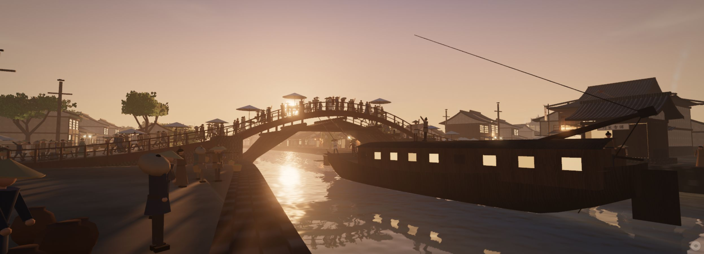</a>   <a href="cards/backlight-reveals-silhouette/shots/05.jpg">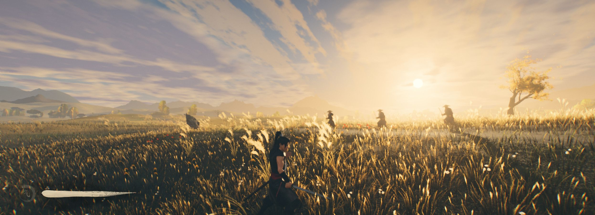</a>

[清明上河 · 黄昏虹桥](https://silentfleetkk.github.io/qingming-bianjing/opus-5.5/qingming-bianjing.html) · [Unreal 云上神殿与巨龙](https://skillry.dev/ai-videos/kimi-k3-1/kimi-moonshot-068067-1) · [中式幻想 RPG · 雾中巨像](https://skillry.dev/ai-videos/kimi-k3-1/crangerus-549203) · [长风 · 草原风起](https://jbang2004.github.io/long-wind/)

**用在博客：**title 主建筑、Shrine 巨像背景。

### [侧光刻石](cards/side-light-carves-stone/README.md)

让侧来的光同时照见凸面、留下凹槽，石材的体量才不会被花纹替代。

  <a href="cards/side-light-carves-stone/shots/03.jpg">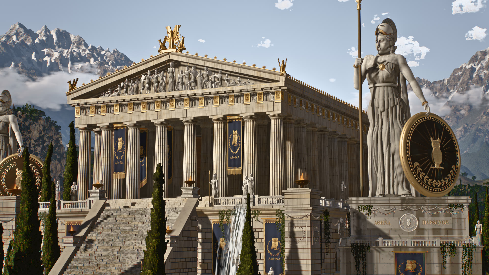</a>

[Athenaion · Fallen head](https://github.com/Leonxlnx/athenaion) · [Blender cathedral interior](https://x.com/k1rallik/status/2113693629713633435) · [Athenaion · Temple facade](https://github.com/Leonxlnx/athenaion)

**用在博客：**Shrine 石阶、BlackCityHall 立柱。

## 色彩

### [冷境暖灯](cards/cold-world-warm-refuge/README.md)

让整个世界保持冷色，把“有人在”的信息压缩成一小块暖光。

<a href="cards/cold-world-warm-refuge/shots/01.jpg">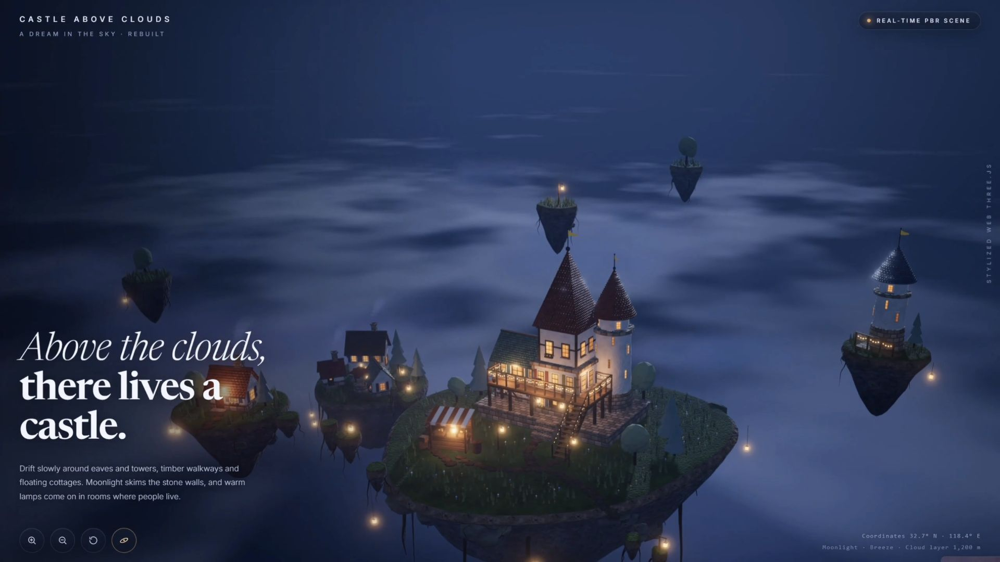</a> <a href="cards/cold-world-warm-refuge/shots/02.jpg">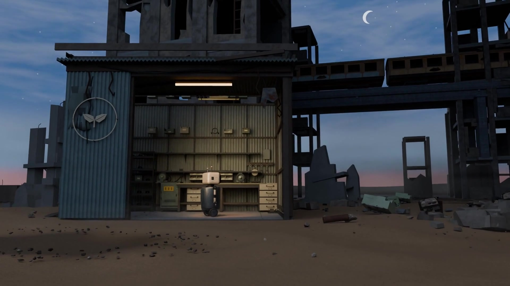</a> <a href="cards/cold-world-warm-refuge/shots/03.png">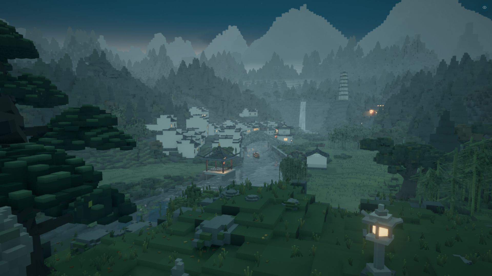</a>

[Castle above the clouds](https://x.com/i/status/2113279019005460816) · [末日机器人短片](https://skillry.dev/ai-videos/kimi-k3-1/kimi-moonshot-068067-8) · [江南山谷 · 蓝调全景](https://github.com/holooooo/webgl-seascape-video/blob/915cb7c9a318e03bd2228bc232494b496ff2316c/episodes/04-jiangnan-voxel/interactive.html)

**用在博客：**title 主视觉、Shrine 夜景与 Alley2 门口。

### [低彩分灰阶](cards/low-chroma-value-steps/README.md)

减少色相竞争，让暗壁、灰天、亮水各占一个明度层，画面仍能有重量。

  

[黑沙之境 · 海岸全景](https://github.com/Zp-Peter/kimi-k31pro-opus55-benchmark-showcase/blob/65e82c53b63f2fdd918617269c057d8e53af2c6f/kimi/iceland-black-sand/dist/index.html) · [雷尼斯黑沙滩 · 海滩](https://github.com/Zp-Peter/kimi-k31pro-opus55-benchmark-showcase/blob/65e82c53b63f2fdd918617269c057d8e53af2c6f/opus/reynisfjara/index.html) · [中式幻想 RPG · 雾中巨像](https://skillry.dev/ai-videos/kimi-k3-1/crangerus-549203)

**用在博客：**BlackCityHall 外部、Beach1/2 海岸方案。

## 构图重心

### [斜向配重](cards/diagonal-mass-balance/README.md)

把重体块压向一侧，用斜向地面或水带把另一侧的空场接回来。

  

[Athenaion · Panorama](https://github.com/Leonxlnx/athenaion) · [Unreal 云上神殿与巨龙](https://skillry.dev/ai-videos/kimi-k3-1/kimi-moonshot-068067-1) · [雷尼斯黑沙滩 · 海滩](https://github.com/Zp-Peter/kimi-k31pro-opus55-benchmark-showcase/blob/65e82c53b63f2fdd918617269c057d8e53af2c6f/opus/reynisfjara/index.html)

**用在博客：**title 主建筑取景、BlackCityHall 外廊。

### [留空放大孤立物](cards/emptiness-isolates-landmark/README.md)

让一个可辨认的物体独占大面积空场，空白本身成为时间和距离。

<a href="cards/emptiness-isolates-landmark/shots/02.jpg">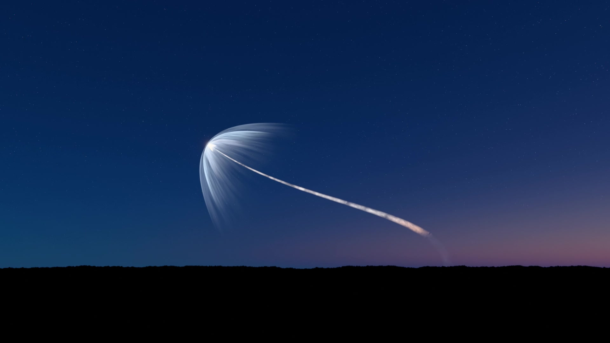</a>  

[Falcon 9 · 暮空尾迹](https://github.com/noahsabaj/falcon9-blender/releases/tag/v1.0) · [Ozymandias · 孤立残像](https://www.echohive.ai/posts/ozymandias/animation.html) · [雷尼斯黑沙滩 · 海滩](https://github.com/Zp-Peter/kimi-k31pro-opus55-benchmark-showcase/blob/65e82c53b63f2fdd918617269c057d8e53af2c6f/opus/reynisfjara/index.html)

**用在博客：**title 的单地标构图、Platform 远眺背景。

### [近框套远景](cards/framed-distant-view/README.md)

用有厚度的近景边界围住远处目标，让观众先拥有一个站立的位置。

  <a href="cards/framed-distant-view/shots/03.jpg">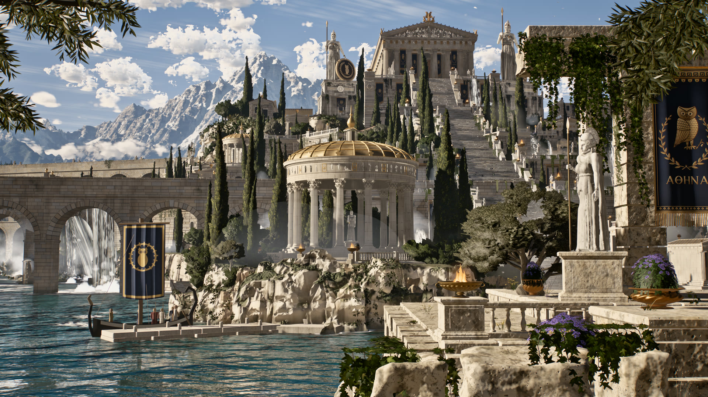</a>

[Athenaion · Ruined portico](https://github.com/Leonxlnx/athenaion) · [中式幻想 RPG · 雾中巨像](https://skillry.dev/ai-videos/kimi-k3-1/crangerus-549203) · [Athenaion · 水庭](https://github.com/Leonxlnx/athenaion)

**用在博客：**title 前景、Shrine 入口与 Alley2 门洞。

### [河道串景](cards/river-leads-the-eye/README.md)

用连续水道在密集场景里留出一条可读路径，把近景、中景与远处地标串起来。

  <a href="cards/river-leads-the-eye/shots/02.jpg">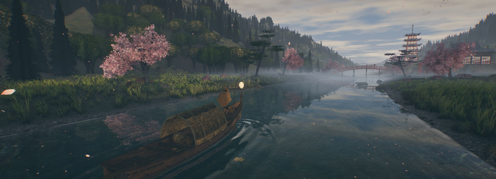</a> 

[Poseidia · Sea Canal](https://poseidia.vercel.app/) · [清明上河 · 黄昏全城](https://silentfleetkk.github.io/qingming-bianjing/opus-5.5/qingming-bianjing.html) · [Sakura River Valley](https://valley.mengto.here.now/) · [江南山谷 · 清晨河岸](https://github.com/holooooo/webgl-seascape-video/blob/915cb7c9a318e03bd2228bc232494b496ff2316c/episodes/04-jiangnan-voxel/interactive.html)

**用在博客：**atlas 河岸组织、Beach 水口的后续建模。

## 造型尺度

### [柱廊明暗节奏](cards/colonnade-rhythm/README.md)

用重复的柱身与暗腔给空间节拍，再用递减的间距把视线带向深处。

  

[Blender cathedral interior](https://x.com/k1rallik/status/2113693629713633435) · [Athenaion · Temple facade](https://github.com/Leonxlnx/athenaion) · [Unreal 云上神殿与巨龙](https://skillry.dev/ai-videos/kimi-k3-1/kimi-moonshot-068067-1)

**用在博客：**BlackCityHall 登记场景、Shrine 入口。

### [巨像越画框](cards/colossus-crosses-the-frame/README.md)

只让巨物的一部分进入画面，同时留下熟悉轮廓，观众会主动补全框外的体量。

  

[云上石像](https://skillry.dev/ai-videos/kimi-k3-1/kimi-moonshot-068067-2) · [中式幻想 RPG · 雾中巨像](https://skillry.dev/ai-videos/kimi-k3-1/crangerus-549203) · [Unreal 云上神殿与巨龙](https://skillry.dev/ai-videos/kimi-k3-1/kimi-moonshot-068067-1)

**用在博客：**Shrine 巨像、title 近地标取景。

### [骨架规整草木野](cards/ordered-frame-wild-growth/README.md)

把清楚的建筑骨架与不均匀生长的植物并置，让两种秩序互相说明。

<a href="cards/ordered-frame-wild-growth/shots/01.jpg">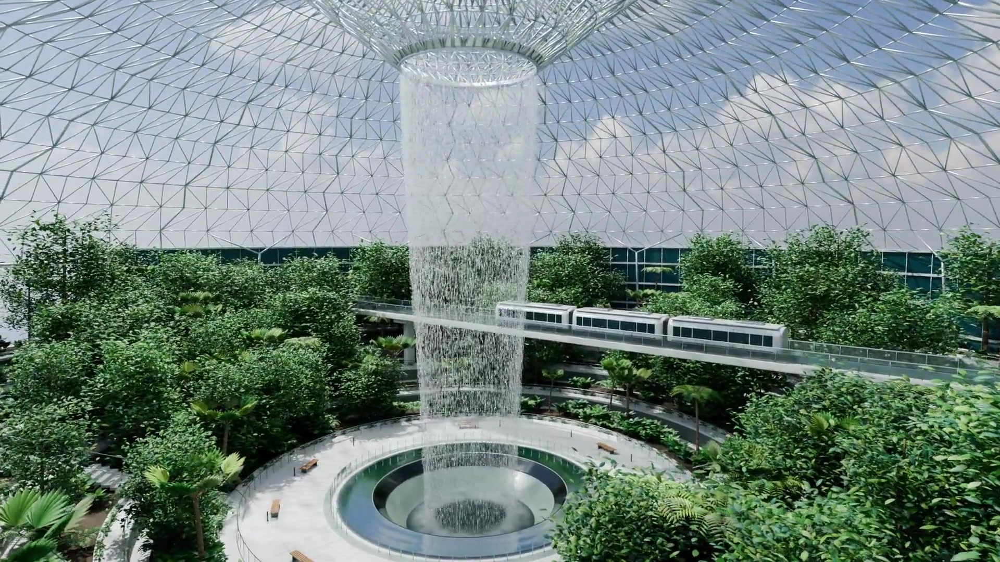</a>  

[Blender 机场室内雨林](https://skillry.dev/ai-videos/kimi-k3-1/kimi-moonshot-068067-4) · [Athenaion · 水庭](https://github.com/Leonxlnx/athenaion) · [Athenaion · Ruined portico](https://github.com/Leonxlnx/athenaion)

**用在博客：**Shrine 庭院与废墟边缘、atlas 绿化地标。

### [熟悉物标定巨构](cards/scale-by-familiar-objects/README.md)

给巨物旁边放一个观众认识大小的东西，巨大才会从形容词变成直觉。

<a href="cards/scale-by-familiar-objects/shots/01.jpg">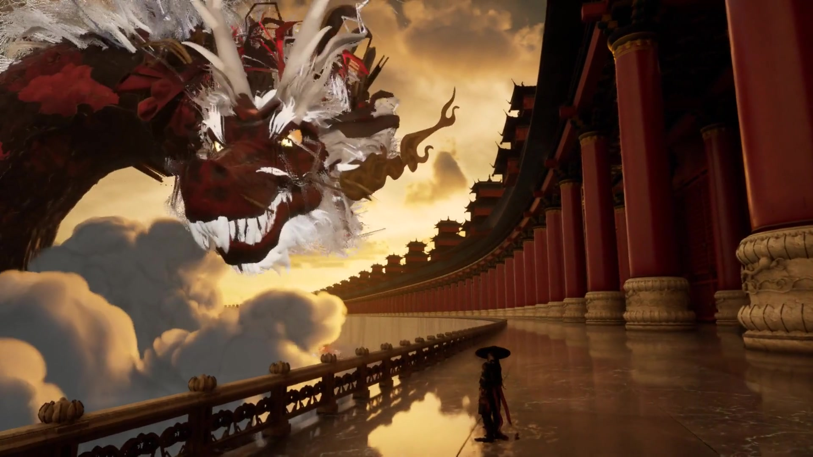</a>  

[Unreal 云上神殿与巨龙](https://skillry.dev/ai-videos/kimi-k3-1/kimi-moonshot-068067-1) · [Athenaion · Panorama](https://github.com/Leonxlnx/athenaion) · [Blender 机场室内雨林](https://skillry.dev/ai-videos/kimi-k3-1/kimi-moonshot-068067-4)

**用在博客：**atlas 主地标、BlackCityHall、Shrine 会面背景。

### [阶台托举主殿](cards/terraces-carry-the-temple/README.md)

用宽台、细阶和最高处主殿组成逐级上升的体量，庄严感来自可读的攀登关系。

  

[Athenaion · 水庭](https://github.com/Leonxlnx/athenaion) · [Athenaion · Grand staircase](https://github.com/Leonxlnx/athenaion) · [Athenaion · Panorama](https://github.com/Leonxlnx/athenaion)

**用在博客：**Shrine 入口层台、BlackCityHall 门厅基座。

## 材质

### [残损仍识原形](cards/broken-form-remains-legible/README.md)

保留足以辨认的原形，再用缺失、断口和散件说明它经历过什么。

<a href="cards/broken-form-remains-legible/shots/03.png">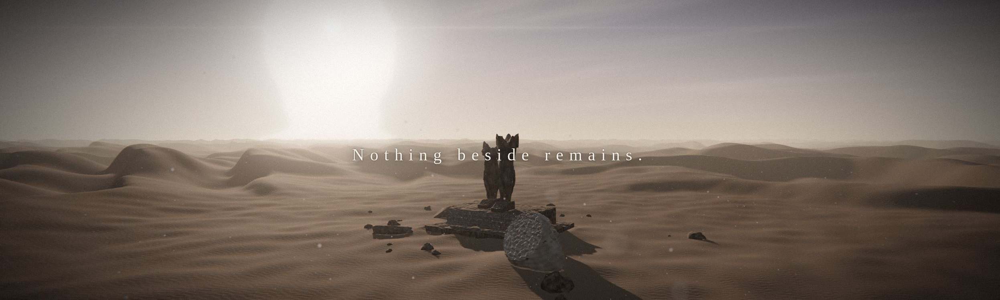</a>  

[Ozymandias · 孤立残像](https://www.echohive.ai/posts/ozymandias/animation.html) · [Athenaion · Fallen head](https://github.com/Leonxlnx/athenaion) · [Athenaion · Ruined portico](https://github.com/Leonxlnx/athenaion)

**用在博客：**Shrine 旧庭院、BlackCityHall 历史层提案。

### [焦散落在表面](cards/caustics-on-receivers/README.md)

把透光的物体、表面高光和投到周围的光斑分开组织，透明材质才有空间关系。

<a href="cards/caustics-on-receivers/shots/01.jpg">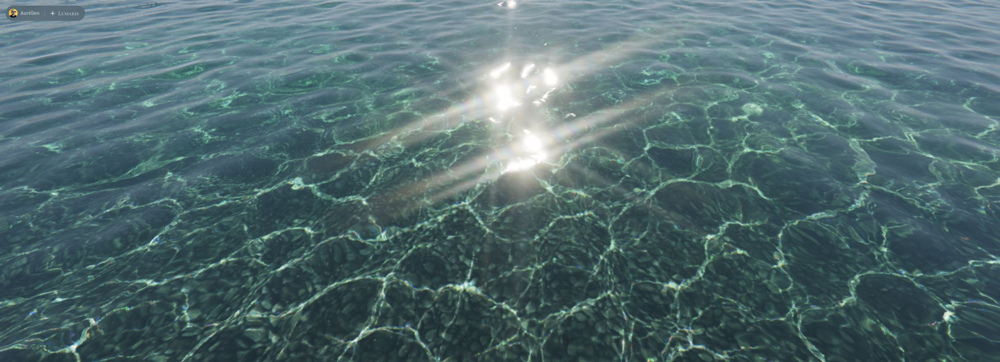</a>   <a href="cards/caustics-on-receivers/shots/05.png">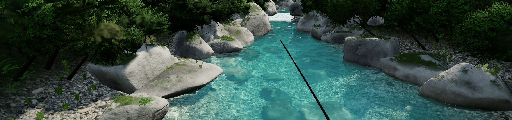</a>

[Clearwater](https://aureliengmz.github.io/clearwater/) · [Glass goblets · 12s](https://x.com/liambraus/status/2113724051332194589) · [Glass goblets · 21s](https://x.com/liambraus/status/2113724051332194589) · [清流 · 浅滩河床](https://seiryu.miraicode.one/)

**用在博客：**Beach 浅水、Shrine 器物、Platform 展示道具。

### [金饰点亮哑面](cards/gold-accents-matte-mass/README.md)

让金色光泽只强调冠、盾、边和器件，大体块继续由哑石、毛发或布料承担。

 <a href="cards/gold-accents-matte-mass/shots/02.jpg">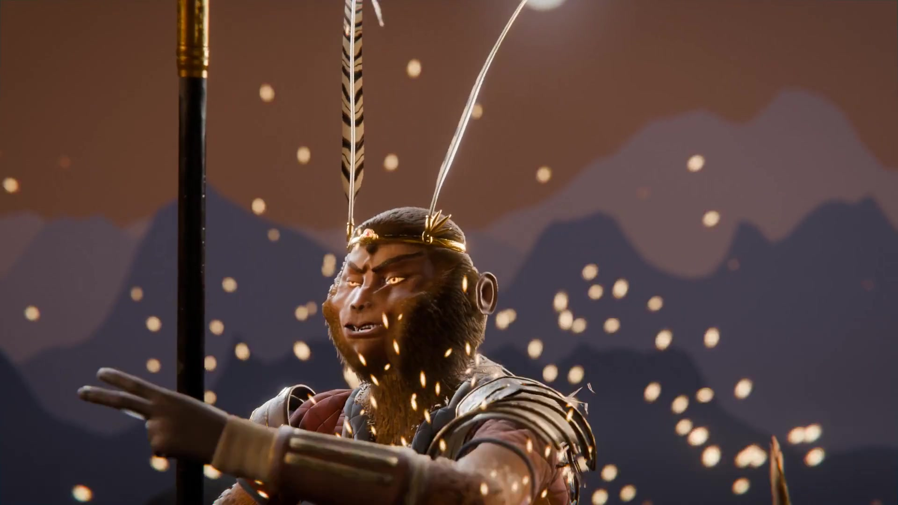</a> <a href="cards/gold-accents-matte-mass/shots/03.jpg">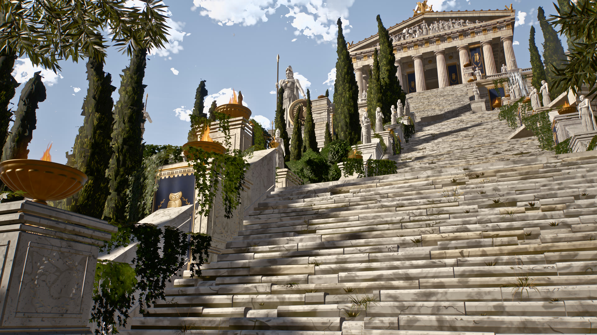</a>

[Athenaion · Temple facade](https://github.com/Leonxlnx/athenaion) · [悟空 · 金箍与棍端](https://skillry.dev/ai-videos/kimi-k3-1/oddjolt-160428) · [Athenaion · Grand staircase](https://github.com/Leonxlnx/athenaion)

**用在博客：**Shrine 门饰与立柱、BlackCityHall 徽记提案。

### [镜面邻粗面](cards/mirror-beside-roughness/README.md)

让会映出形状的面紧挨着哑光实体，观众靠高光形状读懂材质差异。

<a href="cards/mirror-beside-roughness/shots/05.jpg">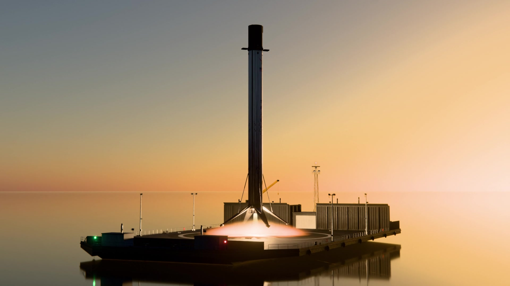</a> <a href="cards/mirror-beside-roughness/shots/01.jpg">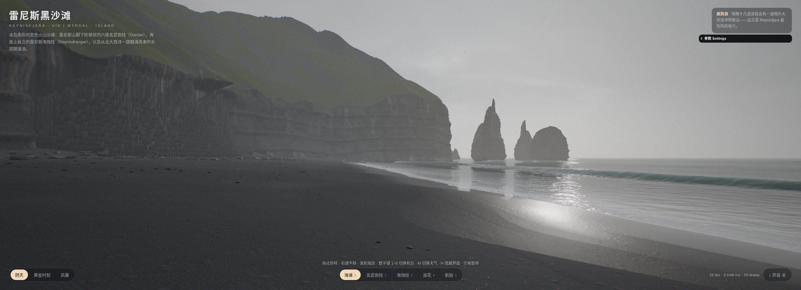</a> 

[Falcon 9 · 海面降落](https://github.com/noahsabaj/falcon9-blender/releases/tag/v1.0) · [雷尼斯黑沙滩 · 海滩](https://github.com/Zp-Peter/kimi-k31pro-opus55-benchmark-showcase/blob/65e82c53b63f2fdd918617269c057d8e53af2c6f/opus/reynisfjara/index.html) · [Unreal 云上神殿与巨龙](https://skillry.dev/ai-videos/kimi-k3-1/kimi-moonshot-068067-1)

**用在博客：**BlackCityHall 石地局部、Shrine 雨后台阶方案。

### [风化依附形体](cards/weathering-follows-form/README.md)

让磨损发生在边缘、接缝和暴露面，而不是给全部表面撒同一种噪点。

  <a href="cards/weathering-follows-form/shots/03.jpg">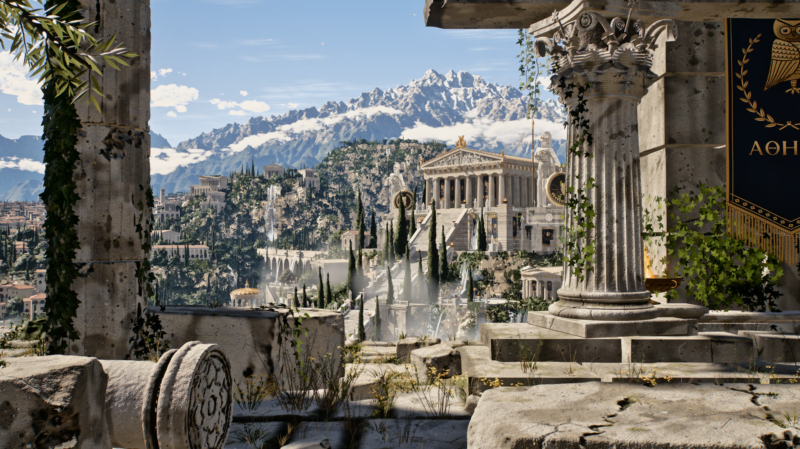</a>

[Athenaion · Grand staircase](https://github.com/Leonxlnx/athenaion) · [Athenaion · Fallen head](https://github.com/Leonxlnx/athenaion) · [Athenaion · Ruined portico](https://github.com/Leonxlnx/athenaion)

**用在博客：**Shrine 台阶、BlackCityHall 石构件。

## 水与大气

### [雾层分远近](cards/fog-separates-depth/README.md)

让远景先失去反差、再失去细节，近景仍有黑位，雾才会把空间拉开。

<a href="cards/fog-separates-depth/shots/01.jpg">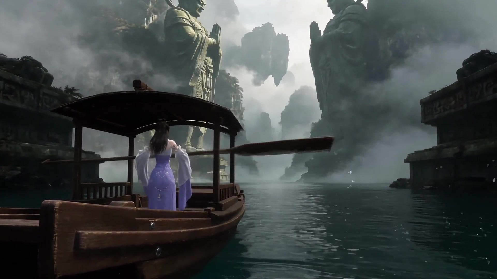</a>  

[中式幻想 RPG · 雾中巨像](https://skillry.dev/ai-videos/kimi-k3-1/crangerus-549203) · [江南山谷 · 蓝调全景](https://github.com/holooooo/webgl-seascape-video/blob/915cb7c9a318e03bd2228bc232494b496ff2316c/episodes/04-jiangnan-voxel/interactive.html) · [清明上河 · 黄昏全城](https://silentfleetkk.github.io/qingming-bianjing/opus-5.5/qingming-bianjing.html)

**用在博客：**Shrine 远山、atlas 地标之间的空气层。

### [水面续轮廓](cards/water-continues-silhouette/README.md)

让岸上形体在水里接着存在，倒影为建筑增加第二个向下延伸的空间。

<a href="cards/water-continues-silhouette/shots/01.png">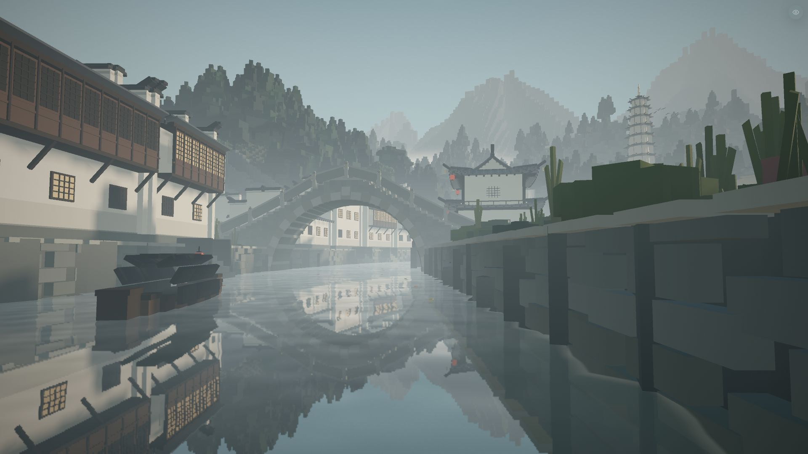</a>  

[江南山谷 · 清晨河岸](https://github.com/holooooo/webgl-seascape-video/blob/915cb7c9a318e03bd2228bc232494b496ff2316c/episodes/04-jiangnan-voxel/interactive.html) · [清明上河 · 雨中虹桥](https://silentfleetkk.github.io/qingming-bianjing/opus-5.5/qingming-bianjing.html) · [Falcon 9 · 海面降落](https://github.com/noahsabaj/falcon9-blender/releases/tag/v1.0)

**用在博客：**Beach1/2 水岸后续建模、Shrine 水庭提案。

## 镜头运动

### [俯瞰读层级](cards/high-view-reads-hierarchy/README.md)

把相机抬到能读懂地形与通路的位置，同时保留近景遮挡，避免把世界拍成桌面模型。

 <a href="cards/high-view-reads-hierarchy/shots/01.jpg">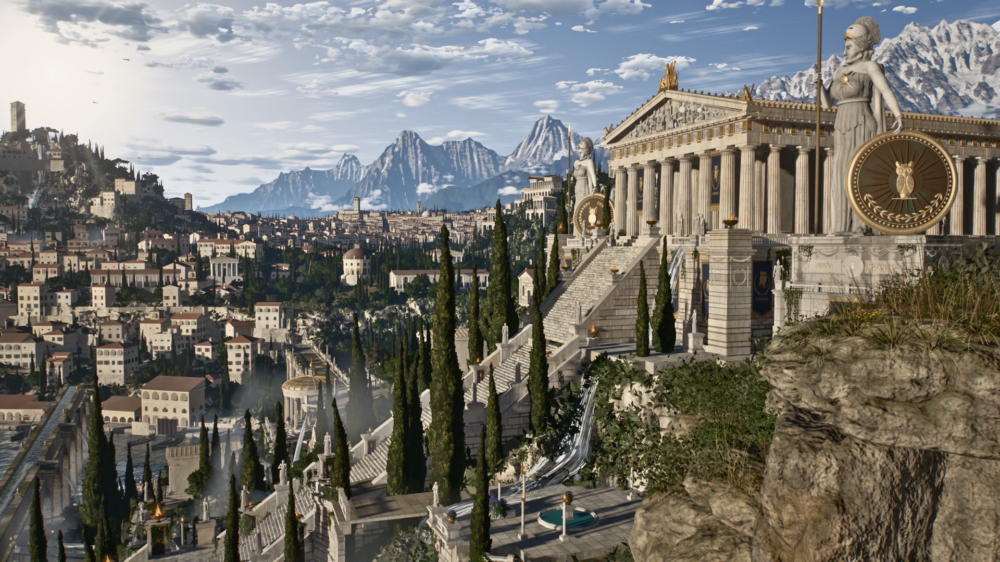</a> 

[清明上河 · 黄昏全城](https://silentfleetkk.github.io/qingming-bianjing/opus-5.5/qingming-bianjing.html) · [Athenaion · Panorama](https://github.com/Leonxlnx/athenaion) · [江南山谷 · 蓝调全景](https://github.com/holooooo/webgl-seascape-video/blob/915cb7c9a318e03bd2228bc232494b496ff2316c/episodes/04-jiangnan-voxel/interactive.html)

**用在博客：**atlas 地点总览与 title 远景备选。

### [低机位入场](cards/low-eye-entry/README.md)

把观众放进通道，允许近物切出画外，让消失方向成为入口。

  

[Sakura River Valley · 行船](https://valley.mengto.here.now/) · [雾中巨像 · 人舟水路](https://skillry.dev/ai-videos/kimi-k3-1/crangerus-549203) · [Warp Striker · 城市峡谷](https://github.com/OpenVGLab/awesome-opus5.5-frontend-showcases/blob/cac43b250f07b7b86f4709c61effc84269f46494/repro/warp-shooter/index.html)

**用在博客：**title 到主城的入场、Shrine 水路背景。

### [分级机位靠近](cards/staged-camera-approach/README.md)

先交代海岸与目的地，再把相机交给柱壁，让近景回答远景留下的问题。

 <a href="cards/staged-camera-approach/shots/02.jpg">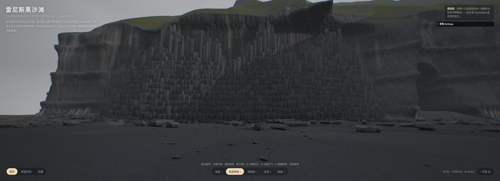</a> 

[雷尼斯黑沙滩 · 海滩](https://github.com/Zp-Peter/kimi-k31pro-opus55-benchmark-showcase/blob/65e82c53b63f2fdd918617269c057d8e53af2c6f/opus/reynisfjara/index.html) · [雷尼斯黑沙滩 · 柱壁](https://github.com/Zp-Peter/kimi-k31pro-opus55-benchmark-showcase/blob/65e82c53b63f2fdd918617269c057d8e53af2c6f/opus/reynisfjara/index.html) · [黑沙之境 · 海岸全景](https://github.com/Zp-Peter/kimi-k31pro-opus55-benchmark-showcase/blob/65e82c53b63f2fdd918617269c057d8e53af2c6f/kimi/iceland-black-sand/dist/index.html)

**用在博客：**BlackCityHall 外廊、Shrine 入口。

## 排版 UI

### [HUD细线叠层](cards/thin-line-hud/README.md)

让细线与数字提供秩序，中央留给目标；仅在事件发生时改变颜色和字级。

<a href="cards/thin-line-hud/shots/01.jpg">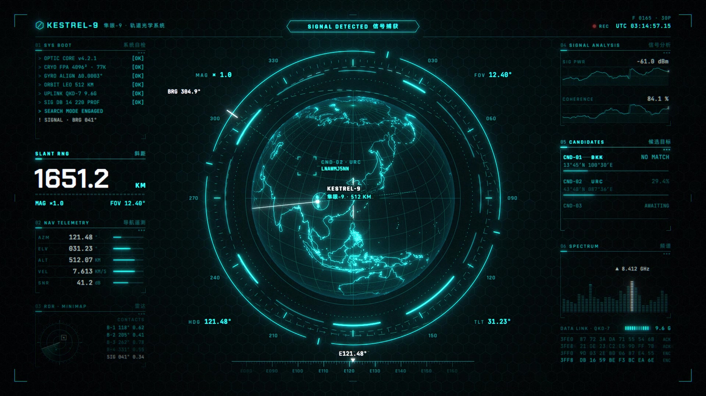</a> <a href="cards/thin-line-hud/shots/02.jpg">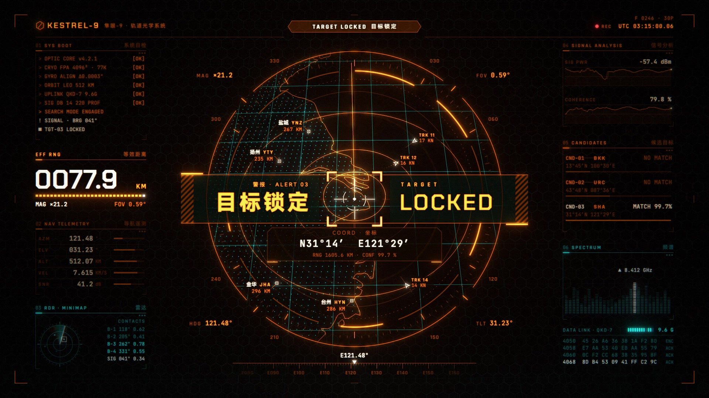</a> <a href="cards/thin-line-hud/shots/03.jpg">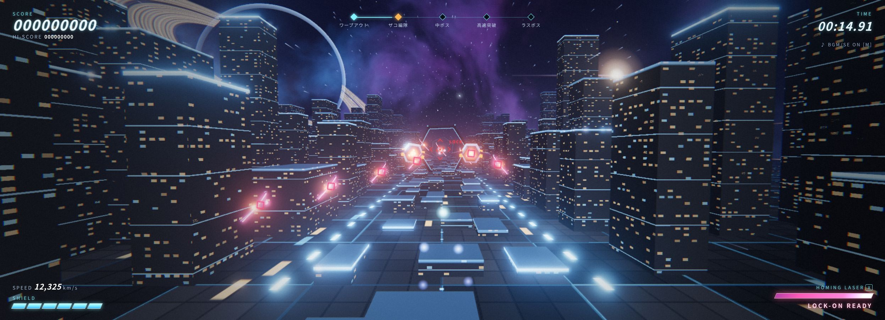</a>

[KESTREL-9 · 扫描](https://vincentwei1021.github.io/mg-styles-15/#22-hud) · [KESTREL-9 · 锁定](https://vincentwei1021.github.io/mg-styles-15/#22-hud) · [Warp Striker · 城市峡谷](https://github.com/OpenVGLab/awesome-opus5.5-frontend-showcases/blob/cac43b250f07b7b86f4709c61effc84269f46494/repro/warp-shooter/index.html)

**用在博客：**atlas 地点选中状态、Platform 设备叠层提案。

### [巨字随景退场](cards/type-yields-to-scene/README.md)

全景用大字命名世界，进入近景后让标题退场，保留足够轻的导航。

<a href="cards/type-yields-to-scene/shots/01.jpg">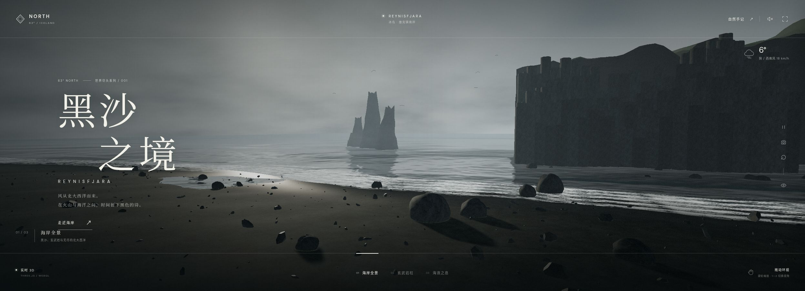</a>  

[黑沙之境 · 海岸全景](https://github.com/Zp-Peter/kimi-k31pro-opus55-benchmark-showcase/blob/65e82c53b63f2fdd918617269c057d8e53af2c6f/kimi/iceland-black-sand/dist/index.html) · [黑沙之境 · 玄武岩柱](https://github.com/Zp-Peter/kimi-k31pro-opus55-benchmark-showcase/blob/65e82c53b63f2fdd918617269c057d8e53af2c6f/kimi/iceland-black-sand/dist/index.html) · [雷尼斯黑沙滩 · 海滩](https://github.com/Zp-Peter/kimi-k31pro-opus55-benchmark-showcase/blob/65e82c53b63f2fdd918617269c057d8e53af2c6f/opus/reynisfjara/index.html)

**用在博客：**title 主视觉、BlackCityHall / Shrine 初次进入。

## 场景配方

- [黑沙与银水的海岸](recipes/black-shore.md)
- [雾水之间的巨像门](recipes/mist-colossi.md)
- [石阶托起云上神殿](recipes/terraced-sanctuary.md)

---

图像保留原作者权利。卡内区分实际网页截图、作品视频帧与作者独立渲染成片；每张图的出处与复现方式见对应 SOURCE。
