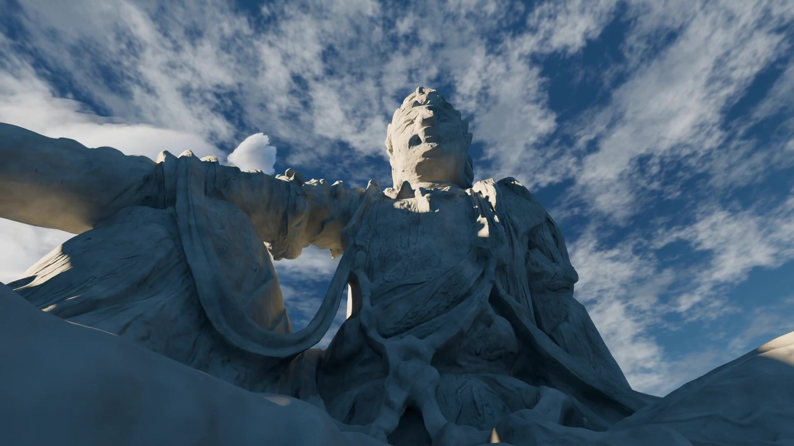
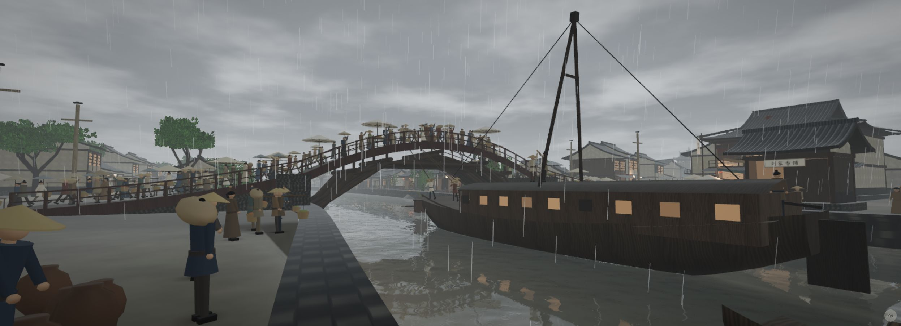

# 暖石冷影

分组：色彩 · 主维度：B 受光与阴影色、A 环境填充、D 面转折、E 石材、C 主次 · 情绪：庄严、清朗

**证据待补：目前只有1张有效全图正例，尚未满足3–8张正例门槛。** 语言保留，暂不作为证据完整的精选卡。Athenaion全城的暖殿/冷山不能代替同一石材的冷暖面；相邻时间的同机位也不凑作新视角。

## 一句话

把暖白受光面与灰蓝背光面放在同一块石头上，冷暖用于塑体而非分割两盏彩灯。

[云上石像](https://skillry.dev/ai-videos/kimi-k3-1/kimi-moonshot-068067-2) · 先看同一张脸：左上受光面暖白，右侧脸颊与衣褶阴面灰蓝。天空只作背景，不计为石材冷面。

## 看哪里

1. 画面中上方脸部：左侧额头、鼻梁旁和颧骨的暖白，向右侧眼眶与脸颊的灰蓝转折；这是同一物体内的对应关系。
2. 中部胸前衣褶：凸棱局部亮，大片凹面仍保留灰蓝层次；暗部能读出雕刻，而非一块黑洞。
3. 左侧屈膝与横伸手臂：暖亮薄边和冷暗大面并置，但手臂下方局部暖灰不应硬说成冷色。面向不同，颜色并不统一。

## 拆解

颜色、比例为画面估计，不是对白平衡、色温、法线或光照模型的测量。

- **B · 同物体分区**：脸部暖白约 `#D8D3BE`，右侧阴面与衣褶约灰蓝 `#3C596B`；两者落在同一石像的连续转折上。色相与亮度同时变化，不能声称仅色相带来全部立体感。
- **A · 暗部可读**：胸前与膝面的阴影保留褶皱和磨损。可迁移的是暗部亮度与低饱和冷倾向，不能据图断言灯的数量或环境贴图来源。
- **D · 大面优先**：头部、屈膝、胸前和横臂形成几块大冷暖面；先看面转折，再读裂纹。石像轮廓约占画面2/3宽，横臂越过左画框。
- **E · 石材细节**：脸部暖亮区仍有坑洼、破损；衣褶暗区仍有刻线。没有靠高亮抹平表面来换取“干净”。
- **C · 主次**：暖亮区域集中在上方面部及少量边缘，大部分胸腹保持冷暗；不要把整座像涂成暖白后仅用蓝天衬托，那会改变本卡定义。

## 做法

先用中性石材，试偏暖主光和低饱和冷环境填充。相机固定后，必须在同一对象上指出一对相邻的受光面与背光面；不能只检查全图平均色或远山颜色。

迁移时先保持双方饱和度低，暗面至少留住脸颊、衣褶和膝部形状。若出现强橙蓝海报感，收回光色强度。原作精确光强、色温与材质参数未核实，这里给出的是可见结果及调试顺序。

## 迁移到博客

Shrine石像可试“面部暖、转折冷”，BlackCityHall厚门框可试“正面暖、内侧冷”。这是静态光色提案，先做同机位A/B；2D角色的颜色不自动继承3D补光。

搭配侧光刻石与巨像越画框。和“冷境暖灯”分清尺度：本卡是同一对象内部的色差，后者是环境与小空间的分区，不能互换证据。

## 反例与证据边界

| 不同物体的环境分色 | 均匀天光下的冷灰同调 |
|---|---|
|  |  |
| 暖神殿与蓝灰远山很好地分离，但它们属于不同对象和不同距离；这张全景不能单独证明同一石面的暖面冷影。不是否定其画面质量。 | 阴雨环境主要靠遮挡与灰阶塑形，缺少强暖面/冷影。作为雨景合理，不应硬加橙蓝滤镜来套本卡。 |

[已复核的Athenaion近柱原图](shots/03.jpg)保留在归档：柱面明暗和质地可读，但阴面主要偏中性灰褐，未达到本卡灰蓝冷影的强证明标准，不计入正例数。

## 待补证据

已向原采集者核对原片，并在浏览器追加抽看7.639069、8.775470、9.395326秒：同一低机位基本不变，仅云层移动，没有可当新机位的画面。未导出这些近重复帧。

下一次应补同一中性石材在明确冷暖面下的两个真实角度，或另一个同类作品；同帧脸部/手臂局部裁切只能帮助读图，不增加独立机位或作品数。证据补足前，本卡保持待补状态。

[逐图来源与复现](SOURCE.md) · [返回视觉卡库](../../../README.md)
