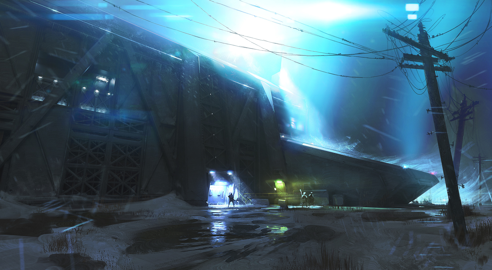

# 冷境承托设施

分组：造型尺度 · 主维度：D 模块与环境尺度、B 冷底点色、C 实体与空地、A 受光与遮蔽、F 风雪距离 · 情绪：孤立、坚守

[Antarctica Research Station](https://www.artstation.com/artwork/zPRVWZ) · 中央穹顶与红白分舱由细连廊接起，雪地留出建筑之间的空白。

<table><tr><td width="50%" valign="top"> <a href="https://www.artstation.com/artwork/Gvnagd">Arctic Sci-Fi Research Base – Environment Design</a> · 中央球体、竖罐和低模块在暗蓝雪场中分成三档，雪点不能抹掉外形。</td><td width="50%" valign="top"> <a href="https://www.artstation.com/artwork/rR39eL">Arctic Research Station</a> · 右侧双塔天桥和左侧低穹顶分级，前景橙色飞机压出远近。</td></tr></table>

[Northern Research Station](https://www.artstation.com/artwork/LaavGk) · 斜向暗立面下的小亮入口与人物标尺度；冷光、湿面和电杆加强暴露感，不能据此认定雪厚。

## 一句话

让冷色空地或寒雾托出人工设施，用连廊、入口和小型载具说明人在巨构中如何停留。

## 看哪里

1. **Antarctica Research Station**：中央穹顶与红白分舱由细连廊接起，雪地留出建筑之间的空白。
2. **Arctic Sci-Fi Research Base – Environment Design**：中央球体、竖罐和低模块在暗蓝雪场中分成三档，雪点不能抹掉外形。
3. **Arctic Research Station**：右侧双塔天桥和左侧低穹顶分级，前景橙色飞机压出远近。
4. **Northern Research Station**：斜向暗立面下的小亮入口与人物标尺度；冷光、湿面和电杆加强暴露感，不能据此认定雪厚。

## 拆解

图号按上方顺序。坐标为左上原点的全幅归一化位置，数值为画面估计，不是PBR反推或源场景实测。

- **D · 模块与尺度**：01 中央穹顶位于约(49%,40%)，横宽约画宽18%，外围舱体约5–12%；03 双塔占画高约65%，飞机占画宽约40%且贴右下。不同尺度不是简单复制同一盒子。
- **B · 冷底点色**：01 雪与阴影主域近灰蓝 `#B5C2CA` / `#647889`，红色舱边约占画面5–10%；03 橙色飞机仅是近景点色。04 是蓝白冷照明，不是全系列都用暖窗的证据。色值与占比均为画面估计。
- **C · 实体与空隙**：01 下半幅约有25–35%全幅面积作为低细节雪地/雾底，细连廊穿过去仍可读；02 中部设施密而四周雪地疏。04 改用下部约20%画高的低细节湿面承接大立面，是近景变体，并非雪原总图。
- **A · 光与遮蔽**：03 两塔阴影斜向右下，底脚没有全部融入白雪；04 最亮冷光在上部中右约(60%,13%)，入口在约(44%,70%)，两者间保留暗立面。最亮灯区有截白，迁移不照抄其曝光。
- **F · 距离大气**：01 远崖从左上至右上被薄雾减对比，近舱边缘比远崖清楚；02 雪点覆盖全图但仍保留约画宽25%的中央球体。雪粒、距离雾与地面积雪是三项，不拿一个满屏白点层代替。

## 做法

先用灰模验证“主设施—服务模块—通路—入口”的层级，再做环境冷暖和距离衰减。近场要有可达地面，远处才让雾吃掉细节；不要把每根连廊和每个窗都设成发光。

- **建议迁移值**：主设施投影高度先占40–60%，至少一处2–5%画宽的入口/小型对象；留一块25–35%全幅面积的低频环境底。不是原作建模尺寸实测。
- **已有模块边界**：`src/world/worlds/placeAir.js:8-22,42-80` 是灰尘/灰烬点场，注释明确不是雪。它仅能提供 object/update/dispose 生命周期与跟随相机包裹的邻接结构；若另做雪需改速度、粒形、风向并核对地面，不能称为已存在的暴雪实现。
- **不强迁移**：不复制作者穹顶、飞机或站体，不将现有场景换成南极，也不为这张卡新增 Cold/Station 地点。

### 实现索引

原作均无已确认源码，以下为已打开的邻接技术源，不是作品对应的完整实现。`source: none` 不以艺术家网址冒充源码；`citadel: none` 表示尚未找到已落地专用实现。路径相对 `~/Blog/`；2026-10-28核对。

| 作品 | 原作 / 邻接源码与机制 | 参数与性质 | 许可与接入 |
|---|---|---|---|
| Antarctica Research Station | `source: none`；原作源码未取得；邻接技术源 Repos/fable-refinery/index.html:866-888,984-1025（MIT） 提供模块体块和显式连接端点，Repos/lygia/lighting/raymarch/fog.glsl:31-35（Prosperity 3.0，只借指数距离雾手法） 提供冷境距离衰减。穹顶拓扑邻接 Repos/hexasphere.js/src/hexasphere.js:90-112（package.json 声明 MIT，未见独立 LICENSE，复制前复核）：这是六/五边双对偶网格，非图中三角玻璃原实现，只作拓扑参考。先搭设施与通路，再用冷色环境/距离雾分离；雾本身不会生成雪、冰或湿面。所有迁移待运行验证。 | 设施/环境画面面积=约40:60 起步（建议迁移值）；冷主色=#9CB2C2（建议迁移值）；可识别入口画宽=2–5%（建议迁移值）；雾公式=1-exp(-distance*density)（源码） | 原作版权归艺术家，未取得代码/资产许可；邻接源分别标注；`borrow`；`citadel: none` |
| Arctic Sci-Fi Research Base – Environment Design | `source: none`；原作源码未取得；邻接技术源 Repos/fable-refinery/index.html:866-888,984-1025（MIT） 提供模块体块和显式连接端点，Repos/lygia/lighting/raymarch/fog.glsl:31-35（Prosperity 3.0，只借指数距离雾手法） 提供冷境距离衰减。穹顶拓扑邻接 Repos/hexasphere.js/src/hexasphere.js:90-112（package.json 声明 MIT，未见独立 LICENSE，复制前复核）：这是六/五边双对偶网格，非图中三角玻璃原实现，只作拓扑参考。先搭设施与通路，再用冷色环境/距离雾分离；雾本身不会生成雪、冰或湿面。所有迁移待运行验证。 | 设施/环境画面面积=约40:60 起步（建议迁移值）；冷主色=#9CB2C2（建议迁移值）；可识别入口画宽=2–5%（建议迁移值）；雾公式=1-exp(-distance*density)（源码） | 原作版权归艺术家，未取得代码/资产许可；邻接源分别标注；`borrow`；`citadel: none` |
| Arctic Research Station | `source: none`；原作源码未取得；邻接技术源 Repos/fable-refinery/index.html:866-888,984-1025（MIT） 提供模块体块和显式连接端点，Repos/lygia/lighting/raymarch/fog.glsl:31-35（Prosperity 3.0，只借指数距离雾手法） 提供冷境距离衰减。穹顶拓扑邻接 Repos/hexasphere.js/src/hexasphere.js:90-112（package.json 声明 MIT，未见独立 LICENSE，复制前复核）：这是六/五边双对偶网格，非图中三角玻璃原实现，只作拓扑参考。先搭设施与通路，再用冷色环境/距离雾分离；雾本身不会生成雪、冰或湿面。所有迁移待运行验证。 | 设施/环境画面面积=约40:60 起步（建议迁移值）；冷主色=#9CB2C2（建议迁移值）；可识别入口画宽=2–5%（建议迁移值）；雾公式=1-exp(-distance*density)（源码） | 原作版权归艺术家，未取得代码/资产许可；邻接源分别标注；`borrow`；`citadel: none` |
| Northern Research Station | `source: none`；原作源码未取得；邻接技术源 Repos/fable-refinery/index.html:866-888,984-1025（MIT） 提供模块体块和显式连接端点，Repos/lygia/lighting/raymarch/fog.glsl:31-35（Prosperity 3.0，只借指数距离雾手法） 提供冷境距离衰减。此帧是斜向暗立面与小入口，不声称含其他三帧的穹顶/筒仓组合。先搭设施与通路，再用冷色环境/距离雾分离；雾本身不会生成雪、冰或湿面。所有迁移待运行验证。 | 设施/环境画面面积=约40:60 起步（建议迁移值）；冷主色=#9CB2C2（建议迁移值）；可识别入口画宽=2–5%（建议迁移值）；雾公式=1-exp(-distance*density)（源码） | 原作版权归艺术家，未取得代码/资产许可；邻接源分别标注；`borrow`；`citadel: none` |

## 迁移到博客

- `landfill-room-1`：用于远端舱室与低矮连接件的尺度组织，保留现有废料工业叙事；冷底只用现有混凝土/雾，不直接铺雪。缺少此处实拍差距审计，不宣称已完成改善。
- `black-city-1`：入口附近可借04的“暗大面—小亮口—平地”关系，人物只作比例验收，不复制作品人物或新增常驻3D hIE。
- 搭配 `card:scale-by-familiar-objects`、`card:fog-separates-depth`；与 `card:gold-accents-matte-mass` 同用时金饰须极少。全屏 bloom/高密度雪会吃掉模块轮廓；title/atlas 不施工。

## 反例

05 Industrial Warzone 是有价值的工业全景，但轨道与设备在前景密铺，三门炮台共同夺取天际线，没有寒冷低频环境底。它是“同题材不等于同语言”的边界反例，不是低质量作品。若把同样的密度铺满01的雪地，冷境承托设施就会变成纯机械陈列。

[Industrial Warzone | Cinematic 3D Environment](https://www.artstation.com/artwork/yAAmWJ) · 设备与轨道铺满画面，下部缺少安静冷底；同为设施巨构，不等于寒境托举。

[逐图来源与复现](SOURCE.md) · [返回视觉卡库](../../../README.md)
