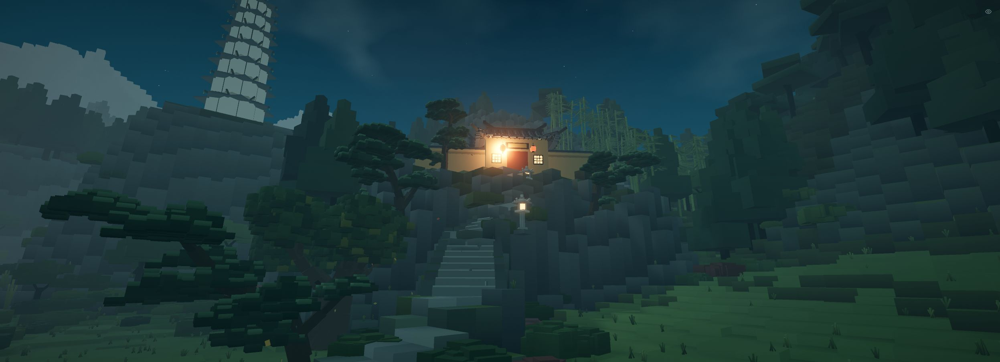

# 冷境暖灯

分组：色彩 · 主维度：A 光的叙事、B 冷暖分区、C 视觉重心、E 发光表面、I 居住暗示 · 情绪：孤寂、庇护

## 一句话

让整个世界保持冷色，把“有人在”的信息压缩成一小块暖光。

[Castle above the clouds](https://x.com/i/status/2113279019005460816) · 灰蓝云海包住暖窗和串灯，居住感集中在右下建筑。

| 参考 | 参考 |
|---|---|
|  |  |
| [末日机器人短片](https://skillry.dev/ai-videos/kimi-k3-1/kimi-moonshot-068067-8) · 冷蓝废墟中，工作间的一条暖灯定义仅存的生活空间。 | [江南山谷 · 蓝调全景](https://github.com/holooooo/webgl-seascape-video/blob/915cb7c9a318e03bd2228bc232494b496ff2316c/episodes/04-jiangnan-voxel/interactive.html) · 山体与树林保持冷暗，河岸灯、亭灯、山寺窗依距离构成三个暖点。 |
## 看哪里

1. Castle above the clouds：灰蓝云海包住暖窗和串灯，居住感集中在右下建筑。
2. 末日机器人短片：冷蓝废墟中，工作间的一条暖灯定义仅存的生活空间。
3. 江南山谷 · 蓝调全景：山体与树林保持冷暗，河岸灯、亭灯、山寺窗依距离构成三个暖点。

## 一句话

暖光首先标出一个值得走近的地点；它必须有窗、灯或门这一类可指认的载体，才不会退化成橙蓝滤镜。

## 拆解

以下百分比、位置和颜色为对截图的视觉估计，不是渲染器测量。

- **A · 光的叙事**：城堡最亮处落在右下约(57%,66%)的窗和栏杆；机器人工作间的顶灯在(40%,30%)，灯下脸与桌面比废墟亮。暖光都有可见来源。
- **B · 冷暖分区**：城堡环境约为灰蓝 `#263B61`，灯窗约 `#FFD28A`；暖亮区域不到全图约5%。机器人小室的暖棕面积更大，但周围约三分之二仍是低饱和冷灰。
- **C · 视觉重心**：江南近灯位于右下约(77%,85%)，亭灯居中偏下，远寺灯在右上；大小约按1 : 0.3 : 0.1递减，引导视线跨越距离。
- **E · 发光边界**：城堡窗框、灯栏仍能辨认；看的是亮窗嵌在暗墙里，而不是整面墙发光。灯晕不应扩张成第二个主体。
- **I · 世界暗示**：机器人周围大片空楼和暗铁皮没有被补满灯；孤寂感与小室的庇护感因这种克制同时成立。

## 做法

先锁住低饱和冷环境，再在入口或人物附近放一组暖实用灯；让邻接墙面受光，远处墙体保持冷暗。不要给每扇窗相同的亮度。

- **源码值**：江南蓝调将主光设为 `0x9cc4cc`、强度 `0.72`，天空/地面半球光分别为 `0x88b8bf` / `0x232d2b`；灯窗另有独立开关。这些值依赖原作尺度与曝光。[蓝调状态的对应代码](https://github.com/holooooo/webgl-seascape-video/blob/915cb7c9a318e03bd2228bc232494b496ff2316c/episodes/04-jiangnan-voxel/interactive.html#L3465-L3475)。
- **迁移起点**：先以暖亮区域占画面2–6%为构图预算，只保留一处主暖光和至多两处远景回声。缩到400px后应先看到目的地，再看到整个环境。
- **不能由图推出**：原片的物理照度、tone mapping、精确bloom阈值均未验证，不给伪精确参数。

## 迁移到博客

- **用在哪**：`citadel/src/world/worlds/title.js`的主视觉；`src/game/places.js`登记的Shrine夜间与Alley2夜间变体。
- **改什么**：这是一份迁移提案，尚未声称当前画面有缺陷。为入口、会面位置或街角摊位选择一个暖焦点；背景建筑保留冷暗，既不移动2D人物层，也不给整片天空加橙色渐变。
- **搭配**：可以配合雾层纵深，让远灯更小更软；可以配合暗前景画框。
- **冲突**：满屏霓虹和彩色焦散会消解唯一暖焦点；高浓度近雾会把窗光涂成一团。先保住窗框，再调灯晕。

## 反例

山寺蓝调图中，中央暖光方向正确，但最亮的左门灯与墙面已连成白黄团；如果继续增大灯晕，门框就失去材质边界。不要把“灯更亮”当成“入口更清楚”。

[江南山谷 · 山寺蓝调](https://github.com/holooooo/webgl-seascape-video) · 暖门灯有目的性，但光晕开始覆盖门口细节。

[逐图来源与复现](SOURCE.md) · [返回视觉卡库](../../../README.md)
