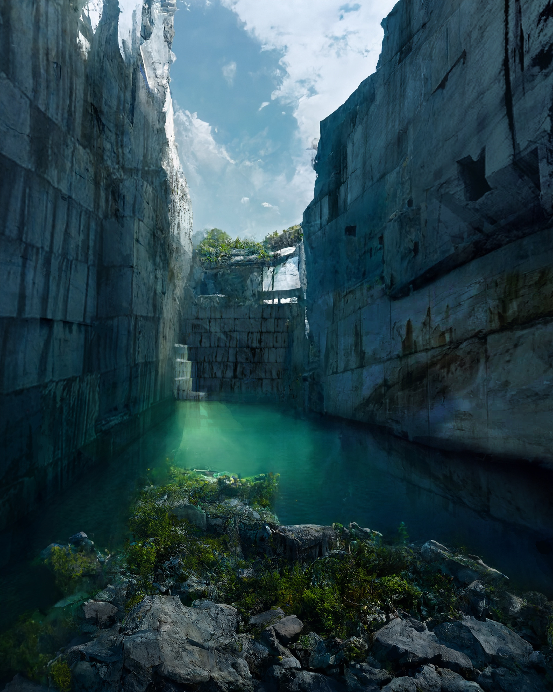
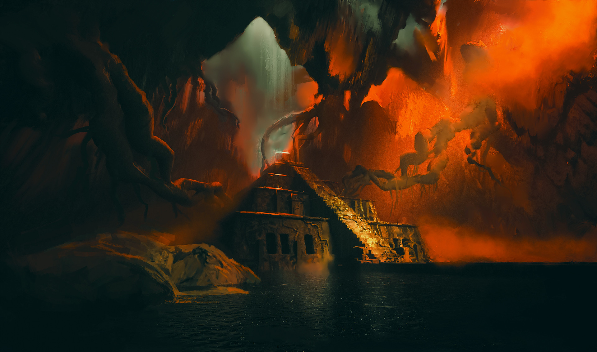

# 深水托高壁

分组：水与大气 · 主维度：F 暗水承底、C 水平脚线、B 冷水暖壁、D 高低对照、E 微波与厚石 · 情绪：静谧、不可踏入

Lost Quarry · oknice · 绿水贴着两侧巨壁的底边，中央微亮、壁脚与反射处更暗。

| 参考 | 参考 |
|---|---|
|  |  |
| Cenote Temple · raylopez · 右侧暖岩与石阶落在一片暗水之上，低部没有亮地板抢走空间。 | Cenote ik Kil 02 · theauthor · 绿潭只露下沿一条，仍能以水平水线托住整圈垂壁；不是大镜面展示。 |

## 一句话

让高壁的脚消失在一片暗水里，用可读的水平水线与不可见池底，把垂直高度接成向下的深度。

## 看哪里

1. **Lost Quarry · oknice**：绿水贴着两侧巨壁的底边，中央微亮、壁脚与反射处更暗。
2. **Cenote Temple · raylopez**：右侧暖岩与石阶落在一片暗水之上，低部没有亮地板抢走空间。
3. **Cenote ik Kil 02 · theauthor**：绿潭只露下沿一条，仍能以水平水线托住整圈垂壁；不是大镜面展示。

## 拆解

比例为原图目估区间，不是相机实参或场景米制测量；位置用归一化画幅描述。

- **F · 看不到底不等于全黑**：图1中央绿水约占画宽1/3，壁脚水带更暗；图2水域占下部约25%，仍有细小反光。图3只露底部约10–15%画高，证明效果不依赖水域很大。
- **C · 支撑线**：图1后壁脚线在画高约58%，前景岩石越入低部；图2阶梯终点约在画高70–75%，下面由水平暗水接住。水线必须贴实，不留发亮漏缝。
- **B · 色块**：图1青绿水与蓝灰壁同属冷色，靠亮度区分；图2橙岩与近黑青水冷暖分离。两种方案都压住水高光面积，而非一律套蓝橙。
- **D · 高低**：图1壁占中上部约60%，水作为低而平的大面；图3长藤垂至水缘，竖线与水平潭面互证高度。
- **E · 表面**：图2近处有细波但无满池白沫；图1切石边比水面纹理清楚。400px缩图先读到“壁上、水下”，不是同频噪声。

## 做法

先定池壳、水平水线和暗底色，再让少量壁色进入反射。反射续形只是辅助，本卡核心是不可见池底的暗承底；与 `card:water-continues-silhouette` 的可辨倒影不是同一验收。现有 reflectFloor 为加法覆层，不处理水深吸收、浮力或岸线自动生成。

### 实现索引

路径相对 `~/Blog/`；citadel 栏相对 `~/Blog/citadel/`。源码默认值不是旧截图的已验证运行实参；建议迁移值仍需目标场景实看。`source: none` 不以邻接源冒充原作算法。

| 作品 | 源码 / 技术与边界 | 参数及性质 | 许可 / 复用 | citadel 已有实现 |
|---|---|---|---|---|
| Lost Quarry · oknice | `none`；原作水材质源码未取得；邻接技术源 Repos/qingming-bianjing/opus-5.5/qingming-bianjing.html:1027-1104 是平面反射+法线扰动（无LICENSE，只借手法），非深池吸收求解器。波纹弱时仍留壁脚暗带，中央透绿；不是把整池铺成高亮平面。 Citadel reflectFloor 仅加法反射覆层，必须另有暗底色/池壳，不能单独做出池深。 | 邻接 Fresnel=.02+.98*(1-ndv)^5（源码）；邻接反射上限=.74（源码）；水域占幅=图1转译先取20–30%画高（建议迁移值） | 原图版权归作者；邻接源无LICENSE / borrow | `lab/src/core/reflect.js:53-101,112-164` |
| Cenote Temple · raylopez | `none`；原作水材质源码未取得；邻接技术源 Repos/qingming-bianjing/opus-5.5/qingming-bianjing.html:1027-1104 是平面反射+法线扰动（无LICENSE，只借手法），非深池吸收求解器。先分离水的底色和阶梯反射，暖岩不应照亮整池。 Citadel reflectFloor 仅加法反射覆层，必须另有暗底色/池壳，不能单独做出池深。 | 邻接 Fresnel=.02+.98*(1-ndv)^5（源码）；邻接反射上限=.74（源码）；水域占幅=图1转译先取20–30%画高（建议迁移值） | 原图版权归作者；邻接源无LICENSE / borrow | `lab/src/core/reflect.js:53-101,112-164` |
| Cenote ik Kil 02 · theauthor | `none`；原作水材质源码未取得；邻接技术源 Repos/qingming-bianjing/opus-5.5/qingming-bianjing.html:1027-1104 是平面反射+法线扰动（无LICENSE，只借手法），非深池吸收求解器。窄水条只需保留水平接触线和深浅差，不需要复制整圈藤蔓倒影。 Citadel reflectFloor 仅加法反射覆层，必须另有暗底色/池壳，不能单独做出池深。 | 邻接 Fresnel=.02+.98*(1-ndv)^5（源码）；邻接反射上限=.74（源码）；水域占幅=图1转译先取20–30%画高（建议迁移值） | 原图版权归作者；邻接源无LICENSE / borrow | `lab/src/core/reflect.js:53-101,112-164` |

## 迁移到博客

落点 `shrine-1` 的 `basin`，已有 `lab/src/scenes/Shrine/index.js:220-221,264` 的1.2×0.5m小池和检查机位；不是已存在的大水庭。只在石盆尺度验证暗水贴住石缘：减掉均匀亮蓝底、保留窄的环境反射，建议水像素暗于石缘1档（建议迁移值）。若复用 reflectFloor，需要作为盆内底材之上的独立覆层并限制边界；不能覆盖整个庭院。搭配 `card:mirror-beside-roughness`；强焦散或满面波峰会抬亮池底、冲掉深度。

## 反例

硫矿入口以橙色地面和道路连续提供立足点，没有“水线以下不可踏入”的缺口。它是空间语义对照，不是劣质作品；明亮实地不能只靠改成绿色就冒充深水。

Venusian Sulfur Mine · finnbrandon · 底部橙色实地和进厂道路连续可走，不产生水下不可踏入的空缺。

[逐图来源与复现](SOURCE.md) · [返回视觉卡库](../../../README.md)
