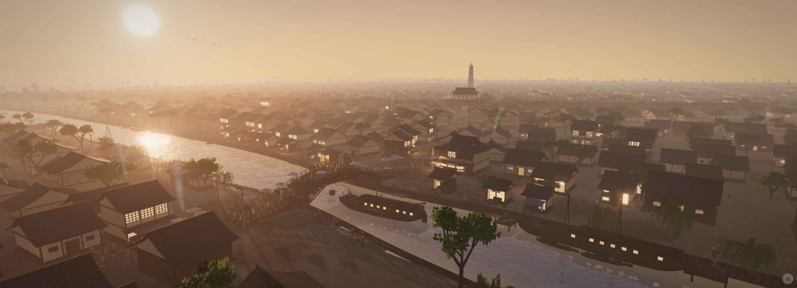

# 留空放大孤立物

分组：构图重心 · 主维度：C 负空间、D 单体尺度、A 高光预算、B 色域、I 孤立 · 情绪：孤寂、静止

## 一句话

让一个可辨认的物体独占大面积空场，空白本身成为时间和距离。

[Falcon 9 · 暮空尾迹](https://github.com/noahsabaj/falcon9-blender/releases/tag/v1.0) · 深蓝天空让出大面积低细节空场，白色薄尾迹成为唯一事件。

| 参考 | 参考 |
|---|---|
|  |  |
| [Ozymandias · 孤立残像](https://www.echohive.ai/posts/ozymandias/animation.html) · 空沙丘围住一小组残腿与碎块，物体靠孤立和长影获得重量。 | [雷尼斯黑沙滩 · 海滩](https://github.com/Zp-Peter/kimi-k31pro-opus55-benchmark-showcase/blob/65e82c53b63f2fdd918617269c057d8e53af2c6f/opus/reynisfjara/index.html) · 黑壁以外的大段灰天与空海让远礁独立出来，湿带只提供一条方向。 |
## 看哪里

1. Falcon 9 · 暮空尾迹：深蓝天空让出大面积低细节空场，白色薄尾迹成为唯一事件。
2. Ozymandias · 孤立残像：空沙丘围住一小组残腿与碎块，物体靠孤立和长影获得重量。
3. 雷尼斯黑沙滩 · 海滩：黑壁以外的大段灰天与空海让远礁独立出来，湿带只提供一条方向。

## 拆解

位置与面积为目估。Ozymandias图是明确标注的去播放器裁切，原全图保留。

- **C · 空场**：残像之外主要是沙丘与天空，局部物组约占中央1/5宽；尾迹图天空约占上部78%，没有再填满巨大标题或星云。
- **D · 孤物**：Ozymandias残腿虽不大，底座与散石形成一个完整组。火箭本体几乎看不见，尾迹给出事件尺度；本卡不以该图证明火箭建模精度。
- **A · 注意力**：沙地长影把焦点拉回残像；夜空白羽只有一个最亮起点。若在每个空角放高亮小图标，孤立就被破坏。
- **B · 色域**：沙褐近`#928373`与浅灰天构成窄色域；暮空深蓝近`#0B315E`加一束淡白。负空间不需要纯黑或纯白。
- **I · 时间**：散石与残腿暗示已消失的纪念物；尾迹暗示远处刚发生的事件。空场给观众留下推想的空间。

## 做法

先选唯一主体，再画出它周围不放东西的区域。空地允许有低频起伏，但不铺与主体同反差的微纹理。

- **迁移试验**：可辨识物组占宽10–25%，主要空场至少50%；如果主体太小读不出形状，先增大它而非加发光箭头。
- 原作没有为本卡核实源码参数；留白通过布局和相机实现，不需要新后处理。

## 迁移到博客

title可选一个孤立门、塔或远礁作为主物；Platform远眺把背景密度降下来，为会面文字和角色留空间。这里不新增已退役的海上入场路线。

搭配低彩分灰阶、薄雾远层；与网格罩住林冠、密柱阵列属于不同密度目标，不在同一视图中心叠满。主物需要近框时，框只占边缘。

## 反例

汴京全景的优点是街市密度与连续生活线索；若将这类密度铺在孤塔四周，孤塔便只是一栋建筑。反例针对组合目标，不否定原作的城市叙事。

[清明上河 · 黄昏全城](https://silentfleetkk.github.io/qingming-bianjing/opus-5.5/qingming-bianjing.html) · 满城屋顶和船桥都在提供生活信息；它不能同时承担孤绝留白。

[逐图来源与复现](SOURCE.md) · [返回视觉卡库](../../../README.md)
