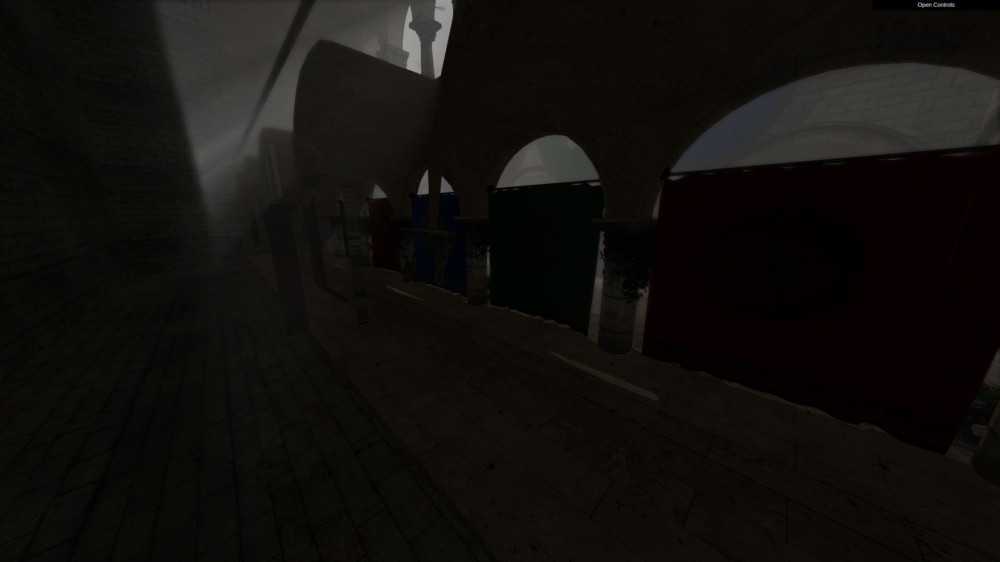

# 雾层分远近

分组：水与大气 · 主维度：F 距离层次、A 局部反差、B 雾色、C 空间开口、D 尺度 · 情绪：幽远、敬畏

## 一句话

让远景先失去反差、再失去细节，近景仍有黑位，雾才会把空间拉开。

[中式幻想 RPG · 雾中巨像](https://skillry.dev/ai-videos/kimi-k3-1/crangerus-549203) · 近舟、两侧巨像、中央浮岩、远山依次向浅灰靠近。

| 参考 | 参考 |
|---|---|
|  |  |
| [江南山谷 · 蓝调全景](https://github.com/holooooo/webgl-seascape-video/blob/915cb7c9a318e03bd2228bc232494b496ff2316c/episodes/04-jiangnan-voxel/interactive.html) · 近岸深、中央村落浅、后方山脊更淡，灯光没有代替距离层次。 | [清明上河 · 黄昏全城](https://silentfleetkk.github.io/qingming-bianjing/opus-5.5/qingming-bianjing.html) · 近屋顶仍分瓦面，远城渐成淡金剪影。 |
## 看哪里

1. 中式幻想 RPG · 雾中巨像：近舟、两侧巨像、中央浮岩、远山依次向浅灰靠近。
2. 江南山谷 · 蓝调全景：近岸深、中央村落浅、后方山脊更淡，灯光没有代替距离层次。
3. 清明上河 · 黄昏全城：近屋顶仍分瓦面，远城渐成淡金剪影。

## 拆解

比例、色值均为画面估计；未从截图反推真实雾算法。

- **F · 分层**：巨像图从左下舟棚、右侧像身、中间浮岩到远山约四层；后两层逐级靠近背景灰绿，不是每层都加一块白雾。
- **A · 反差**：近棚仍近黑，远山与天的明度差很小；缩图中先读舟与像，再读浮岩。中层仍有实体轮廓，没有被完全抹掉。
- **B · 雾色**：巨像远层近`#A8B4A6`、山谷近蓝灰`#788E92`、汴京近暖米`#BAAA89`。雾色服从环境光，不固定使用纯白。
- **C · 开口**：巨像中央亮通道约占画宽1/4；雾最易读的地方恰好没有复杂近景挡住。山谷河道同样留出一条低细节通路。
- **D · 尺度**：远塔和山脊保留足够大轮廓，细窗与瓦先消失。距离削弱细节而非把几何缩成小摆件。

## 做法

先把近、中、远层分别用灰模检验，再加雾。能分辨几何层次之后，才用雾色把它们连起来。

- **原作源码值**：江南[MOODS与大气状态](https://github.com/holooooo/webgl-seascape-video/blob/915cb7c9a318e03bd2228bc232494b496ff2316c/episodes/04-jiangnan-voxel/interactive.html#L3465-L3500)黄昏雾色`0x5a7a82`、密度`0.0048`；这是该场景单位下的值，不能直接当Citadel标准。
- **迁移试验**：在目标相机截近中远三层灰度图，先让远层局部反差约为近层的1/3–1/2；保留近棚或门框黑位。用实际画面验收，不以某个density数值验收。

## 迁移到博客

Shrine把会面人物后的一层建筑与更远山体分开；atlas的远地标可减细节、减反差，当前地点保持清楚。人物是独立2D层，不为制造雾感给人物也盖同一层白纱。

搭配近框套远景、巨像越画框；与浓厚全屏bloom冲突，因为后者也会抬近景黑位。与黑沙灰阶搭配时要保留至少一块较深的近景。

## 反例

Sponza的暗帘和廊道都落在接近黑的区间，靠“更暗”不能识别哪一层更远。它说明应保存距离差，而不是简单降低全场曝光。

[Sponza · 本次偏暗机位](https://three-good-godrays.ameo.design/#sponza) · 近中景一起压成黑，暗并没有带来足够的距离线索。

[逐图来源与复现](SOURCE.md) · [返回视觉卡库](../../../README.md)
