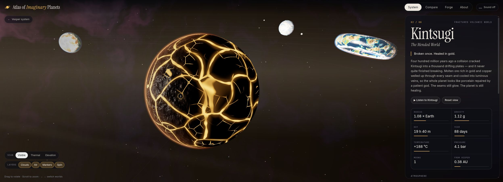

# 金饰点亮哑面

分组：材质 · 主维度：E 金色光泽与哑面、A 亮边位置、B 点缀色面积、D 结构节点、C 识别焦点 · 情绪：庄严、精致

## 一句话

让金色光泽只强调冠、盾、边和器件，大体块继续由哑石、毛发或布料承担。

[Athenaion · Temple facade](https://github.com/Leonxlnx/athenaion) · 金盾、冠饰和檐口小饰在大面积灰石旁形成窄亮边，石柱仍是主体体块。

| 参考 | 参考 |
|---|---|
|  |  |
| [悟空 · 金箍与棍端](https://skillry.dev/ai-videos/kimi-k3-1/oddjolt-160428) · 金箍与棍端出现集中的金色亮边，毛发、暗棍身与布料保留宽暗面；银灰肩甲不作为金饰证据。 | [Athenaion · Grand staircase](https://github.com/Leonxlnx/athenaion) · 左前景金盆的窄亮边邻接灰石宽面；看盆沿、盆腹与石基座，不把火焰当金饰发光。 |
## 看哪里

1. Athenaion · Temple facade：金盾、冠饰和檐口小饰在大面积灰石旁形成窄亮边，石柱仍是主体体块。
2. 悟空 · 金箍与棍端：金箍与棍端出现集中的金色亮边，毛发、暗棍身与布料保留宽暗面；银灰肩甲不作为金饰证据。
3. Athenaion · Grand staircase：左前景金盆的窄亮边邻接灰石宽面；看盆沿、盆腹与石基座，不把火焰当金饰发光。

## 拆解

颜色、比例为画面估计。截图支持光泽与表面差异，不足以证明真实金属材质、镀金工艺或准确PBR参数。

- **E · 表面对照**：Athenaion金盾的边环、铆点和中央纹饰比灰石像更集中地反光；悟空金箍与棍端比毛发、暗棍身锐亮。哑面仍保留大的连续中间调。
- **A · 亮边**：神殿饰件的亮面沿上缘与凸起分布，暗面仍是金褐而非纯白；阶梯金盆的盆沿明亮、盆腹仍暗，盆中火焰另属光源，不能混作表面反光。
- **B · 面积与色域**：神殿大面是低彩灰石，金色约`#B89348`到暖白只出现在少数饰件；悟空主要是棕黑毛发与金色箍边，火星虽同色却属另一层发光，迁移时应减量。
- **D · 节点**：冠顶、盾环、檐缘、器皿边沿都位于能说明结构或身份的位置。不是每一道随机裂缝都描金，也不把人物皮肤染成金属。
- **C · 识别**：神殿右侧盾直径约画高1/3，边环大形先读到；人物金箍跨眉上；阶梯左下金盆和基座约占画宽1/5，亮边使器件从大面积石阶中可辨。细饰服务已存在的轮廓。

## 做法

先用哑光灰模确认大形，最后才选择哪些节点需要金色光泽。若移除金饰后建筑完全不可辨认，应先补造型而不是补更多金色。

- **迁移试验**：金饰在最终相机中先限5–10%可见面积；金色表面的roughness可从0.25–0.45试，邻接石材从0.7–0.9试。这些是Blog实验参数，未从原作反推。
- 用同一环境光检查亮边能否随角度变化；如果始终整片同亮，先检查是否误把反光写成自发光。金色本身不能证明“金属”。
- 本卡未核实角色视频的shader或资产来源，不提供伪造的源码永久链接；可见造型与材料分工才是本卡内容。

### 实现索引

2026-10-28 已打开本地源码核对；当前 checkout 不等同旧成片版本。参数区分源码与建议迁移值，尚未在 Citadel 运行复刻。`citadel: none` 是尚未找到可复用实现，不是已落地声明。第三方路径相对 `~/Blog/`，Citadel 路径相对 `~/Blog/citadel/`。固定版本与许可见 [SOURCE.md](SOURCE.md)。

| 作品 | 源码 / 邻接与手法 | 参数及性质 | 许可 / 复用 | Citadel 可复用实现 |
|---|---|---|---|---|
| Athenaion · Temple facade | `Repos/athenaion/src/materials/metal.js:22-55,76-104`；金属材质按 cavity 压暗、edge 提亮，金饰单独赋材质；需 core/materials.js 与 marble.js AO/noise 依赖，非整栋描金 | gold roughness=0.4（源码）；gold wear=0.45（源码）；metalness 基值=1（源码）；金饰可见面积=5–10%（建议迁移值） | MIT / integrate | `none` |
| 悟空 · 金箍与棍端 | `none`；原作源码未取得；邻接技术源 Repos/athenaion/src/materials/metal.js:22-55,76-104（MIT）。仅以 goldMaterial 的受光亮边邻接；角色、皮毛与模型不迁移；不是原作实现证明，迁移待验证。 | gold roughness=0.4（源码）；石材 roughness=0.7–0.9（建议迁移值） | 原作许可未明；邻接源许可见说明 / borrow | `none` |
| Athenaion · Grand staircase | `Repos/athenaion/src/materials/metal.js:22-55,76-104`；金属材质按 cavity 压暗、edge 提亮，金饰单独赋材质；需 core/materials.js 与 marble.js AO/noise 依赖，非整栋描金 | gold roughness=0.4（源码）；gold wear=0.45（源码）；metalness 基值=1（源码）；金饰可见面积=5–10%（建议迁移值） | MIT / integrate | `none` |

## 迁移到博客

Shrine仅给门钉、柱脚或一处纹章增加金饰，大石面与木柱保持哑；BlackCityHall若使用徽记，先让金色集中于标识边界，别把整座城描金。人物参考只借材质层次，不把现有2D角色改成3D或复制悟空资产。

搭配侧光刻石、柱廊明暗节奏；与冷境暖灯要分清反射与光源，金饰不应自行照亮整个房间。与大量火星、金缝和高bloom同时出现会稀释饰件身份。

## 反例

Kintsugi图的金缝覆盖球体大范围并带扩散光晕，暗片由发光网络切分。这可以表达能量裂缝，却不是“哑面上少量受光饰件”；把这种全表面发光移到殿柱会改变材料和世界观。背景紫雾与说明卡片不迁移。

[Kintsugi · 发光裂缝](https://github.com/OpenVGLab/awesome-opus5.5-frontend-showcases/blob/cac43b250f07b7b86f4709c61effc84269f46494/repro/imaginary-planets/index.html) · 大面积金缝主动发亮并软扩散，属于能量裂缝语言，不能当作少量金饰受光的证据。

[逐图来源与复现](SOURCE.md) · [返回视觉卡库](../../../README.md)
