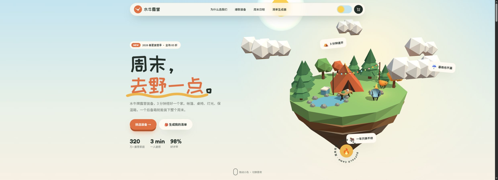

# 俯瞰读层级

分组：镜头运动 · 主维度：G 高视点、C 布局与通路、D 高低层级、F 远景衰减、H 标注空间 · 情绪：开阔、统观

## 一句话

把相机抬到能读懂地形与通路的位置，同时保留近景遮挡，避免把世界拍成桌面模型。

[清明上河 · 黄昏全城](https://silentfleetkk.github.io/qingming-bianjing/opus-5.5/qingming-bianjing.html) · 河与街区关系被一次读懂，桥成为岸区之间的连接点。

| 参考 | 参考 |
|---|---|
|  |  |
| [Athenaion · Panorama](https://github.com/Leonxlnx/athenaion) · 高处斜看仍有近殿遮挡，城市由高殿、低居与远山组成。 | [江南山谷 · 蓝调全景](https://github.com/holooooo/webgl-seascape-video/blob/915cb7c9a318e03bd2228bc232494b496ff2316c/episodes/04-jiangnan-voxel/interactive.html) · 山脊围住水与村落，视点够高能看布局，又未露出世界底盘。 |
## 看哪里

1. 清明上河 · 黄昏全城：河与街区关系被一次读懂，桥成为岸区之间的连接点。
2. Athenaion · Panorama：高处斜看仍有近殿遮挡，城市由高殿、低居与远山组成。
3. 江南山谷 · 蓝调全景：山脊围住水与村落，视点够高能看布局，又未露出世界底盘。

## 拆解

本卡分析静态高视点，不据三张静帧编造升降镜头的速度或缓动。

- **G · 视点**：看得见屋顶与水面，所以能读区域连接；Athenaion仍从一侧高处看，不是完全垂直正投影。近殿保留立面高度。
- **C · 布局**：汴河斜切街区，宽度沿远近缩小；山谷水道被两岸建筑夹住。主要通道约占宽1/5–1/3，密集建筑不能封死它。
- **D · 层级**：Athenaion高殿、低城、山脉不等高，山谷近岸、谷地与山顶也分级。若所有建筑同高，抬高相机只会看见一片重复格子。
- **F · 延续**：远山与远城向浅色衰减，框外仍可延伸；没有把整个世界的圆形底座交代完。
- **H · 信息位置**：总览适合少量地点标记，但应沿空水面/天空或空隙放置；不让每个屋顶都顶一条常驻标签。参考原图不证明已实现这种UI。

## 做法

先选择能说明通路的高视点，再保留一个近景大体块作为观看位置。总览不是把相机无限拉远。

- **原作机位**：江南[CAMERAS](https://github.com/holooooo/webgl-seascape-video/blob/915cb7c9a318e03bd2228bc232494b496ff2316c/episodes/04-jiangnan-voxel/interactive.html#L3615-L3618)给出全景与高处机位；本卡所用截图的实际操作仍以SOURCE为准，不以代码存在替代实看。
- **迁移试验**：画面至少保留一个近实体、一个通路、一个远地标；标记先只显示当前目标，避免总览变成仪表盘。

## 迁移到博客

atlas总览用它说明地点之间的地理层级，进入地点后再切换为分级机位靠近。title远景如采用此法，应与标题阅读区一起调，不增加新前端交互。

搭配河道串景、雾层分远近；与巨像越画框的近身目标分属两级镜头。可顺序使用，不能要求同一帧同时读清全城布局与巨像脸部纹理。

## 反例

浮岛全轮廓、底盘和树冠全被看见，空间被压成可搬走的物件。要保留巨构感，至少让世界在一个方向上继续到框外。

[水牛露营 · 浮岛](https://github.com/Zp-Peter/kimi-k31pro-opus55-benchmark-showcase/blob/65e82c53b63f2fdd918617269c057d8e53af2c6f/opus/buffalo/02-camp.html) · 完整岛底与等比例小树让俯视变成手办展示，缺少框外世界。

[逐图来源与复现](SOURCE.md) · [返回视觉卡库](../../../README.md)
