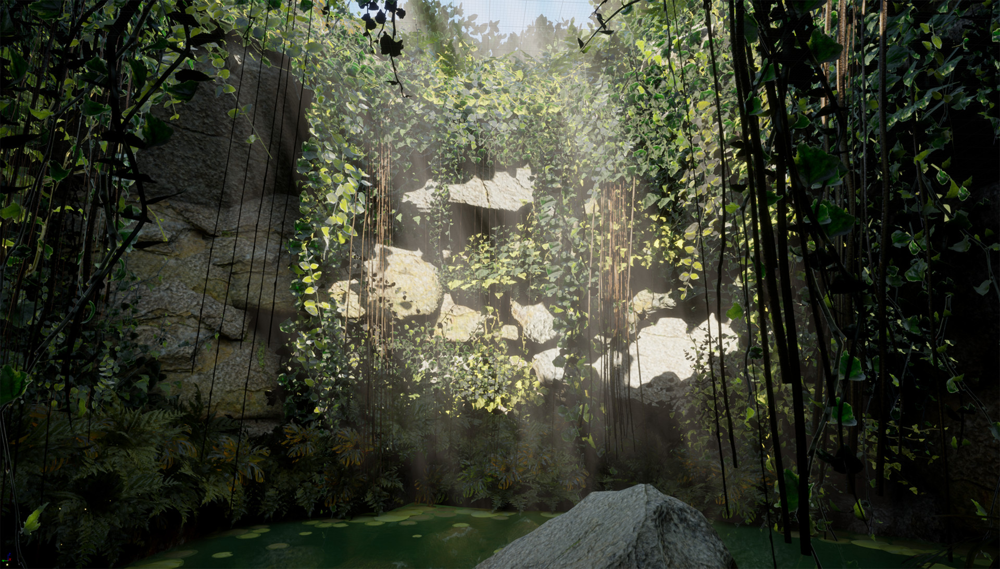
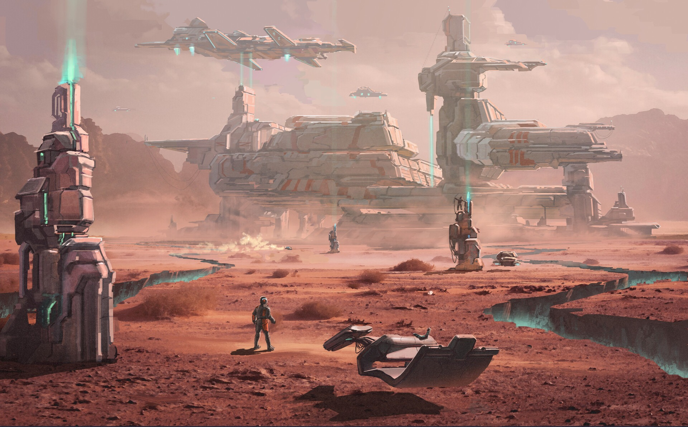

# 高壁夹深口

分组：造型尺度 · 主维度：D 壁高与空腔、C 三面围合、A 天口明暗、E 大切面与碎石、I 围困感 · 情绪：幽深、围困

Lost Quarry · oknice · 左右壁占满侧边，狭长天空与远端横壁把视线压入坑内。

| 参考 | 参考 |
|---|---|
|  |  |
| Marble Quarry · alecheck · 切块岩壁和吊架上下包围，远端暗槽比任何灯具更像空间主体。 | Cenote ik Kil 02 · theauthor · 前景藤蔓、两侧岩壁和上方小天口形成三面围合；天然壁而非人工切面。 |

## 一句话

用贴近两侧的高壁夹住一个可辨认的空腔，让负空间而不是岩石数量成为主体。

## 看哪里

1. **Lost Quarry · oknice**：左右壁占满侧边，狭长天空与远端横壁把视线压入坑内。
2. **Marble Quarry · alecheck**：切块岩壁和吊架上下包围，远端暗槽比任何灯具更像空间主体。
3. **Cenote ik Kil 02 · theauthor**：前景藤蔓、两侧岩壁和上方小天口形成三面围合；天然壁而非人工切面。

## 拆解

比例为原图目估区间，不是相机实参或场景米制测量；位置用归一化画幅描述。

- **D · 高壁**：图1两侧岩壁各约画宽25–35%，从底延至顶外；图2前壁与吊架同样越框。高度不靠密集小石头证明。
- **C · 空腔**：图1中段通口约画宽25–35%，后壁横跨其中；图2右中部暗槽约宽20%，不是一条均匀走廊。图3顶口约宽20–30%，由藤蔓再收一道。
- **A · 开口亮度**：图1天空集中上部约1/3，岩壁主体冷暗；图2无亮天空，由局部灯显壁，仍保留大暗腔。两者共同点是边界可辨，不是必须用同一种光。
- **E · 频率**：图1中上部切面宽约5–15%画宽，前景碎石小于5%；图3天然岩面不规则，不能反推切石工法。
- **I · 封闭但可进入**：三图都能指出坑底/地面位置，不把黑色洞口当无厚度背景。图1低部水面约占20–30%画高，进一步压低立足点。

## 做法

先排两面高壁、远端收口和一条不被杂石塞满的负空间，再加台阶与碎石。邻接高度场只能提供层级草模；不把水平地形算法包装成完整矿坑生成器。建议先用现有岩体/块体灰模检查400px缩图的空腔形状，后续才做材质。

### 实现索引

路径相对 `~/Blog/`；citadel 栏相对 `~/Blog/citadel/`。源码默认值不是旧截图的已验证运行实参；建议迁移值仍需目标场景实看。`source: none` 不以邻接源冒充原作算法。

| 作品 | 源码 / 技术与边界 | 参数及性质 | 许可 / 复用 | citadel 已有实现 |
|---|---|---|---|---|
| Lost Quarry · oknice | `none`；原作源码/资产未取得；最近邻接技术源 Repos/ProceduralTerrains/src/manual/ManualTerrainField.js:490-537（MIT）。采石切面应是独立近竖直壁；terrace 高度量化只可先排出层级，不生成这种垂直矿坑。 可移植编辑算法但不是原作建模证明；完整洞壁仍需现有合规岩体资产。 | terraceStep=max(1, terraceStep)（源码）；creaseWidth=clamp 0.04–0.8（源码）；侧壁总占幅=约55–70%（建议迁移值） | 原图版权归作者；邻接算法 MIT / reference | `none` |
| Marble Quarry · alecheck | `none`；原作源码/资产未取得；最近邻接技术源 Repos/ProceduralTerrains/src/manual/ManualTerrainField.js:490-537（MIT）。岩块大面与台阶须用块体/已有岩体重排；crease 只是向下切削的高斯剖面，不提供天车、悬挑或洞顶。 可移植编辑算法但不是原作建模证明；完整洞壁仍需现有合规岩体资产。 | terraceStep=max(1, terraceStep)（源码）；creaseWidth=clamp 0.04–0.8（源码）；侧壁总占幅=约55–70%（建议迁移值） | 原图版权归作者；邻接算法 MIT / reference | `none` |
| Cenote ik Kil 02 · theauthor | `none`；原作源码/资产未取得；最近邻接技术源 Repos/ProceduralTerrains/src/manual/ManualTerrainField.js:490-537（MIT）。自然围壁可先借 ridge/crease 的宽窄控制排围合；藤蔓与倒悬岩不属于这个高度场。 可移植编辑算法但不是原作建模证明；完整洞壁仍需现有合规岩体资产。 | terraceStep=max(1, terraceStep)（源码）；creaseWidth=clamp 0.04–0.8（源码）；侧壁总占幅=约55–70%（建议迁移值） | 原图版权归作者；邻接算法 MIT / reference | `none` |

## 迁移到博客

具体落点为 `shrine-1` 的 `cloud-terrace`，`lab/src/scenes/Shrine/index.js:270` 已有 position=[6,3.9,-31.4]、target=[3,-5,-64]、FOV60°。只借两侧崖肩夹出下方云海深口，保持 Shrine 的开放云崖，不建新矿坑。此机位只是落点，现有围合造型不在 `citadel` 栏冒充通用实现。建议迁移起点：侧肩合占55–70%画宽、中央开口≥25%，栏杆仍标定人尺度。搭配 `card:fog-separates-depth`、`card:scale-by-familiar-objects`；与全宽无阻的远景展示冲突。title / atlas 不动。

## 反例

Industrial outpost 的尺度与材质并不差，但视平线开放、前景裂隙低矮。它反证本卡不是“有山、有工业物就算矿坑”，而是近壁压住视野、让空腔成立。

Industrial outpost · appoloss · 前方地平线展开，裂隙低于人身，巨构不能形成近身高壁围合。

[逐图来源与复现](SOURCE.md) · [返回视觉卡库](../../../README.md)
