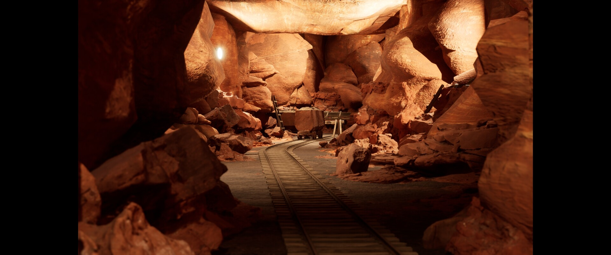
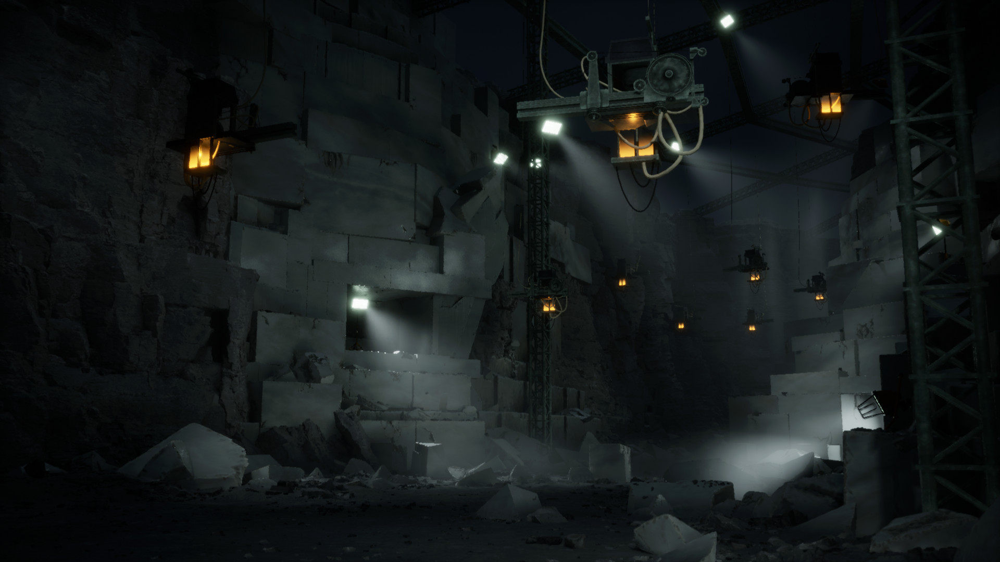
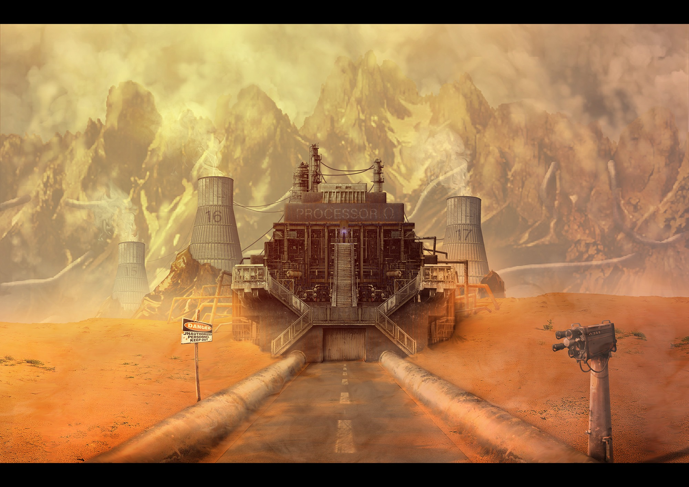

# 灯池显洞腔

分组：光影 · 主维度：A 局部受光、C 暗间隔、D 壁顶体积、B 主辅灯色、I 作业痕迹 · 情绪：隐秘、有人使用

Salt Mine cave Environment · pranav_16 · 近侧岩块深暗，中段灯照亮顶与壁，矿车后方再退进暗缝。

| 参考 | 参考 |
|---|---|
|  |  |
| Marble Quarry · alecheck · 白工作灯各照一段壁，橙灯只作小点，远壁被明暗间隔拆成多层。 | Cenote Temple · raylopez · 暖光显右壁与台阶，天口只照局部，左侧与前景仍是大暗区。 |

## 一句话

不把洞穴整体照亮，让局部灯池分别触到侧壁、顶面与地面，暗间隔才把一个房间读成多段洞腔。

## 看哪里

1. **Salt Mine cave Environment · pranav_16**：近侧岩块深暗，中段灯照亮顶与壁，矿车后方再退进暗缝。
2. **Marble Quarry · alecheck**：白工作灯各照一段壁，橙灯只作小点，远壁被明暗间隔拆成多层。
3. **Cenote Temple · raylopez**：暖光显右壁与台阶，天口只照局部，左侧与前景仍是大暗区。

## 拆解

比例为原图目估区间，不是相机实参或场景米制测量；位置用归一化画幅描述。

- **A · 灯不是贴亮点**：图1亮顶位于画面上部约20–30%，中央岩面也被照到，左近岩则暗；图2白灯锥落到左中部和右下部实面，来源可指认。
- **C · 暗间隔**：图1前景两边各有约15–25%画宽深暗岩块，中后部的黑缝不抬平；图3左半与下1/4压暗，亮阶梯只占中右一条。这些隔断比新增灯数更重要。
- **D · 体积闭合**：图1顶、左右岩和地面都有相互遮挡，轨道从底中伸入车后；图2近石、吊架、远壁至少三层。不能用一张发光平面假装腔室。
- **B · 配色职能**：图2冷白工作光面积明显大于橙灯，每个橙灯约小于画宽2%；图1主调统一暖赭，不强求蓝橙互补。
- **I · 使用尺度**：图1矿车在中部约画宽7–10%，灯的高度与车、梯子联系；图2天车与吊灯给洞壁第二套尺度。照明应服务作业空间，不是随机洒光斑。

## 做法

先选一块真实受光侧面和一个顶/悬挑轮廓，使用已有灯逐段调明暗；再决定是否需要雾。下表邻接源只解决点光布点和预算；Marble 的可见光锥与空间散射没有在该源中得到实现，不许把12盏点光写成完整体积光方案。

### 实现索引

路径相对 `~/Blog/`；citadel 栏相对 `~/Blog/citadel/`。源码默认值不是旧截图的已验证运行实参；建议迁移值仍需目标场景实看。`source: none` 不以邻接源冒充原作算法。

| 作品 | 源码 / 技术与边界 | 参数及性质 | 许可 / 复用 | citadel 已有实现 |
|---|---|---|---|---|
| Salt Mine cave Environment · pranav_16 | `none`；原作灯光/渲染源码未取得；邻接技术源 Repos/threejs-procedural-dungeon/src/main.js:1850-1894（MIT）用关键灯优先、剩余火把最远点采样，限制预算。暖灯需照到顶与侧壁，弯轨/矿车标定前后；不提供盐岩或轨道资产。 移植布点逻辑仍需提供受光实体与阴影，非洞穴生成器。 | 邻接 point-light budget=12（源码）；邻接 decay=2（源码）；亮区/暗间隔=先做3段：近暗→中亮→后暗（建议迁移值） | 原图版权归作者；邻接布点 MIT / reference | `none` |
| Marble Quarry · alecheck | `none`；原作灯光/渲染源码未取得；邻接技术源 Repos/threejs-procedural-dungeon/src/main.js:1850-1894（MIT）用关键灯优先、剩余火把最远点采样，限制预算。工作白灯与低强度橙灯分职；点光采样只解决局部受光，不会自动产生图中的可见雾锥。 移植布点逻辑仍需提供受光实体与阴影，非洞穴生成器。 | 邻接 point-light budget=12（源码）；邻接 decay=2（源码）；亮区/暗间隔=先做3段：近暗→中亮→后暗（建议迁移值） | 原图版权归作者；邻接布点 MIT / reference | `none` |
| Cenote Temple · raylopez | `none`；原作灯光/渲染源码未取得；邻接技术源 Repos/threejs-procedural-dungeon/src/main.js:1850-1894（MIT）用关键灯优先、剩余火把最远点采样，限制预算。暖侧光和顶部自然入光是两套来源；torch 布点不负责天口，也不生成神庙或水池。 移植布点逻辑仍需提供受光实体与阴影，非洞穴生成器。 | 邻接 point-light budget=12（源码）；邻接 decay=2（源码）；亮区/暗间隔=先做3段：近暗→中亮→后暗（建议迁移值） | 原图版权归作者；邻接布点 MIT / reference | `none` |

## 迁移到博客

落点 `neverland-room` 的 `mound-side`，`lab/src/scenes/NeverlandRoom/index.js:112-127` 已有该机位，目标是房间岩丘的近暗石→受光肩部→后侧暗口，不把房间改造成盐矿。建议迁移值：只选1个主灯池，邻区亮度约为主受光面的1/3–1/2；沿用场景已有灯与岩体，先查是否真的照到几何而非只加发光材质。`citadel: none` 表示没找到通用灯池布点模块；机位不冒充效果模块。搭配 `card:side-light-carves-stone`；全局提曝光/环境光会抹平暗间隔。

## 反例

硫矿图依靠广域硫雾环境光成立开阔工业景观，但大面积地面与远壁同时可见。本卡需要受限光源揭示腔体，不能拿统一橙雾代替局部照明。

Venusian Sulfur Mine · finnbrandon · 硫黄环境光把工厂、地面、远壁一起照亮，缺少暗间隔串起的室内体积。

[逐图来源与复现](SOURCE.md) · [返回视觉卡库](../../../README.md)
