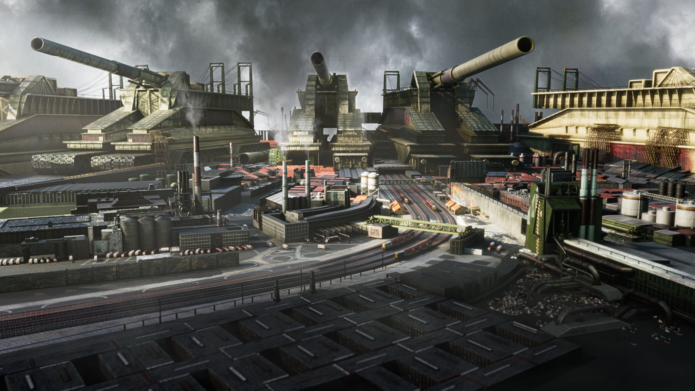

# 管网串起巨构

分组：造型尺度 · 主维度：D 设备与连接层级、C 线路与开口、E 表面因果、A 暗面与远亮、F 蒸汽距离 · 情绪：运转、沉重

[Geothermal Plant part 1](https://www.artstation.com/artwork/ykvLaQ) · 左侧粗管接入成组立罐，后方水平管线延至远处，青绿热泉留出设备轮廓。

<table><tr><td width="50%" valign="top"> <a href="https://www.artstation.com/artwork/Bkr6eD">The Pipe City</a> · 近粗管框住中部青色通道，小人所在桥面把管径变成可感尺度。</td><td width="50%" valign="top"> <a href="https://www.artstation.com/artwork/L4Vb4K">Power Grid</a> · 上部工人桥面压住下方深坑，管与缆沿多层环向结构延续。</td></tr></table>

[Industrial Warzone | Cinematic 3D Environment](https://www.artstation.com/artwork/yAAmWJ) · 设备台座、阶台和前景轨道组成互联设施；借网络，不把轨道误说成流体管。

## 一句话

用粗管、桥架与运输线把设备串成有功能的整体，巨构的尺度来自连接关系，不只来自堆大的盒子。

## 看哪里

1. **Geothermal Plant part 1**：左侧粗管接入成组立罐，后方水平管线延至远处，青绿热泉留出设备轮廓。
2. **The Pipe City**：近粗管框住中部青色通道，小人所在桥面把管径变成可感尺度。
3. **Power Grid**：上部工人桥面压住下方深坑，管与缆沿多层环向结构延续。
4. **Industrial Warzone | Cinematic 3D Environment**：设备台座、阶台和前景轨道组成互联设施；借网络，不把轨道误说成流体管。

## 拆解

图号按上方顺序。坐标为左上原点的全幅归一化位置，数值为画面估计，不是PBR反推或源场景实测。

- **D · 设备/连接/人**：01 前部两主罐各约画高20–25%，左侧主干管直径约画高5–7%；02 中央桥上人高约画高3%，前部管径约8–12%。设备、主干、支路与人不能只有同一档尺寸。
- **C · 线路与开口**：02 两边粗管包围约画宽25%的中部亮通道，左右并非镜像重复；04 下部约35%画高的轨道从左近向中央收束，连接分层平台。看得到去处比“随机塞满管”重要。
- **E · 表面因果**：02 前管在左下至右下的弯部出现窄亮边，大片管腹保持暗褐；01 地热白垢沿右下水岸聚集，与深灰设备分开。窄亮边约占管径10–20%，不能把每根管都做成均匀自发光。
- **A · 明暗主次**：02 约三分之二幅面是近暗机械，最高明度集中在中上青色通道；03 上部约(53%,30%)的橙衣工人邻接暗坑，最下层缆管仅露局部边线。03 暗部已经很重，迁移时不能再叠全屏黑雾。
- **F · 运行与距离**：01 左中罐旁蒸汽斜向右扩，远处烟层压低后排设施对比；04 中央后部约(50%,35%)有淡烟，而前轨道清楚。烟源附着设备节点，不能以等量烟盖住每一条连接。所有比例与位置为归一化画面估计。

## 做法

先画设备连接图：三档设备、每条主管的两个端点、检修人员可走的桥架；再把管线投影到主相机，确保至少一组连接从头到尾可追踪。设备不能漂浮，管架不能穿过门口。

- **源码值**：邻接炼厂 tank 半径7/高8，CDU 半径2.6/高22，管路半径0.18–0.45；这些是 demo 的世界单位，不直接当 Citadel 米制资产尺寸。
- **建议迁移值**：相机里主干/支管/缆线可见宽度比先试1:0.3:0.05；保留20–30%画宽的阅读开口。大弯头若需要特写，应先找已许可资产，不把简化球接头当最终成片目标。
- **边界**：本卡迁移布局和连接，不实现地热流体模拟，不复制概念图的炮台、人物或专有模型；金属亮边是受光，不等于给所有管子发光。

### 实现索引

原作均无已确认源码，以下为已打开的邻接技术源，不是作品对应的完整实现。`source: none` 不以艺术家网址冒充源码；`citadel: none` 表示尚未找到已落地专用实现。路径相对 `~/Blog/`；2026-10-28核对。

| 作品 | 原作 / 邻接源码与机制 | 参数与性质 | 许可与接入 |
|---|---|---|---|
| Geothermal Plant part 1 | `source: none`；原作源码未取得；邻接技术源 Repos/fable-refinery/index.html:866-888,984-1025（MIT）：tank farm 与 CDU 分大中体块，makePipe 用端点方向对齐圆柱并以球封接，pipe rack 单独承重。不含热泉水体、地热模拟或蒸汽体积；待验证。 | tank r/h=7/8（源码）；CDU r/h=2.6/22（源码）；pipe route radius=0.18–0.45（源码）；主干/支管/缆线可见宽度比=1:0.3:0.05（建议迁移值） | 原作版权归艺术家，未取得代码/资产许可；邻接源分别标注；`borrow`；`citadel: none` |
| The Pipe City | `source: none`；原作源码未取得；邻接技术源 Repos/fable-refinery/index.html:866-888,984-1025（MIT）：tank farm 与 CDU 分大中体块，makePipe 用端点方向对齐圆柱并以球封接，pipe rack 单独承重。原作圆滑大弯头不由此简化圆柱/球接头精确重现；待验证。 | tank r/h=7/8（源码）；CDU r/h=2.6/22（源码）；pipe route radius=0.18–0.45（源码）；主干/支管/缆线可见宽度比=1:0.3:0.05（建议迁移值） | 原作版权归艺术家，未取得代码/资产许可；邻接源分别标注；`borrow`；`citadel: none` |
| Power Grid | `source: none`；原作源码未取得；邻接技术源 Repos/fable-refinery/index.html:866-888,984-1025（MIT）：tank farm 与 CDU 分大中体块，makePipe 用端点方向对齐圆柱并以球封接，pipe rack 单独承重。支持主干/支路层级，不是原作深坑/工人/电缆资产；待验证。 | tank r/h=7/8（源码）；CDU r/h=2.6/22（源码）；pipe route radius=0.18–0.45（源码）；主干/支管/缆线可见宽度比=1:0.3:0.05（建议迁移值） | 原作版权归艺术家，未取得代码/资产许可；邻接源分别标注；`borrow`；`citadel: none` |
| Industrial Warzone \| Cinematic 3D Environment | `source: none`；原作源码未取得；邻接技术源 Repos/fable-refinery/index.html:866-888,984-1025（MIT）：tank farm 与 CDU 分大中体块，makePipe 用端点方向对齐圆柱并以球封接，pipe rack 单独承重。只借设备—连桥—运输线的网络组织，不含炮台、履带或军械资产；待验证。 | tank r/h=7/8（源码）；CDU r/h=2.6/22（源码）；pipe route radius=0.18–0.45（源码）；主干/支管/缆线可见宽度比=1:0.3:0.05（建议迁移值） | 原作版权归艺术家，未取得代码/资产许可；邻接源分别标注；`borrow`；`citadel: none` |

## 迁移到博客

- `landfill-1`：把已有大型设备按主干/支路连成前中后层级，保留回收场而非重建军工厂；从一组远景设备开始，验收线路在400px缩图能否追踪。
- `landfill-room-1`：用罐体间的检修桥与支架说明设备如何工作，不能挡住 F/G 交互与行走通道。没有在本批修改场景，实施前仍须核对现有布局。
- 搭配 `card:scale-by-familiar-objects`、`card:fog-separates-depth`、`card:broken-form-remains-legible`；破损只切断少数支路，主网保持可读。与大量HUD线、满屏粒子冲突，三者叠加会把真实管线淹没。title/atlas 不施工。

## 反例

05 Desert refinery 的斜坡堡体和烟柱很有整体感，但细外管只在屋顶边缘出现，主体读成独立堡垒而非设备互联。它可服务“孤立地标”语言，不适合作本卡正例。只堆这种大盒子，再随机贴管饰，会缺少02那种可追踪的连接与人体尺度。

[Desert refinery](https://www.artstation.com/artwork/vDGL4D) · 堡垒式单体与细烟柱清楚，但外部连接网弱；不能仅因名叫炼厂就算同类。

[逐图来源与复现](SOURCE.md) · [返回视觉卡库](../../../README.md)
